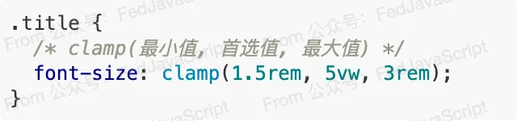

px是我们熟悉且常用的CSS单位，但在如今这个设备屏幕尺寸千差万别的时代，px似乎不在像以前那么好用

分享一个强大的CSS新特性，它将改变我们编写响应式样式的方式，让我们告别繁琐的媒体查询，轻松实现流畅的『流体式』布局

## px的问题
px是一个绝对单位，它代表屏幕上的一个屋里像素点，这意味着 width: 300px; 在任何设备上都会视图渲染成300哥像素点宽。

为了解决不同尺寸设备渲染的问题，传统的做法是使用大量的媒体查询
```css
.title {
    font-size: 48px;
}

@media (max-width: 768px) {
    .title {
        font-size: 32px;
    }
}
@media (max-width: 480px) {
    .title {
        font-size: 24px;
    }
}
```
仅为了一个字体大小，就写了这么多代码。如果再加上 padding、margin、width...代码会变得臃肿不堪，难以维护。更重要的是，这种『阶梯式』的调整是不连贯的，在断点之间，布局仍然是僵硬的。

## CSS数学函数 clamp()
clamp()的语法非常简单： clamp(MIN, PREFERRED, MAX);

<span style="color: red;font-weight: bold;">浏览器会首先尝试使用 PREFERRED值，如果 PREFERRED 值小于 MIN,则采用MIN值，反之采用MAX值</span>

### 流体式字体排版
让我们用 clamp() 来重写刚才字体大小的示例



让我们来解读一下这行代码的魔力
- 1.5rem(最小值)：在非常窄的屏幕上(如手机),字体大小为1.5rem(约24px)，保证可读性
- 5vw (首选值)：字体大小根据视口宽度进行动态缩放，5vw 意味着字体大小是视口宽度的 5%。当用户缩放浏览器窗口时，字体会如丝般顺滑地变大或变小
- 3rem (最大值)：在非常宽的屏幕上（如 4K 显示器），字体大小最大为 3rem（约 48px），保持美观

最终，字体大小会在 24px 到 48px 之间根据屏幕宽度平滑地过渡，不再有断点之间的跳变，这是真正的“流体式”设计！

### clamp() 在不居中的应用
clamp()的威力远不止于此，我们可以将它应用到任何需要动态调整的地方。

例如我们想要一个内容区域的宽度自使用，但是又不想它在下屏幕上太窄，或在大屏幕上太宽
```css
.container {
    width: clamp(320px, 90%, 1200px);
    margin: 0 auto;
}
```
- 在下屏幕上，宽度是90%,但最小不会低于320px；
- 在超大屏幕上，宽度也是90%,但最大不会超过1200px；

是时候从 px 的思维定势中解放出来了，clamp() 这个现代 CSS 特性，并不是什么遥不可及的黑科技，它们的浏览器兼容性已经非常好（主流浏览器早已支持）。