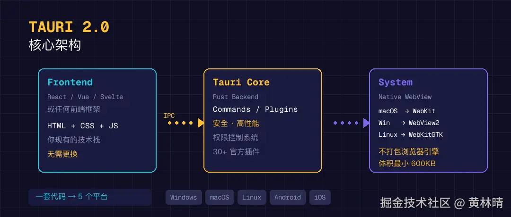
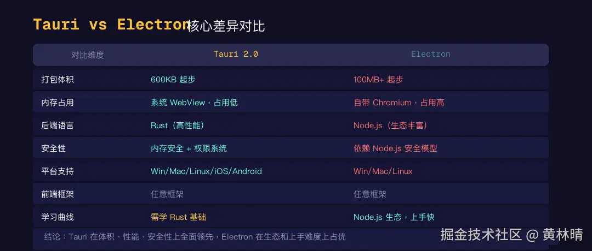
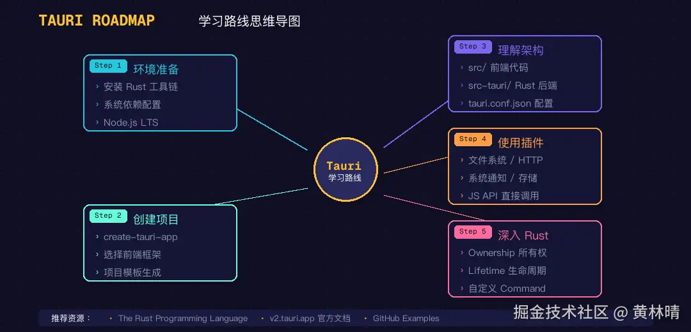

## Tauri是什么
一句话：**Tauri是一个用Rust构建跨平台应用的框架**

你用熟悉的前端技术(React、Vue、Svelte随便选)写界面，用Rust写后端逻辑，打包出来的应用可以跑在Windows、macOS、Linux上，甚至Android、iOS上。

听起来像Electron？确实，它们解决的是同一个问题。但Tauri的思路完全不同。



Electron的做法是把整个Chromium浏览器打包进你的应用。所以一个见到那的Hello World应用，Electron打包出来至少100MB起步。

**一个最小的Tauri应用，打包后只有600KB**

你没看错，600KB。不是600MB。

## 和Electron比，到底强在哪
既然都是做桌面端，那就直接对比



- 体积: Tauri应用600KB起步，Electron应用100MB起步。差了100多倍
- 内存占用：Tauri用系统原生Webview，不需要额外的浏览器进程。内存占用通常只有Electron的一般甚至更少
- 安全性：Tauri基于Rust,天生内存安全。还内置了权限系统，你的前端代码不能随便访问文件系统或网络，必须在配置里显示声明权限
- 前端自由度：两者都支持任意前端框架。这一点打平
- 后端语言：Electron用Node.js，Tauri用Rust。Rust性能更强，但学习曲线也更陡
- 平台支持：Electron 支持 Windows、macOS、Linux。Tauri 2.0 在此基础上还加了 Android 和 iOS。

说实话，Tauri 在大部分维度上都赢了。唯一的"缺点"是需要学 Rust。但后面我会告诉你，其实入门没那么难。

## 它能做什么？
Tauri不只是一个『壳』。它故宫了30+官方插件。覆盖了桌面应用开发的几乎所有常见需求

### 系统集成类
- 系统托盘
- 全局快捷键
- 原生通知
- 深度链接
- 自动启动

### 数据存储类
- 文件系统访问
- SQL数据库
- 键值对存储
- 加密数据库

### 网络通信类
- HTTP客户端
- WebSocket
- 文件上传

### 应用管理类
- 自动更新
- 单实例控制
- 窗口状态管理
- CLI命令行支持

<!--  -->

除了官方插件，社区贡献了70+第三方插件。基本上你能想到的桌面端功能，都有方案

举几个用Tauri构建的知名应用：
- Cody(Sourcegraph的AI编程助手)
- Crabnehula(应用分发平台)
- 还有不少独立开发者用它做工具类应用

## 前端开发者的最大疑问：必须学Rust吗？
答案是：**看你要做什么**。

如果你只是做一个简单的桌面应用--把网页包装成桌面端，加个系统托盘，加个本地存储--那你几乎不需要写Rust。Tauri的官方插件已经帮你封装好了，前端直接调Javascript API就行。

```js
// 前端直接调用Tauri的文件系统插件
import { readTextFile } from '@tauri-apps/plugin-fs';

const content = await readTextFile('config.json');
```
但如果你需要做一些重度后端逻辑--比如图像处理、大文件操作、复杂的系统调用--那你需要用Rust写Command，通过Tauri的IPC机制让前端调用

```js
// Rust端定义Command
#[tauri::command]

fn greet(name:&str)-> String {
    format!("Hello, {}!", name)
}

// 前端调用
import { invoke } from '@tauri-apps/api/core';

const result = await invoke('greet', { name: 'Tauri' });
```
所以Rust不是门槛，而是天花板。你可以从零Rust开始用Tauri，等需要的时候在学

## 学习路线：怎么开始
很多人听到tauri的第一反应是"好是好，但学起来很难吧？"

其实还好。我整理了一条从零开始的学习路线




### 第一步：环境准备
不管你用什么系统，都需要安装 Rust。macOS 还需要 Xcode，Windows 需要 Visual Studio Build Tools，Linux 需要一些系统依赖。

具体步骤官方文档写得很清楚，跟着走就行：v2.tauri.app/start/prerequisites

### 第二步：创建一个项目
一行命令搞定
```bash
npm create tauri-app@latest
```
它会让你选择前端框架(React/Vue/Svelte/Vanilla等)，然后自动生成项目模板

### 第三部：理解项目结构
tauri项目分两个不分
- src--你的前端代码，和普通web项目一样
- src-tauri--Rust后端代码和Tauri配置

先把前端跑起来，确认界面ok，再去看Rust那边。

### 第四步：学会用插件
不要从零写Rust。先用官方插件解决问题。文件读写、HTTP 请求、本地存储、系统通知……这些都有现成的插件，npm install 一下就能用。

### 第五步：按需学Rust
等你发现插件满足不了需求的时候，再去学 Rust 基础。重点学所有权（Ownership）、生命周期（Lifetime）、错误处理（Result/Option）这几个核心概念就够起步了。
推荐资源：

• Rust 官方教程 The Rust Programming Language（免费在线）

• Tauri 官方文档 v2.tauri.app（写得非常好）

• Tauri GitHub 仓库的 examples 目录（实战参考）

## 使用谁用
- 前端开发者想做桌面端：这是Tauri最核心的目标用户。你不需要学新的UI框架，用现有的前端技术栈就能做出专业的桌面应用
- 独立开发者做工具类产品：：体积小、性能好、跨平台，非常适合做效率工具、编辑器、管理面板这类应用。
- 企业内部工具：比 Electron 省资源，安全性更好，适合做需要长期运行的内部工具。
- 想学 Rust 的同学：Tauri 是一个很好的 Rust 实战入口。你可以从前端入手，逐步深入 Rust，比直接啃 Rust 教程有趣得多。