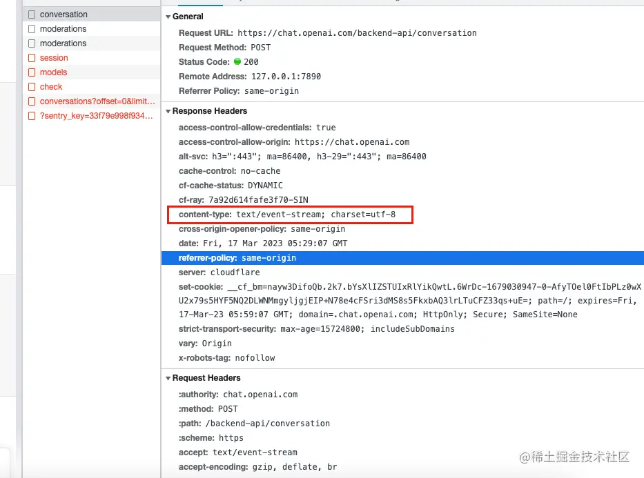

主要是了解，客户端和服务端对于回答的内容的数据实时传输的实现。

web通信方式
1. 轮训
2. 长轮训
3. 数据流
4. websocket
5. eventsource

我们这次说的 application/octet-stream 和 text/stream 分别属于上述通信方式的长轮训和eventsource

- SSE(server send events) content-type:text/event-stream;

    

[application/octet-stream vs text/event-stream](/articles/front-end/JavaScript/network-contentType.html#application-octet-stream)