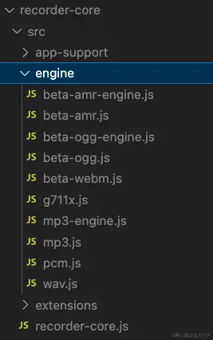

技术栈：Vue3 + element-plus + Recorder

这段代码主要实现了以下功能
1. 长按录音，松开发送
2. 上划至一定位置取消
3. 音频blob转成base64格式
4. 录音音频下载
5. 模拟音频声波的动画

## 安装依赖
```bash
yarn add recorder-core
// 或者
npm i recorder-core
```
## 引入依赖
在使用录音的页面文件中添加如下代码引入Recorder及音频编码器
```js
import Recorder from 'recorder-core';
import 'recorder-core/src/engine/wav.js'; // 引入对应格式的编码器
```
编码器必须引入，否则录音时会报错未加载对应的编码器。我使用的是wav格式，如果使用其他音频格式，可引入对应的编码器文件。下图是依赖中编码器文件所在位置，按需引入即可。



## 使用

```html
<template>
    <el-button
        class="audio-btn"
        @touchstart="startRecording"
        @touchend="handleTouchMove"
        @touchend="sendRecording"
    >
        {{ recording ? '松开发送' : '按住说话' }}
    </el-button>
    <el-drawer
        v-model="dialogVisible"
        direction="btt"
        :show-close="false"
        :with-header="false"
    >
        <div v-if="recording">
            <p v-if="canceling">松手取消发送</p>
            <p v-else-if="seconds && seconds < 10">{{seconds}}s后将停止录音</p>
            <p v-else>松开发送，上划取消</p>
            <div class="audio-animation">
                <span class="audio-wave" :class="'wave' + index" v-for="iindex in 8" :key="index"></span>
            </div>
        </div>
    </el-drawer>
</template>
```

```js

const recording = ref(false);
const cancel = ref(false); // 上滑并松手，确定取消录音（用于判断是否将录音发送给服务端）
const canceling = ref(false); // 正在上滑，也可能还会下滑继续录音（用于在上滑时提示用户上滑会取消）
const dialogVisible = ref(false);
let startY = 0; // 用于判断上滑取消
const rec = ref(null);
let countdownTimer = null;
const seconds = ref(60); // 录音限制60s

function startRecording(event) {
  cancel.value = false;
  recording.value = true;
  dialogVisible.value = true;
  startY = event.touches[0].clientY;
  seconds.value = 60;
  recOpen()
};

// 开启录音
function recOpen() {
  // 传入 音频采样所需的格式，采样频率和采样位数
  rec.value = Recorder({
    type: "wav",
    sampleRate: 8000,
    bitRate: 16,
  });
  rec.value.open(function(){
    // 这个定时器是限制录音60s,最后10s的时候给用户提示
    countdownTimer = setInterval(() => {
      console.log(`倒计时：${seconds.value}秒`);
      seconds.value--;
      if (seconds.value < 0) {
        clearInterval(countdownTimer);
        // 到达录音限制时间，自动停止录音并发送给服务端
        sendRecording();
      }
    }, 1000);
    console.log('开始录音');
    rec.value.start(); // 开始录音

  },function(msg, isUserNotAllow){
    console.log((isUserNotAllow ? "UserNotAllow，" : "")+"无法录音:" + msg);
  });
};

// 结束录音
function recStop(){
    rec.value.stop(function(blob, duration){
        // window.URL.createObjectURL(blob) 是blob格式链接，可直接播放音频；duration为音频时长（ms）
        console.log(blob, window.URL.createObjectURL(blob), "时长:" + duration + "ms");
        rec.value.close(); // 释放录音资源，最好释放，否则会导致当前页面一直占用麦克风
        rec.value = null;
        if (countdownTimer) {
          clearTimeout(countdownTimer); // 清除倒计时计时器
        }
        
        // 如果调试时想要下载录音文件，可把这段注释打开。
        // const a = document.createElement('a');
        // a.href = (window.URL).createObjectURL(blob);
        // a.download = 'recording.wav';
        // a.style.display = 'none';
        // document.body.appendChild(a);
        // a.click();
        // document.body.removeChild(a);

        console.log('cancel', cancel.value);
        // 如果没有上滑取消则转成base64发给服务端，否则不做操作
        if (!cancel.value) {
          transBase64(blob)
        }
    },function(msg){
        console.log(msg);
        rec.value.close();
        rec.value = null;
    });
}

// 把blob格式的录音文件转成base64格式
function transBase64(wavBlob) {
    let reader = new FileReader();
    reader.onloadend = function(){
        const base64Str = (/.+;\s*base64\s*,\s*(.+)$/i.exec(reader.result)||[])[1];
        // 调用接口，发给服务端
        sendBase64AudioToBackend(base64Str);
    };
    reader.readAsDataURL(wavBlob);
}

// 上滑超过50px则取消录音
function handleTouchMove(event) {
  if (recording.value) {
    const currentY = event.touches[0].clientY;
    const deltaY = startY - currentY;
    console.log(deltaY);

    if (deltaY > 50) {
      cancel.value = true;
      canceling.value = true;
    } else {
      cancel.value = false;
      canceling.value = false;
    }
  }
};

// 结束录音时，恢复各字段默认值并执行recStop方法
function sendRecording() {
  dialogVisible.value = false;
  recording.value = false;
  canceling.value = false;
  recStop()
};
```
样式部分只包含模拟声波的动画部分，其余省略
```css
.audio-animation {
  display: flex;
  align-items: center;
  justify-content: center;
  margin-top: 50px;
}

.audio-wave {
  width: 2px;
  height: 6px;
  margin: 0 2px;
  background-color: #0078d4;
  animation: waveAnimation 0.5s ease infinite;
  animation-fill-mode: both; /* 保持动画结束状态 */
}

.audio-wave.wave1 { animation-delay: -.9s; }
.audio-wave.wave2 { animation-delay: -.8s; }
.audio-wave.wave3 { animation-delay: -.7s; }
.audio-wave.wave4 { animation-delay: -.6s; }
.audio-wave.wave5 { animation-delay: -.5s; }
.audio-wave.wave6 { animation-delay: -.4s; }
.audio-wave.wave7 { animation-delay: -.3s; }
.audio-wave.wave8 { animation-delay: -.2s; }

@keyframes waveAnimation {
  0%, 100% {
    transform: scaleY(1);
  }
  50% {
    transform: scaleY(3);
  }
}
```
## 其他
H5录音的底层依赖
1. navigator.mediaDevices.getUserMedia()：申请麦克风权限
2. MediaRecorder: 录制音频流
3. Blob: 保存音频数据
4. URL.createObjectURL(): 生成可播放阿德音频地址

问题| 原因| 解决方案
---|---|---
IOS录音失败|Safari限制，只能在用户手势事件中触发 | 必须在点击事件中调用 getUserMedia
HTTPS必须 | 浏览器安全策略 | 录音页面必须部署在HTTPS或localhost
微信/抖音内置浏览器不能录音 | 内核禁用 WebRTC | 必须用它们的JS-SDK(如wx.startRecord)
录音时间太长卡顿或失败| 数据挤压内存 | 分片录音，每N秒触发ondataavailabel上传
后台录音失败 | 浏览器后台自动挂起 | H5无法解决，需用原生或小程序方案

录音 + 时长限制 + 显示计时
```ts
let timer: number | null = null;
const duration = ref(0);
const MAX_DURATION = 60; // 限时60s

const startRecord = async () => {
  const stream = await navigator.mediaDevices.getUserMedia({ audio: true });
  mediaRecorder = new MediaRecorder(stream);
  audioChunks = [];
  duration.value = 0;

  mediaRecorder.ondataavailable = e => audioChunks.push(e.data);
  mediaRecorder.onstop = () => {
    clearInterval(timer);
    clearTimeout(timer);
    const blob = new Blob(audioChunks, { type: 'audio/webm' });
    audioUrl.value = URL.createObjectURL(blob);
    recording.value = false;
  }

  mediaRecorder.start();
  recording.value = true;

  // 每秒更新时长
  timer = window.setInterval(() => duration.value++, 1000);

  // 限时停止
  const stopTimer = window.setTimeout(() => {
    mediaRecorder?.stop();
    alert('已达到最大录音时长 60 秒')
  }, MAX_DURATION * 1000);
}
```
如果需要上传音频到后端
```js
const blob = new Blob(audioChunks, { type: 'audio/webm' });
const formData = new FormData();
formData.append('file', blob, 'record.webm');

await fetch('/api/upload', {
  method: 'POST',
  body: formData,
})
```


[记录使用Recorder实现H5页面录音](https://juejin.cn/post/7298658664196948020)