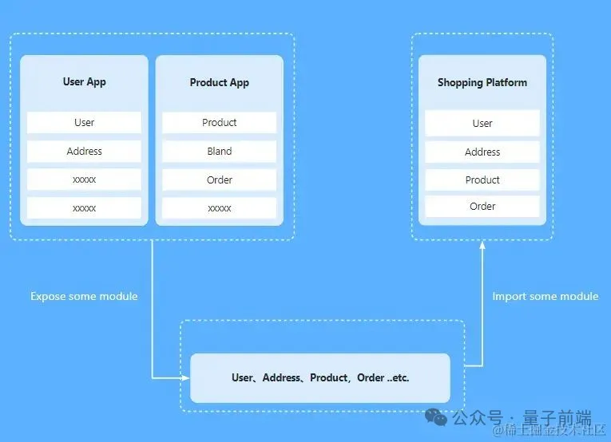
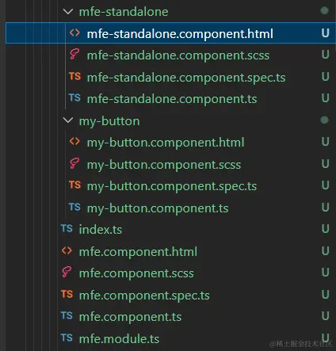

## 前言
多个独立的构建可以组成一个应用程序，这些独立的构建之间不应该存在依赖关系，因此可以单独开发和部署他们。这通常被称作微前端，但是不仅限于此

## 模块联邦的概念
:::tip
模块联邦(Module Federation)是Webpack5引入的一项强大功能，旨在解决微前端架构中的模块共享问题。它允许多个独立构建的应用程序**在运行时动态加载远程模块**和共享代码，而无需构建或部署整个应用。这种技术可以提高代码复用性和团队协作效率，增强应用程序的可扩展性
:::
MF(模块联邦 Module Federation, 下文将使用MF缩写)的核心在于**它允许运行时，动态从远程加载模块，在运行时加载模块**，这部分听起来有点像路由懒加载，但他们不太一样

路由懒加载是对模块代码进行了拆分，编译后的代码还是在同一个包里，在运行时根据路由去动态加载

而MF则更进一步，允许你从远程加载代码，假设你有AB两个应用，分别部署在A.com 和 B.com，MF允许你在A.com运行时，动态加载B.com暴漏出来的模块，是不是有点熟悉了，这不就是微前端吗？是的，MF可以作为微前端的另一种实现思路



除此之外，MF还有一个特性就是**共享依赖**，它允许多个应用程序共享相同的依赖库，从而避免重复加载和版本冲突

在MF里有类似于生产者和消费者概念，在上面例子中，A就是消费者，B就是生产者,B暴漏模块供A使用。

但同时A可以即是消费者，又是生产者，A也可以暴漏模块，供B和C调用，支持循环依赖

## 模块联邦实践
[文章中涉及源码的github链接](https://github.com/Ybbbb/module-federation-example)

### 以Angular为例
推荐使用 monorepo 管理项目，在本示例中我们使用 lerna + pnpm。

[将pnpm于lerna一起使用](https://lerna.nodejs.cn/docs/recipes/using-pnpm-with-lerna)

#### Step1：创建项目
```shell
lerna init
```
1. 在lerna.json 中添加 "npmClient": "pnpm" 配置，使用pnpm进行依赖和工作区管理
2. 在项目根目录下创建 pnpm-workspace.yaml 文件，指定工作区位置

    ```yaml
    packages:
      - 'packages/*'
    ```
3. 在packages文件夹下使用angular cli创建项目
    ```shell
    ng new ng-main
    ng new ng-component-lib
    ```
4. 执行pnpm install 安装依赖
5. 消费者(Main App) 和生产者(Component Lib)都需要添加 @angular-architects/module-federation 依赖

  @angular-architects/module-federation 在安装后会自动帮你改造项目,比如帮你生成webpack.config.js以及修改一下配置代码等等，另外这一步有两种不同的安装方式，他们生成的代码也有一些细微的差别，感兴趣的自己试一下
  - 直接使用 angular-cli，执行 ng add @angular-architects/module-federation,由于 angular默认使用npm管理依赖，所以在执行 ng config cli.packageManager pnpm 改成默认使用pnpm。ng add 。。。命令执行后会自动安装依赖包和改造项目，所以在执行完命令后你还需要删除子应用的node_modules 和 pnpm lock文件，然后在根目录重新执行 pnpm install
  - 第二种是先安装依赖包,然后调用它提供的自动配置项目的脚本。在项目根目录下执行 pnpm add @angular-architects/module-federation -D同时为两个应用安装依赖，然后在对应应用里执行 ng g @angular-architects/module-federation:init，它支持下列配置 --project xxx --port xxx --type(remote || main)。

  本文的示例代码，采用了第一种方式。ng-main 项目的端口为 4200， ng-component-lib 的端口为 4201.

还记得上面提到过的 @angular-architects/module-federation 会自动生成一些文件，并修改配置吗？

它除了会生成 webpack.config.js， 还会生成 bootstrap.ts ，自动把原来的 main.ts 文件里的内容抽离到 bootstrap.ts中，改为在 main.ts 中 使用import('./bootstrap') 来异步加载。这并不是针对 Angular 框架的特殊处理， React 和 Vue 也是一样的，这么操作有什么目的呢？

当你尝试恢复原来的写法，会发现页面无法正常加载，控制台报错

Uncaught Error: Shared module is not available for eager consumption

这是因为共享的依赖还没有加载完，就尝试去访问。

:::tip
所以必须把原来的入口代码放到 bootstrap.ts 里面，在 main.ts 中使用 import 来异步加载 bootstrap.ts ，这样可以实现先加载 main，然后在异步加载 bootstrap 的时候, 先加载好远程应用的资源并初始化好共享的依赖，最后再执行 bootstrap 模块。
:::
#### Step2:配置生产者
ng-component-lib 项目




## 怎么跨技术栈使用
### 介绍下思路


## 总结
至此，我们实现了在Angular中实现MF，以及跨技术栈实现MF，在对巨型项目进行拆解时，除了使用QianKun,Micro-App,Wujie等这些库外，我们又多一种MF作为可选方案。要注意的是MF在使用 Web Component 方案的时候，虽然可以解决样式隔离，但**它无法解决元素隔离，沙箱等痛点**

总的来说，**微前端关注的是应用的拆分和团队独立工作能力，而模块联邦则更关注与模块的共享和复用**。在实际应用中，这两者可以结合使用，利用模块联邦在微前端架构中实现跨应用的模块共享，比如组件库的共享，相比使用npm包，每次组件库发布新版本，一来组件库的项目都要重新编译发布，使用MF则更加方便

## 原文
[原文](https://juejin.cn/post/7386243179279663144)