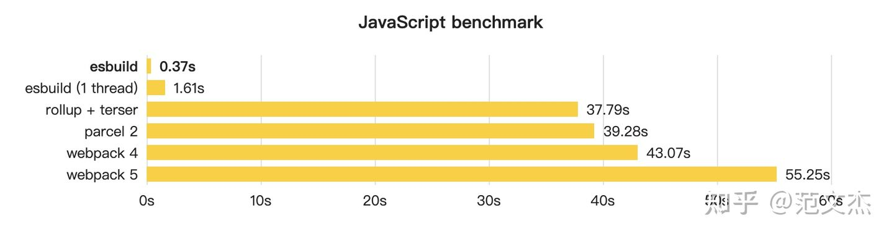

相信很多小伙伴第一次使用vite开发项目的时候，都会被它的速度震惊到。为什么Vite那么快呢？除了使用ESModule之外，Vite内部还是用了一个神器--esbuild
## Esbuild是什么
ESbuild是由Figma联合创始人Evan Wallace于2020年开发的工具。它的速度是几块的Javascript/CSS打包器，相比已有的web构建工具，它的速度快10-100倍

Esbuild是一个非常新的模板打包工具，它提供了与Webpack、Rollup、Parcel等工具相似的资源打包能力，却有着高的离谱的性能优势：


go语言实现

## 安装
你可以通过npm来安装esbuild，以下命令将以局部的方式来安装esbuild。当然你也可以使用yarn或pnpm等其他客户端来安装esbuild
```javascript
npm install esbuild -D
```
待安装成功后，可以运行一下命令来检测是否安装成功
```javascript
./node_modules/.bin/esbuild --version
```
当以上命令成功执行后，终端会输出当前的esbuild版本信息----0.14.21.为了方便后面的演示，我们来新建一个<span style="color: blue">getting-started-esbuild</span>项目，然后使用npm init -y来初始化项目
```javascript
mkdir getting-started-esbuild
npm init -y
```
ESbuild支持TypeScript和JSX语法，下面我们体检如何打包TS文件

## 打包TS
首先，在根目录下新建一个math.ts文件并输入一下内容
```javascript
// math.ts
export const add = (a: number, b: number) => a + b;
```
接着，继续新建一个main.ts文件并输入一下内容
```javascript
// main.ts
import { add } from './math';

console.log(`3 + 5 = ${add(3, 5)}`)
```
为了方便后续的打包操作，我们在package.json文件的script字段中新增一个打包TS文件的命令
```javascript
{
    "name": "getting-started-esbuld", 
    "script": {
        "build:ts": "esbuild main.ts --bundle --outfile=main.js"
    }
}
```
esbuild默认不进行打包，所以你必须显式设置<span style="color: blue">--bundle</span>,而<span style="color:blue">--outfile</span>标志用于设置打包输出的文件名称。若未设置<span style="color: blue">--outfile</span>标志，esbuild将结果发送到标准输出(stdout)。

之后，我们就可以通过<span style="color: blue">npm run build:ts</span>命令来打包main.ts文件。以下是经过esbuild打包后的输出结果
```javascript
// main.js
(() => {
    // math.ts
    var add = (a, b) => a + b;

    // main.ts
    console.log(`3+ 5 = ${add(3, 5)}`)
})
```
除了支持打包TS外，esbuild也支持打包css文件。下面我们来看一下如何利用esbuild打包css

## 打包CSS
首先，在根目录下新建一个<span style="color: blue">normalize.css</span>文件并输入
```css
/* normalize.css */
html {
    line-height: 1.5;
    -webkit-text-size-adjust: 100%;
}
body {
  margin: 0;
}
```
接着，继续新建一个 style.css 文件并输入以下内容：
```css
/** style.css */
@import "normalize.css";

p {
  font-weight: bold;
}
```
同样，为了方便后续的打包操作，我们在 package.json  文件的 scripts 字段中新增一个打包 CSS 文件的命令：
```javascript
{
  "name": "getting-started-esbuild",
  "scripts": {
    "build:css": "esbuild style.css --bundle --minify --outfile=
      style.min.css"
  }
}
```
之后，我们就可以通过 npm run build:css 命令来打包 style.css 文件。以下是经过 esbuild 打包后的输出结果：
```css
html{line-height:1.15;-webkit-text-size-adjust:100%}body{margin:0}p{font-weight:700}
```
## 打包图片
在Web项目打包过程中，我们经常需要处理图片资源。esbuild内置了dataurl和file加载器，利用这些加载器我们可以轻松处理图片资源

下面我们将使用 esbuild 的 logo 来演示一下如何打包图片资源，为了验证不同 loader，我们准备了 esbuild-logo.png 和 esbuild-logo.jpg 两张不同格式的图片文件：


准备好图片资源文件之后，我们在根目录下新建一个 index.html 文件并输入以下内容：
```html
<!DOCTYPE html>
<html lang="zh-cn">
  <head>
    <meta charset="UTF-8" />
    <meta http-equiv="X-UA-Compatible" content="IE=edge" />
    <meta name="viewport" content="width=device-width, initial-scale=1.0" />
    <title>Getting started esbuild</title>
  </head>
  <body>
    <div id="main">
      <div>
        
      </div>
      <div>
        
      </div>
    </div>
    <script src="./index.js"></script>
  </body>
</html>
```
接着，继续新建一个 index.ts 文件并输入以下内容：
```javascript
import pngUrl from './esbuild-logo.png';
const dataUrlImg: HTMLImageElement = document.querySelector('#dataUrlLogo')
dataUrlImg.src = pngUrl;

import jpgUrl from "./esbuild-logo.jpg";
const urlImg: HTMLImageElement = document.querySelector("#urlLogo");
urlImg.src = jpgUrl;
```
然后，我们在 package.json  文件的 scripts 字段中新增一个打包图片资源的命令：
```javascript
{
  "name": "getting-started-esbuild",
  "scripts": {
    "build:image": "esbuild index.ts --bundle --loader:.png=dataurl 
       --loader:.jpg=file --outfile=index.js"
  }
}
```
在以上的 build:image 命令中，我们为 .png 文件指定了 dataurl 加载器，为 .jpg 文件指定了 file 加载器。dataurl 加载器会对图片的二进制数据进行 base64 编码，然后组装成 data-uri 的形式。

之后，我们就可以通过 npm run build:image 命令来打包图片资源文件。以下是经过 esbuild 打包后的输出结果：
```javascript
(() => {
  // esbuild-logo.png
  var esbuild_logo_default = "data:image/png;base64,iVBORw0KGgoAAAAN...=";

  // esbuild-logo.jpg
  var esbuild_logo_default2 = "./esbuild-logo-WVOHGFM5.jpg";

  // index.ts
  var dataUrlImg = document.querySelector("#dataUrlLogo");
  dataUrlImg.src = esbuild_logo_default;
  var urlImg = document.querySelector("#urlLogo");
  urlImg.src = esbuild_logo_default2;
})();
```
由于我们为 .png 文件指定了 dataurl 加载器，所以 esbuild-logo.png 文件的内容就被转化为 data-uri 的数据格式。

## 使用build API
在前面的示例中，我们都是通过在命令行启动 esbuild 应用程序来执行打包操作。对于简单的命令来说，这种方式很便捷。但如果我们的命令很复杂，比如需要设置较多的配置选项，那么我们的命令就不便于阅读。针对这个问题，我们可以使用 esbuild 提供的 build api。

在esbuild模块的入口文件main.js中，我们可以清楚的看到该模块导出的内容
```javascript
// node_modules/esbuild/lib/main.js
0 && (module.exports = {
  analyzeMetafile,
  analyzeMetafileSync,
  build,
  buildSync,
  formatMessages,
  formatMessagesSync,
  initialize,
  serve,
  transform,
  transformSync,
  version
});
```
由以上代码克制，esbuild为我们提供了<span style="color:blue">build(异步)和buildSync(同步)</span>的API。

接下来，我们可以异步build API为例，来打包一下前面的main.ts文件

为了方便管理项目的脚本，我们先在根目录下新建一个 scripts 目录，然后在该目录下新建一个 build.js 文件并输入以下内容：
```javascript
// scripts/build.js
require('esbuild')
    .build({
        entryPoints: ['main.ts'],
        ouitfile: 'main.js',
        build: true,
        loader: {'.ts', 'ts'}
    })
    .then(() => console.log('🌩DONE'))
    .catch(() => process.exit(1))
```
创建完build.js文件之后，我们可以在终端执行<span style="color: blue">node scripts/build.js</span>命令来执行打包操作

## Watch Mode
在开发阶段，我们希望当文件发生异动的时候，能自动执行打包操作，从而生成新的文件。针对这种场景，可以在调用build API的时候，设置<span style="color: blue">watch</span>字段的值为<span style="color: blue">true</span>
```javascript
// scripts/watch-build.js
require("esbuild")
  .build({
    entryPoints: ["main.ts"],
    outfile: "main.js",
    bundle: true,
    loader: { ".ts": "ts" },
    watch: true,
  })
  .then(() => console.log("⚡ Done"))
  .catch(() => process.exit(1));
```
## Serve Mode
除了Watch模式之外，esbuild还支持Serve模式。在该模式下，esbuild将会根据用户的配置启动一个静态资源服务器。当用户在浏览器请求打包生成的文件时，若文件已经发生变化，则esbuild会自动触发打包操作并返回新的资源文件
```javascript
// scripts/serve.js
require("esbuild")
  .serve(
    {
      servedir: "www",
      port: 8000,
      host: "localhost"
    },
    {
      entryPoints: ["index.ts"],
      outdir: "www",
      bundle: true,
      loader: {
        ".png": "dataurl",
        ".jpg": "file",
      },
    }
  )
  .then((server) => {
      console.log("Server is running at: http://localhost:8000/")
    // server.stop();
  });
```
## 使用插件
ESbuild提供了很多开箱即用的功能，比如可以打包TS、CSS、和Image等文件。但这还不能满足我们日常的工作需求。在日常工作中，我们可能还需要打包Sass、Less、Yaml或Markdown文件

为了解决上述问题，从而满足不同的使用场景，esbuild设计了插件机制。利用esbuild提供的插件机制，开发者可以根据自己的需求，定制对应的插件，来实现对应的功能。当然你并不需要从头开发各种插件，在开发对应的插件前，可以先浏览已有的社区插件

**<span style="color: red">使用 esbuild 插件，主要分为 2 个步骤：安装插件和注册插件</span>**。这里我们来介绍一下如何使用 esbuild-plugin-less 插件。

步骤一：安装插件

```javascript
npm install esbuild-plugin-less -D
```
步骤二:注册插件
```javascript
import { build } from 'esbuild';
import { lessLoader } from 'esbuild-plugin-less';

build({
  entryPoints: [path.resolve(__dirname, 'index.ts')],
  bundle: true,
  outdir: path.resolve(__dirname, 'output'),
  plugins: [lessLoader()],
  loader: {
    '.ts': 'ts',
  },
});
```
在以上代码中，我们通过 plugins 字段来注册 esbuild-plugin-less 插件，之后 esbuild 就可以打包 less 文件了。如果使用的是 Sass 的话，就需要安装 esbuild-plugin-sass 插件。

## 资料
[Esbuild 为什么那么快](https://zhuanlan.zhihu.com/p/379164359)

[快速上手 Esbuild](https://mp.weixin.qq.com/s/F1MRrkE-5oLUuWPbxBKUAA)