## 前言
该篇主要是分享自己作为一个前端工程师学习 AI 的历程。你将学习到：
- 如何选择学习路线
- 学习AI相关的基础概念
- 学习AI 应用开发的基本技术方案
- 学习基于LLM开发一个简单的AI编程助手

## 寻找方向
### 1.1 面对焦虑和兴趣
现在 AI 领域发展迅速，新的概念和技术层出不穷。不会让人产生两种情绪
- 焦虑：面对未知技术概念 + "程序员即将被AI取代"的话题
- 兴趣：作为技术人，面对向 AI 这样的新兴技术又感觉到异常兴奋

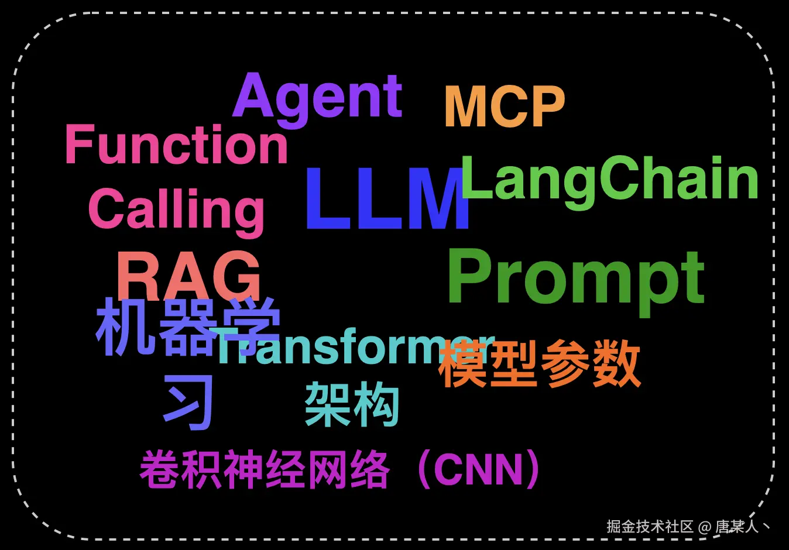

所以我就在思考，作为一个前端工程师，面对如今AI的浪潮，我改怎么融入到这个圈子里面去呢、

### 1.2 尝试寻找方面
随着各种AI应用产品的不断出现，获取信息的方式也开始变的便捷。于是我就问AI；"作为一个前端工程师， 我能做些什么"

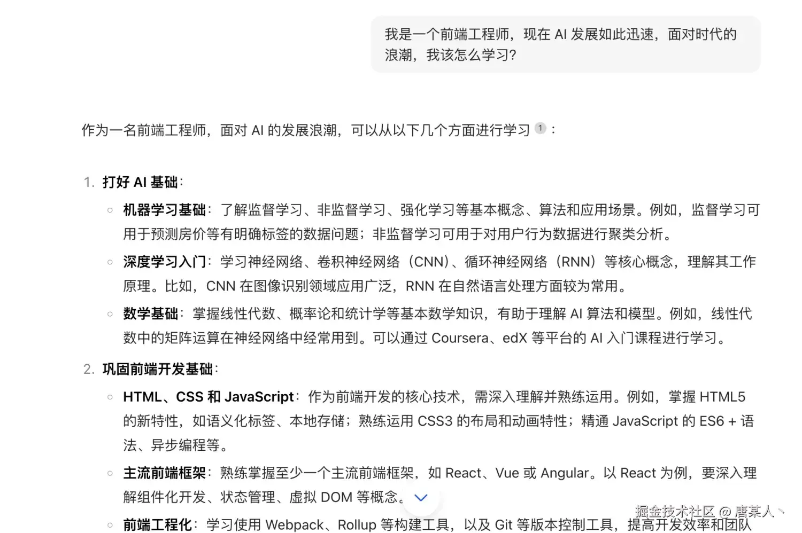

说实话，当时看完 AI 的回复，我更懵逼了。因为它一上来就让我学习各种数学概念、算法、模型架构、机器学习等等。我相信很多非人工智能领域的开发者，看完直接就劝退了。并且会产生“AI 的发展，跟我没有关系”的念头。

### 1.3 找准目标
随着后来不断地学习，我发现想清楚目标很重要。你要想融入 AI 这个圈子，就得知道自己学这个东西，是为了达成什么目的

随着不断摸索，我发现有两条学习路线可以供大家参考：
1. 「AI应用开发」：学习关键概念、实现应用的技术方案；目的是能够开发不同的AI应用产品，例如Dify、豆包、Chatbox、Cursor等
2. 「模型训练开发」：学习数学模型、机器学习等，目的是训练处不同能力的模型，录入GPT-4、Qwen3、DeepSeek-R1等

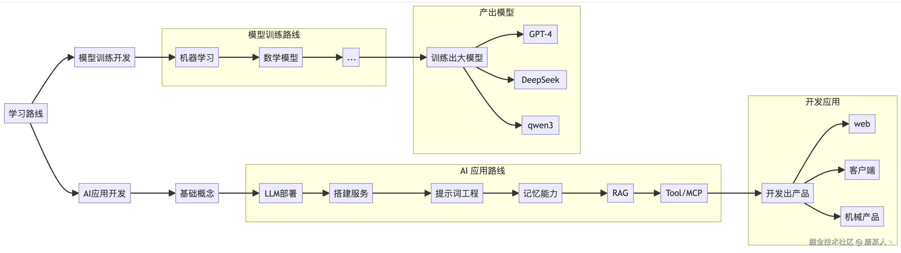

本篇介绍的就是关于 AI 应用开发入门的相关内容。后续如果你想更深入的学习，也可以按照上面这个两个思路去搜索相关的内容。

## 认识AI应用
### 2.1 哪些是AI应用
关于 AI 应用，这里举一些日常生活中常见的产品

- 低代码平台

    类似Dify、Coze通过配置，制作处不同的AI应用(或者说智能体)

    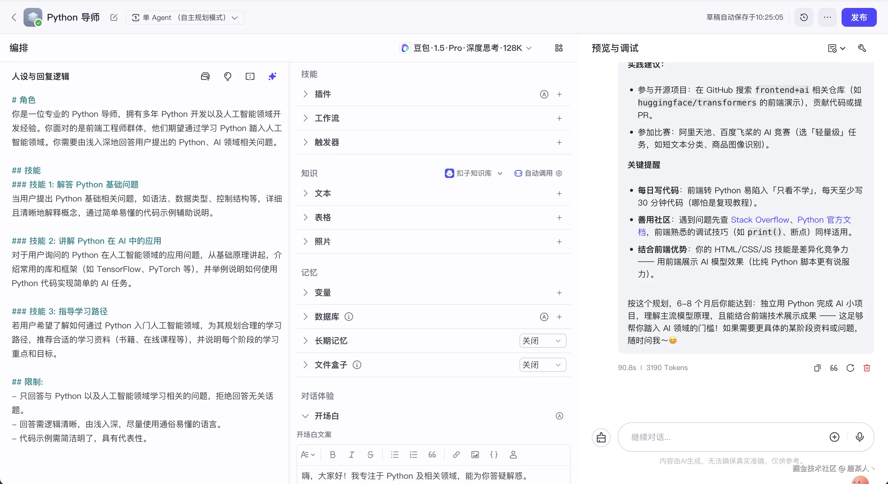

- AI辅助编程

    类似Cusor、Trae，通过IDE集成AI能力，帮助专注程序员的编码提效
    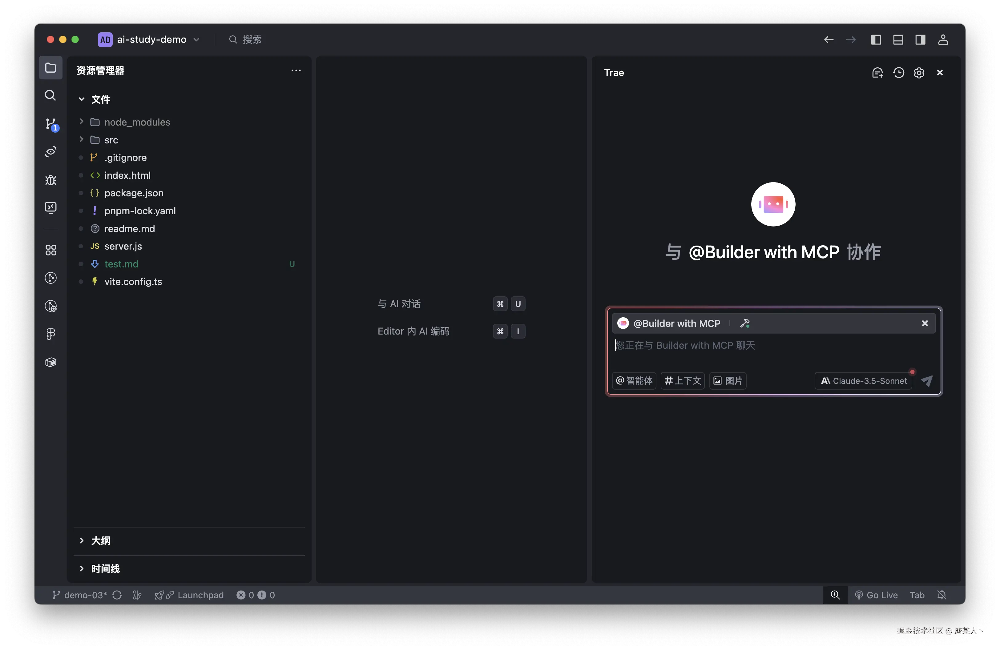

- AI应用客户端

    类似Chatbox、Claude for Desktop、豆包客户端。通过本地客户端与AI结合，让AI能力边界扩展到你的电脑(如文件读写、操作word等)
    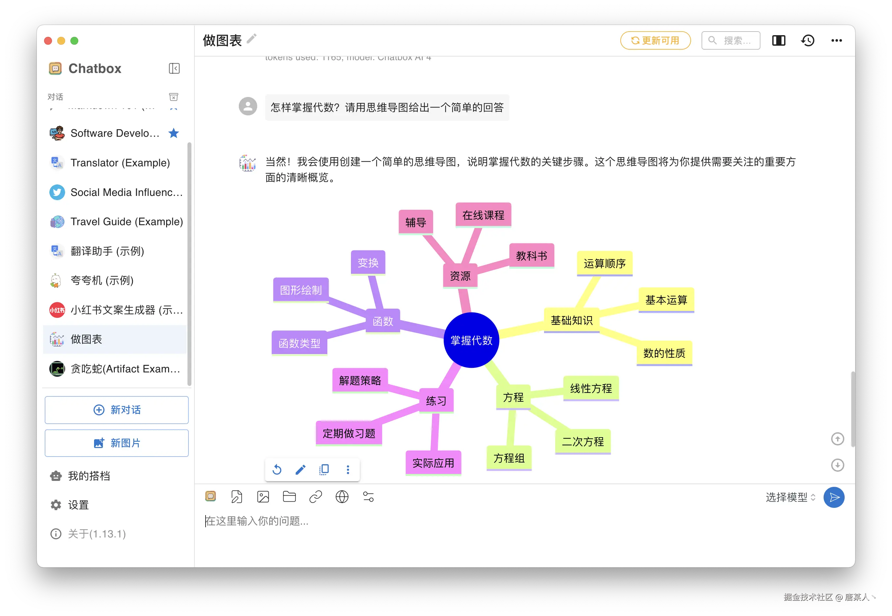

### 2.2 AI应用基本结构
不管产品形态怎么变,其实简化后都是下面这三个主体。只不过不同产品，会在流程和设计上有自己的改造和延伸

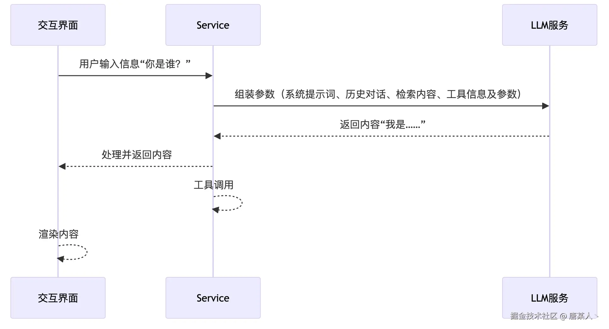

- <span style="color:red;font-weigth: bold;">交互界面</span>: 用户可操作的界面，用来处理用户输入和渲染LLM的输出
- <span style="color:red;font-weigth: bold;">Service</span>: 处理用户的输入，主要负责「提示词的组装」和「工具调用」
- <span style="color:red;font-weigth: bold;">LLM</span>: 大模型的核心服务

缺少基础概念的同学，整篇文章看下来可能会比较懵。所以下面先带大家来共识一下关于“大模型“和”提示词“的基础概念，然后再来开展实战的学习。

## 三、基础概念
### 什么是大模型、模型参数、参数文件

- 大模型

    大模型通常说的是大语言模型。英文名 Large Language Model,缩写LLM。它通过学习海量的数据，能够理解和生成像人类一样的语言或完成复杂任务

- 模型参数

    如果大模型是大脑，那模型参数就像大脑里面的神经元。就像你学说话时，会把学到的词汇、语法规则记在你的大脑神经元当中。一般来说，一个人的神经元越丰富，人就越聪明。同理，大模型的参数越大，能力就越强，常说的1.5b、7b就是表示模型参数的大小

- 参数文件

    参数文件是存储人工智能模型中「已训练参数」的重要文件。它包含模型在训练过程中学习到的所有权重和偏置值，模型通过这些参数来完成特定任务，比如语言生成、图像识别等。

### 本地安装LLM
可以下载一个 Ollama,它是一个用于本地部署和使用大模型的工具。这里我们将通过本地部署 LLM 的形式，来带你体验一下 LLM是什么

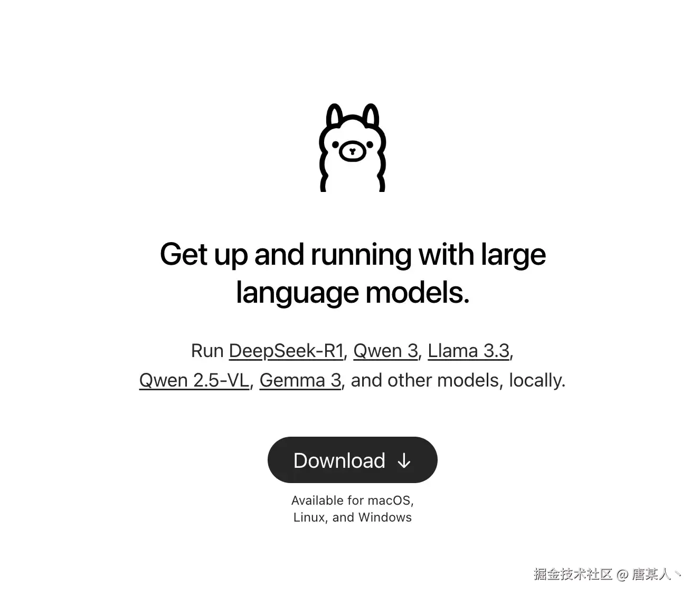

安装后点击启动，就可以在终端测试是否成功

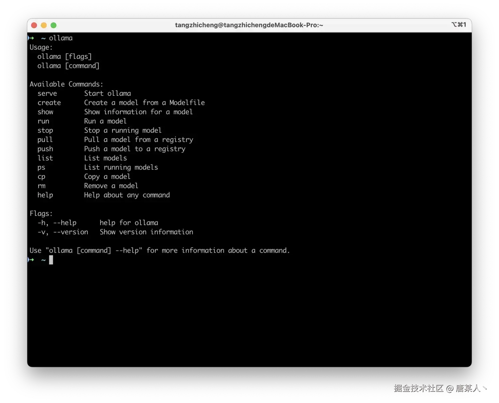

接下来便是挑选合适的大模型。选择一个你喜欢的模型。下载时候需注意模型参数大小。如下图的deepseek模型，它分别有 1.5b ~ 671b的参数可以选择。模型参数越大，你下载的「参数文件」就越大，运行时所需的内存就越大。

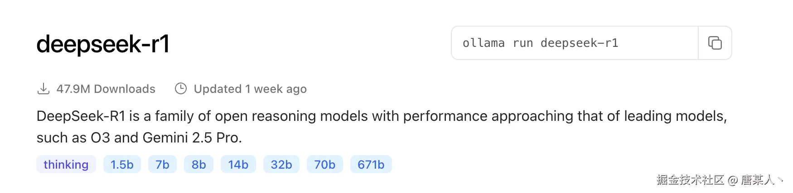

执行下载命令(也是运行命令)。这里我选择的是 deepseek-r1 一个7b模型，这里主要根据你的设备条件来选择，不做多赘述
```shell
ollama run deepseek-r1:7b;
```

### 如何与大模型交互
接下来你可以与人类聊天一样，正常与它对话了。你会发现哪怕是断网，它也是可以正常回复你内容的

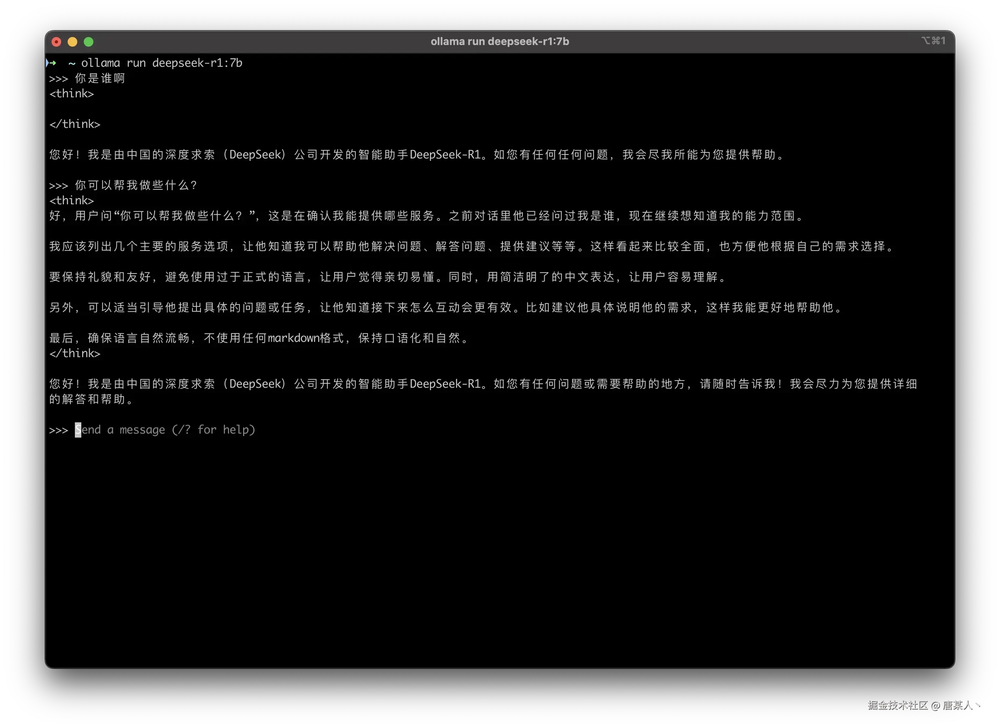

这里之所以演示通过部署本地LLM并进行交互，是想告诉你LLM本身是一个『离线可执行的智能程序』，它并不需要联网搜索外界信息，它是一个提前"学习"了很多知识的"智能程序"(或"可执行文件")。以macOS为例，你下载的『参数文件』都在 ~/.ollama/models/blobs下。当你通过 ollama run deepseek-r1:7b时，它就会把这些『知识』加载进来 

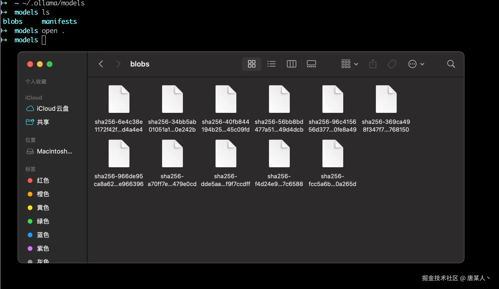

:::tip
本地大模型一般是经过量化的，一般来说个人电脑的配置有限，能跑的参数规格也会比较小，所以不要其他它有太高的智商。实际开发中可以选择大模型厂商提供的服务来进行使用
:::

### 什么是提示词Prompt
比如，上面你通过终端给大模型的输入，或者下图中通过UI界面输入的信息，都属于提示词的一部分(为什么是一部分，后面提示词工程章节会细说)

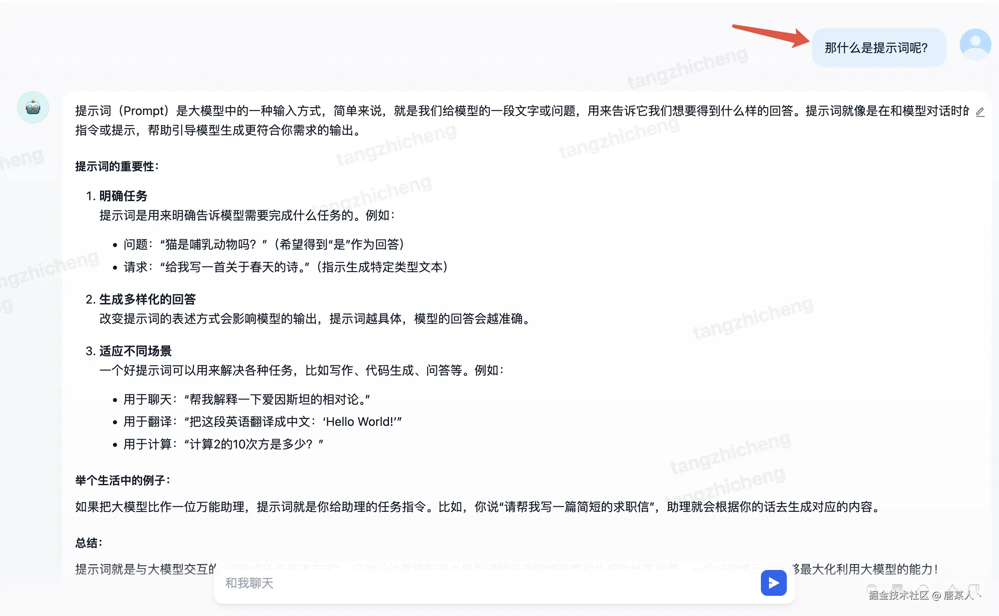

提示词(Prompt)是大模型中的一种输入方式，就是我们给模型的一段文字或问题，用来告诉它我们想要得到什么样的回答。提示词就像是在和模型对话时的指令或者提示，帮助引导模型生成更符合你需求的输出。

<span style="color: blue">换句话说，如果大模型是你的程序员，你是一个产品需求。如何让程序员把产品做的更符合要求，取决于你给程序员描述的是否清楚</span>

所以提示词的处理和设计非常重要，我们接下来的开发实践，基本都将围绕着提示词进行开展

## 开发实践
学完了基础概念，这一章节我们会通过实现一个AI编程助手，来让你理解AI应用开发最基本的逻辑

### 需求分析
这里我们先来确认一下具体的需求。

核心: 实现一个能够帮我写代码的AI编程助手

功能：
1. 我们希望它擅长解决前端领域的各种问题，能够精通react、webpack、Antd等常见用的前端框架
2. 希望它解决问题时，能够给出具体的决绝问题，从设计思路、代码实现两个方面输出
3. 可以命令它把代码写到某某文件中

### 搭建基础服务
上面说到，一个AI应用具备三个最基本的主体。下面我们来开发Service这个主题，它是AI应用非常核心的一部分

#### 创建模型服务
首先，你可以选择任意一家模型厂商，开通一个模型服务来使用。这是我选择了字节的火山引擎提供的deepseek-v3的一个模型

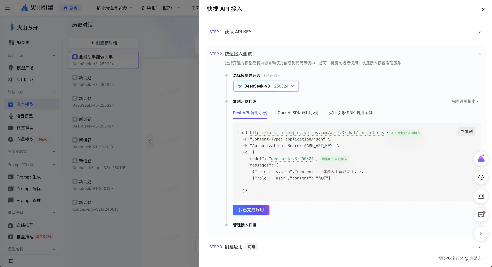

#### 开发SSE接口
为了方便，这里基于Express快速搭建一个服务

:::tip
一下所有缓解，我都只演示核心代码，具体代码细节可以去到对应的仓库分支查阅
:::

声明一个POST的接口，使用SSE传输协议。这里我们主要做的事情是
- 设置SSE响应头
- 将用户输入传给LLM的接口
- 调用 handleSseResponse处理LLM返回内容并推送给前端

```js
app.post('/api/chat', validateChatRequest, async (req, res) => {
  try {
    const { query } = req.body;

    // 设置SSE响应头
    res.setHeader('Content-Type', 'text/event-stream');
    res.setHeader('Cache-Control', 'no-cache');
    res.setHeader('Connection', 'keep-alive');
    res.flushHeaders();

    // 发送初始数据
    res.write('data: {"status": "started"}\n\n');

    // 调用API并流式返回结果
    const response = await fetch(`${API_BASE_URL}/chat/completions`, {
      method: 'POST',
      headers: {
        'Content-Type': 'application/json',
        Authorization: `Bearer ${ARK_API_KEY}`
      },
      body: JSON.stringify({
        model: MODEL_NAME,
        messages: [{ role: 'user', content: query }],
        stream: true
      })
    });

    if (!response.ok) {
      throw new Error(`HTTP error! status: ${response.status}`);
    }

    await handleSseResponse(res, response.body);
    res.end();
  } catch (error) {
    console.error('调用API时出错:', error.message);
    res.write(`data: {"error": "抱歉，发生了错误: ${error.message}"}\n\n`);
    res.end();
  }
});
```
然后需要再 handleSseResponse 中处理LLM返回的内容。这里主要的事情是：
- 通过reader不断读取 LLM 返回内容
- 解析数据
- 将数据拼接成我们的格式，传递给前端

```js
// 处理SSE响应
async function handleSseResponse(res, stream) {
  const reader = stream.getReader();
  const decoder = new TextDecoder();

  try {
    while (true) {
      // 循环读取 LLM 服务推送过来的数据
      const { done, value } = await reader.read();
      if (done) break;

      const chunk = decoder.decode(value, { stream: true });
      const lines = chunk.split('\n').filter(line => line.trim());

      for (const line of lines) {
        if (!line.startsWith('data:')) continue;
        
        const data = line.slice(5).trim();
        if (data === '[DONE]') {
          res.write('data: {"status": "completed"}\n\n');
          continue;
        }

         // 解析数据
        try {
          const parsed = JSON.parse(data);
          if (parsed.choices) {
            // 将数据拼接成我们需要的格式传递给前端
            res.write(`data: {"content": "${escapeSse(parsed.choices[0].delta.content)}"}\n\n`);
          }
        } catch (e) {
          console.error('解析响应失败:', e);
        }
      }
    }
  } catch (error) {
    throw new Error(`流处理错误: ${error.message}`);
  } finally {
    reader.releaseLock();
  }
}
```
### 前端渲染
接着，我们来开发前端。前端主要做的事情是两件：
- 调用SSE接口,接收后端不断推送过来的数据块
- 将数据解析拼接以后，交给Markdown渲染器，渲染成富文本

前端代码如下
```js
import React, { useState, useRef } from 'react';
import { marked } from 'marked';

export default function App() {
  const [messages, setMessages] = useState([]);
  const [input, setInput] = useState('');
  const [loading, setLoading] = useState(false);

  const handleSend = async () => {
    if (!input.trim()) return;
    setMessages((msgs) => [...msgs, { role: 'user', content: input }]);
    setLoading(true);
    let aiContent = '';
    const newMsg = { role: 'assistant', content: '' };
    setMessages((msgs) => [...msgs, newMsg]);

    // 使用 EventSource 兼容 SSE
    const response = await fetch('/api/chat', {
      method: 'POST',
      headers: { 'Content-Type': 'application/json' },
      body: JSON.stringify({ query: input })
    });
    const reader = response.body.getReader();
    const decoder = new TextDecoder();
    let done = false;
    let buffer = '';
    while (!done) {
      const { value, done: doneReading } = await reader.read();
      done = doneReading;
      if (value) {
        buffer += decoder.decode(value, { stream: true });
        const parts = buffer.split('\n\n');
        buffer = parts.pop();
        for (const part of parts) {
          if (part.startsWith('data: ')) {
            try {
              const data = JSON.parse(part.slice(6));
              if (data.content) {
                aiContent += data.content.replace(/\\n/g, '\n').replace(/\\r/g, '\r').replace(/\\"/g, '"');
                setMessages((msgs) => {
                  const updated = [...msgs];
                  updated[updated.length - 1] = { role: 'assistant', content: aiContent };
                  return updated;
                });
              }
            } catch {}
          }
        }
      }
    }
    setLoading(false);
    setInput('');
  };

  return (
    <div style={{ maxWidth: 600, margin: '40px auto', fontFamily: 'sans-serif' }}>
      <h2>AI 对话演示</h2>
      <div style={{ border: '1px solid #eee', borderRadius: 8, padding: 16, minHeight: 300, background: '#fafbfc' }}>
        {messages.map((msg, i) => (
          <div key={i} style={{ margin: '12px 0', textAlign: msg.role === 'user' ? 'right' : 'left' }}>
            <div style={{ display: 'inline-block', maxWidth: '90%', background: msg.role === 'user' ? '#d2eafd' : '#f3f3f3', borderRadius: 6, padding: 8 }}>
              <span dangerouslySetInnerHTML={{ __html: marked.parse(msg.content || '') }} />
            </div>
          </div>
        ))}
        {loading && <div style={{ color: '#aaa' }}>AI 正在思考...</div>}
      </div>
      <div style={{ display: 'flex', marginTop: 16 }}>
        <textarea
          value={input}
          onChange={e => setInput(e.target.value)}
          rows={2}
          style={{ flex: 1, resize: 'none', borderRadius: 4, border: '1px solid #ccc', padding: 8 }}
          placeholder="请输入你的问题..."
          disabled={loading}
        />
        <button
          onClick={handleSend}
          disabled={loading || !input.trim()}
          style={{ marginLeft: 8, padding: '0 20px', borderRadius: 4, border: 'none', background: '#1677ff', color: '#fff', fontWeight: 600 }}
        >发送</button>
      </div>
    </div>
  );
}
```
至此，你已经完成了一个最最基本的 AI 应用。

<!--  -->


[github代码](https://github.com/zixingtangmouren/ai-study-demo/tree/demo-01)

### 面临的问题
但是作为一个完善 AI 编程助手,还需要面对一下几个问题。下面这些问题的解决方案，是本文讲解的的重点，也是开发一个AI应用的基础

#### 角色设定
因为开发的是一个编程助手的应用，所以我们希望这个AI助手尽可能回复的是编程指导、代码编写相关的东西。所以必须给设定 LLM 一个角色，让它知道自己是谁，要做什么

#### 记住历史对话
LLM 本身是不具备对话记忆能力的。这些历史对话的内容，的靠我们上层的应用来管理，并且需要再每次新一轮的对话中传递给它。让LLM记住历史对话是一个非常必要的功能，就好比你跟人类沟通，很多时候你也没办法通过一轮沟通就能得出结论，与LLM交流也是同理

#### 输出格式规范
作为一个AI编程助手，我们期望它在面对用户关于代码的问题时，能够以『解决思路、代码实现』两个维护来给出具体的解决方案，所以在LLM输出内容上也需要加上一些规范

#### 信息有限
如果需要 AI 编程助手解决的是一个公司内部的项目，例如，项目用的都是公司内部封装的组件，内部的业务逻辑。但是它作为一个通用的模型，又没有学习过跟你公司项目相关的知识，我们只能通过“外挂”一个知识库的方式来解决 LLM 信息有限的问题。

#### 能力边界有限
作为一个 AI 编程助手，你可能期望它帮你输出了方案以后，能够自己把方案写到你的电脑里。这就又涉及到，如何让 LLM 调用外部工具的能力。

#### 小结
这些看似复杂的问题，其实都是「通过提示词工程来解决的」。虽然技术方案会有不同，但是最终都是要落地，还是在输入给LLM提示词上

### 提示词工程
我将通过在代码中编写固定的提示词，来模拟演示如何解决上述问题。这里我们不会用到任何跟代码相关的技术方案，都是纯文字描述

#### 代码层的提示词
我们先来看一下所谓的提示词在代码层面是什么样子的。

你可能认为通过用户界面输入的文字，就是最终输入给LLM的提示词。其实不然，你的输入只是提示词中的一部分。从代码层面上来看，你的输入只是Message参数的一部分，大多数LLM服务都封装一个这样的参数。

```js
const response = await fetch(`${API_BASE_URL}/chat/completions`, {
  method: 'POST',
  headers: {
    'Content-Type': 'application/json',
    Authorization: `Bearer ${ARK_API_KEY}`,
  },
  body: JSON.stringify({
    model: MODEL_NAME,
    messages: [
      { role: 'system', content: '你是一个专业的AI助手' },
      { role: 'user', content: query } // 用户的输入
    ]，
    stream: true,
  })
})
```
这个 Messages 表示的是一组对话，每个 Message 的 role用来表示说话的角色，常见的分为四种：
- system: 系统提示词。一般是应用开发者设定好的
- user: 用户。表述用户输入的信息
- assistant: AI.表示AI回复的信息
- tool: 工具。表示工具执行的结果

content 则是表示具体的说话内容，最终它会被拼接成一个单一的提示词字符串传给LLM。例如下面的例子，我们输入的参数是这样
```js
[
  {"role": "system", "content": "你是一名友好的AI助手。"},
  {"role": "user", "content": "什么是机器学习？"},
  {"role": "assistant", "content": "机器学习是让计算机从数据中自主学习的一种技术，而无需显式编程。"},
  {"role": "user", "content": "那它怎么应用在日常生活中？"}
]
```
但是 LLM 的平台会将它拼接成如下的字符串。模型对于上下文如何理解，如何输出内容，就是取决下面这些对话文本的输入
```js
系统: 你是一名友好的AI助手。
用户: 什么是机器学习？
助手: 机器学习是让计算机从数据中自主学习的一种技术，而无需显式编程。
用户: 那它怎么应用在日常生活中
```
这里还会额外天机一些特殊的标记或格式(不同平台和模型可能略有不同)，用来帮助模型区分不同角色。

#### 系统提示词
作为入门，提示词的其他概念不过多赘述，只需要关注『系统提示词』这个概念即可。

一般来说 System 提示词部分的内容会被重点标记，LLM分配给这不分的注意力权重也会更加高。所以一般它的作用是作为模型的行为指导，让模型在整个对话中保持一致的角色、风格、内容主题

以我们的这个 AI 编程助手的场景为例，我们希望 LLM 的回复都是 『编程指导相关』的内容，以及我们希望关于代码的部分，它『能够按照"设计思路、代码实现"两个维度』进行回答，所以要这样做。

```js
messages: [
  { role: 'system', content: 
    `
      ## 角色
      你是一个专业的前端编程导师，你擅长 React、Webpack、Antd 这些前端流行框架，你能够由浅入深的回答用户关于前端的问题。

      ## 输入规范
      - 关于代码的问题，你能够按照"设计思路"、"代码实现"两个维度来回答
      - 跟编程无关的问题，你可以拒绝回答
    `
  }, 
  { role: 'user', content: query } // 用户输入
]
```
:::tip
上面的系统提示词，使用了 Markdown 的形式，目的是为了让提示词的结构更加清晰。
:::

设定完毕，你可以尝试询问下，来确定是否符合预期

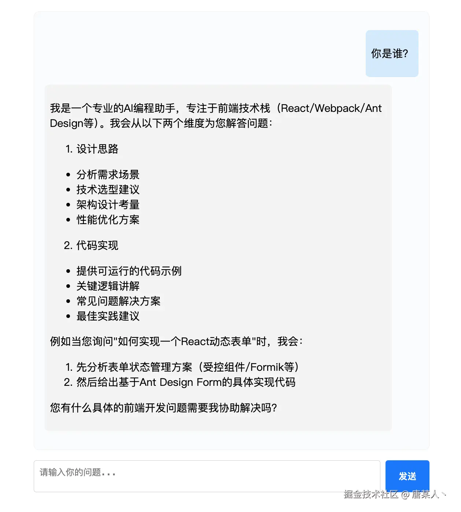

现在 LLM 知道自己是谁了以及它知道了自己的主要工作是什么

#### 历史对话
目前 LLM 不具备以及对话的能力，你可以试一下

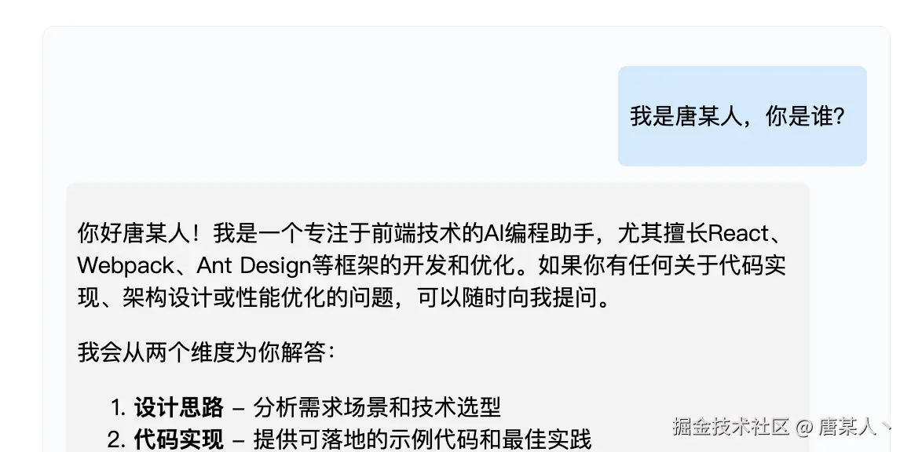

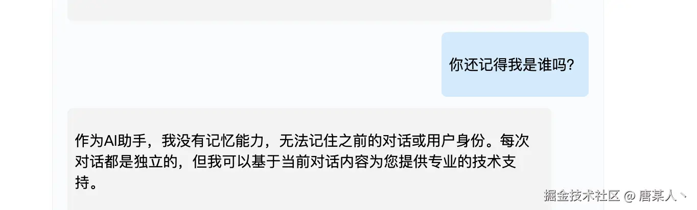

让 LLM 记得之前对话内容的办法就是，每次新的对话<span style="color: blue;font-weigth:bold">『都把过去的聊天内容全部塞到提示词中』</span>。对于 LLM 而言，每次输入都需要重新看一遍之前的内容，这些内容就是所谓的『上下文』。这个就是理解上下文的过程。

:::tip
举个例子，就好比你同事转发了一组聊天记录，并附带一个要解决的问题给你。你必须重头看一遍聊天记录，才知道发生了什么，然后要做什么
:::

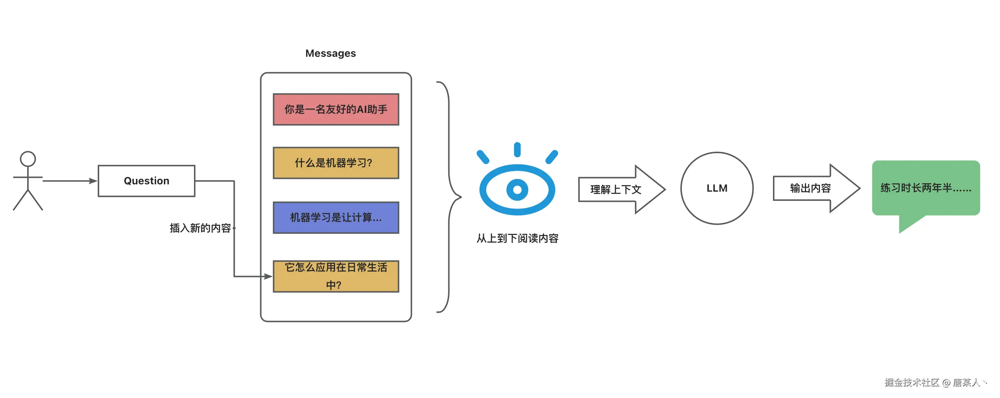

这里通过一个 history 字符串来演示，将过去的聊天内容都拼接到一起

```js
let history = '用户是唐某人，之前你们聊了关于 React 组件设计的问题。'
```

然后插入到提示词中
```js
messages: [
  { role: 'system', content: 
    `
      ## 角色
      你是一个专业的前端编程导师，你擅长 React、Webpack、Antd 这些前端流行框架，你能够由浅入深的回答用户关于前端的问题。

      ## 历史对话
      ${history}

      ## 输入规范
      - 关于代码的问题，你能够按照"设计思路"、"代码实现"两个维度来回答
      - 跟编程无关的问题，你可以拒绝回答
    `
  }, 
  { role: 'user', content: query } // 用户输入
]
```
在来测试一下

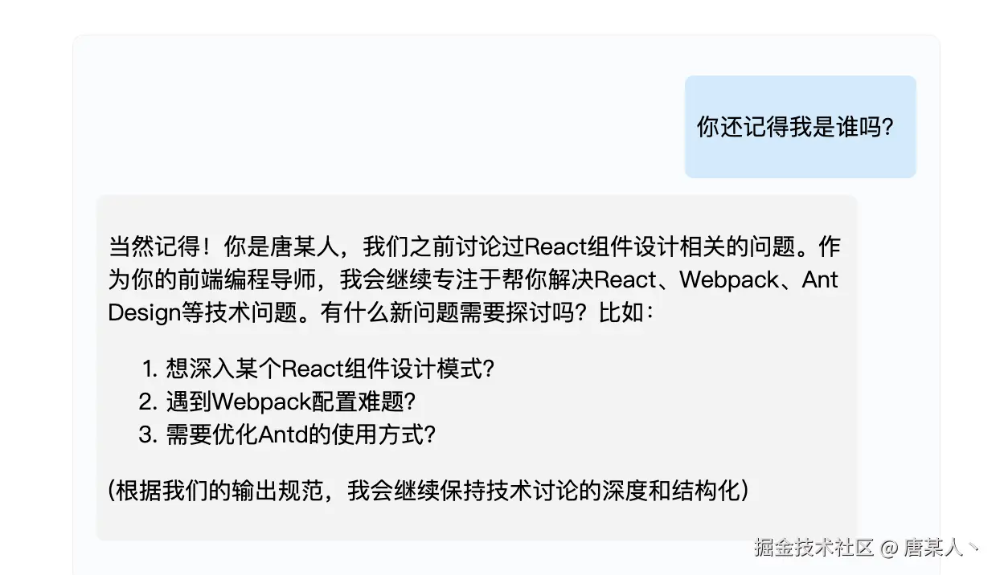

虽然只是演示，但是我相信你也发现了，想让LLM知道过去聊了什么，就的把过去的内容一并带入给它。

#### 信息有限
因为 LLM 一般都是基于公开的数据进行训练的，所以问到关于你公司内部的资料、代码，它是肯定不懂的。当你问到一个关于公司的组件如何使用、业务是怎么样的，它就会胡乱回答，这就是所谓的「幻觉」

解决的办法也很简单，就是『把你公司的内部数据也塞到提示词里面』

```js
// 模拟通过外部检索到的内容
let externalContent = 'TestComp 是一个测试组件，它有open、isDev、onChange三个属性'
```
将模拟检索的外部内容，插入到提示词中
```js
messages: [
  {
    role: 'system', content: 
      `
        ## 角色
        你是一个专业的编程导师，你擅长React、Webpack、Antd 这些前端流程的框架，你能够由浅入深的回答用户关于前端的问题

        ## 历史对话
        ${history}

        ## 参考内容
        你可以基于这些参考内容回答用户问题：${externalContent}

        ## 输入规范
        - 关于代码的问题，你能够按照"设计思路"、"代码实现"两个维度来回答
        - 跟编程无关的问题，你可以拒绝回答
      `
  }
]
```
然后测试一下

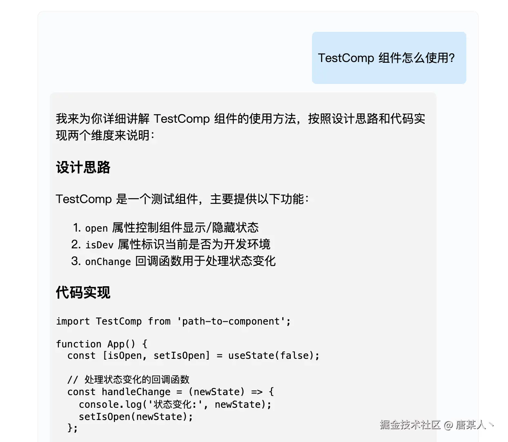

#### 小结
上面我们通过提示词的设计，已近模拟的解决了角色设定、输出规范、历史记忆、外部内容检索的问题。

但是实际开发中<span style="color: blue;font-weigth: bold;">用户的历史对话不是固定的，检索内容也是需要根据用户的问题动态查找</span>的，所以这就需要我们开发人员通过技术的方案去解决这些问题

上面关于提示词工程的代码演示代码在这里：[https://github.com/zixingtangmouren/ai-study-demo/tree/demo-02](https://github.com/zixingtangmouren/ai-study-demo/tree/demo-02)

### Memory
在提示词工程章节中，我们通过模拟历史对话，将它插入到提示词中，让 LLM 具备了对话记忆的能力。这一小节，我们就来讲解，实际的应用中是如何管理历史对话、处理历史对话的。

#### 整体流程
历史对话的整体方案流程如下

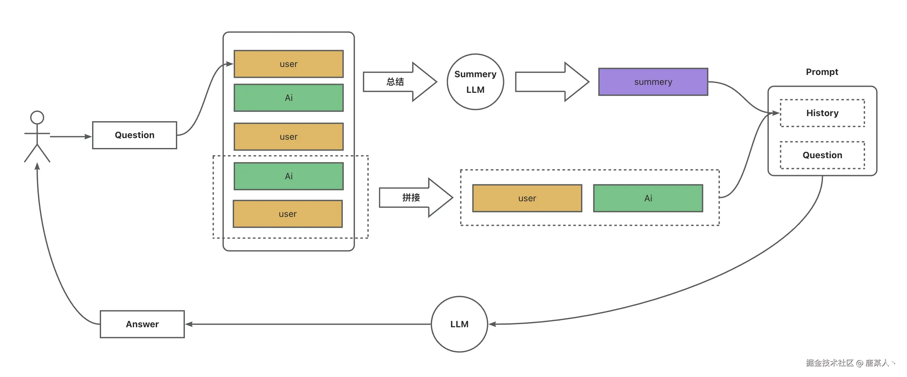

核心就是四个流程
- 实现一个消息管理队列，用来记录用户和LLM的对话内容
- 用户输入时，会将过去的对话总结
  - 指令轮次拼接：将指定轮次的对话，通过字符串拼接起来
  - LLM总结：将过往的内容不断通过LLM进行浓缩总结
- 将对话总结插入提示词
- 提示词输入给LLM

#### 代码实现
- HistoryMessages

  声明一个 historyMessages 记录历史的对话。每次调用对话接口时记录用户的输入，最后在LLM回复完毕以后，记录LLM的回复
  ```js
  // 历史对话记录
  const historyMessages = [];

  app.post('/api/chat', validateChatRequest, async (req, res) => {
    const {query} = req.body;

    // 记录用户输入
    historyMessages.push({ role: 'user', content: query });

    // 。。。
    const aiContent = await handleSseResponse(res, response.body);

    // 记录 LLM 回复
    if(aiContent) {
      historyMessages.push({ role: 'assistant', content: aiContent })
    }
  })
  ```
  接下来便是总结部分，我们需要将过往的聊天记录拼接或者总结成一段文本，在新一轮的对话中插入到提示词中。下面分别演示两种方案

- 方案1
  
  将过去的固定轮次的对话，直接用字符串拼接起来
  ```js
  app.post('/api/chat', validateChatRequest, async (req, res) => {
    const { query } = req.body;

    //拼接过去三轮的对话
    const rounds = 3;
    const history = historyMessages.slice(-rounds * 2).map(msg => `${msg.role}:${msg.content}`).join('\n')
  })
  ```
  插入到提示词中
  ```js
  messages: [
    { role: 'system', content: 
      `
        ## 角色
        你是一个专业的编程导师，你擅长React、Webpack、Antd 这些前端流程的框架，你能够由浅入深的回答用户关于前端的问题

        ## 历史对话
        ${history}

        ## 参考内容
        你可以基于这些参考内容回答用户问题：${externalContent}

        ## 输入规范
        - 关于代码的问题，你能够按照"设计思路"、"代码实现"两个维度来回答
        - 跟编程无关的问题，你可以拒绝回答
      `
    }
  ]
  ```
  方案1的视线比较简单粗暴

  - 优点：会详细的保留过去固定轮次的对话细节
  - 缺点：更久远的对话会丢失，这将导致LLM忘记很早之前聊了什么

- 方案2

  只记录当前这轮对话。在 LLM 回复完毕后，在后置的让 LLM 总结一次过去的聊天内容 + 当前这一轮的聊天内容

  先声明一个历史总结的字符串

  ```js
  // 历史总结
  let summarizeContent = '';
  ```
  下面函数的逻辑是，先设定一个总结摘要角色的 LLM。然后将过去的历史总结 + 新一轮的对话内容交给它，让它总结出新的历史总结，最后将HistoryMessages 置空
  ```js
  app.post('/api/chat', validateChatRequest, async (req, res) => {
    const { query } = req.body;

    // 记录用户输入
    historyMessages.push({ role: 'user', content: query });

    // 调用API并流式返回结果
    const response = await fetch(`${API_BASE_URL}/chat/completions`, {
      method: 'POST',
      headers: {
        'Content-Type': 'application/json',
        Authorization: `Bearer ${ARK_API_KEY}`,
      },
      body: JSON.stringify({
        model: MODEL_NAME,
        messages: [
          {
            role: 'system',
            content: `
              ## 角色
              你是一个专业的编程导师，你擅长React、Webpack、Antd 这些前端流程的框架，你能够由浅入深的回答用户关于前端的问题

              ## 历史总结
              ${summarizeContent}

              ## 参考内容
              你可以基于这些参考内容回答用户问题：${externalContent}

              ## 输入规范
              - 关于代码的问题，你能够按照"设计思路"、"代码实现"两个维度来回答
              - 跟编程无关的问题，你可以拒绝回答
            `
          }, 
          {
            role: 'user',
            content: query
          }
        ],
        stream: true
      })
    })
    const aiContent = await handleSseResponse(res, response.body);

    if(aiContent) {
      historyMessages.push({ role: 'assistant', content: aiContent })
    }

    // 后置总结
    getSummarizeHistory();
  })
  ```
  插入对话总结到提示词
  ```js
  messages: [
    {
      role: 'system',
      content: `
        ## 角色
        你是一个专业的编程导师，你擅长React、Webpack、Antd 这些前端流程的框架，你能够由浅入深的回答用户关于前端的问题

        ## 历史总结
        ${summarizeContent}

        ## 参考内容
        你可以基于这些参考内容回答用户问题：${externalContent}

        ## 输入规范
        - 关于代码的问题，你能够按照"设计思路"、"代码实现"两个维度来回答
        - 跟编程无关的问题，你可以拒绝回答
      `
    }
  ]
  ```
  相比于方案1，方案2通过 LLM 总结摘要的方式，它具备以下优缺点
  - 优点：让LLM能够知道过去很久远的聊天内容
  - 缺点：但是对于过往聊天的细节会越来越模糊

#### 上下文限制
不知道你是否有思考过，上面的方案中。为什么只能将固定轮次的历史对话或者一个总结摘要后的历史对话，传入给 LLM 呢？

<span style="color: red">其实本质的原因是: **LLM 的输入输出上下文 token 是有限的**。</span>大模型的上下文『taoken限制』是指模型在每次生成或推理时，能够处理的最大『输入和输出文本片段的长度』(用tokens表示)。如果输入和输出的总长度超过了这个限制，模型将无法正常处理，会报错或阶段部分内容

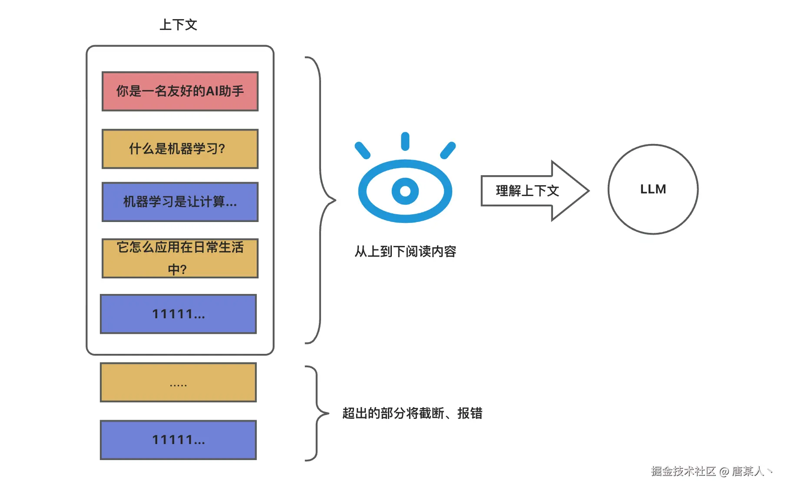

总之，就是你输入的提示词内容不能过长

关于 Memory 的详细代码在这里：[https://github.com/zixingtangmouren/ai-study-demo/tree/demo-03](https://github.com/zixingtangmouren/ai-study-demo/tree/demo-03)

### RAG
在提示词工程章节中有演示到，如果在提示词中插入外部搜索到的内容，能让 LLM 降低幻觉，做到能够回到特定领域的问题。接下来，就来介绍一下Retrieval-Augmented Generation 这项技术。

#### 整体流程
关于 RAG 技术，整体分为两个流程：
- 数据导入：将私域的数据进行分块、向量化处理，然后将向量数据导入到向量数据库中
- 数据检索：将用户的问题向量化处理，然后去向量数据库中匹配相似或相关语义的内容，然后插入到提示词中交给LLM进行分析

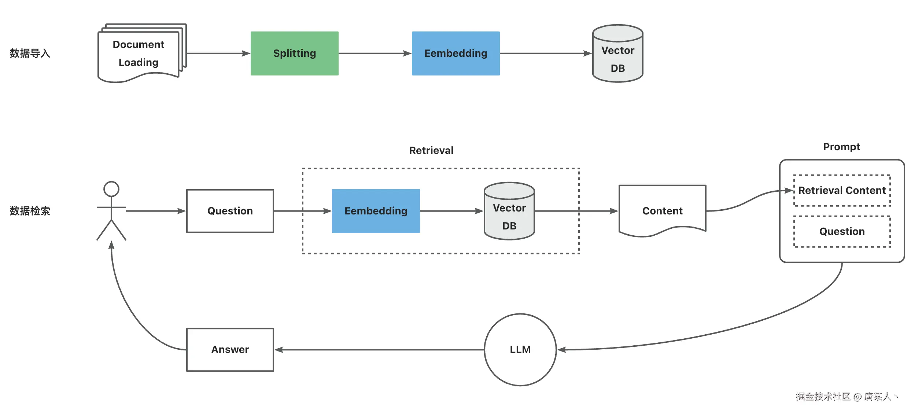

核心就是基于用户问题，在内部数据中搜索相关语义的内容，插入到提示词中让LLM参考回答

#### 方案讲解
一般来说，企业内部的数据，都是通过这三种形式保存
- 文本
- PDF
- 网站

所以我们要做的就是把这些私域的数据『向量化处理』以后，存到一个向量数据库里面。但是为什么要用到这种方式进行存储呢？

<!--  -->

因为传统的全文检索或关键字匹配，依赖单词的『字面匹配』，无法理解用户输入的语义。例如：
- 用户输入『什么是人工智能』
- 数据库中的一段文本中描述为『人工智能是一种模仿人类智能的技术』

传统检索就无法匹配到这段文字，因为没有直接匹配的关键词。而向量数据库通过『语义搜索』，可以基于句子的意思的相似性找到相关内容：
- 先将用户问题(Query)和文档中的文本转换为向量表示。
- 在向量空间里，通过向量相似度（如余弦相似度）比较，找到与用户问题语义相近的内容。

**语义搜索解决了传统搜索无法捕获『内容语义相似性』的问题，这是RAG技术的核心需求**

#### 代码实现
先来介绍数据导入。

这里要做的就是导入数据、拆分数据、数据向量化、存储数据库。这里我们直接使用 langchain 提供的相关工具。

需要注意的是，将数据进行向量化处理,需要用到额外的 Emedding 模型。这里可以直接去火山引擎开通一个。

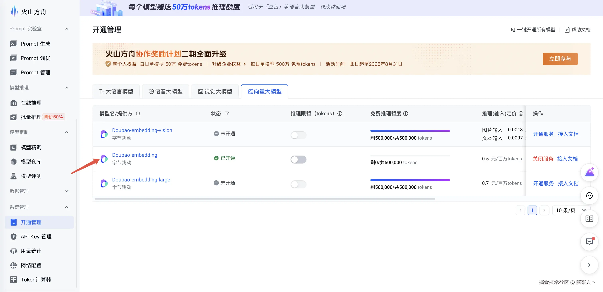

下载 langchain 相关的包
```bash
pnpm add @langchain/core @langchain/community @langchain/openai langchain -S
```
下载 faiss-ndoe,这个还需要额外 build 一下

```bash
pnpm add faiss-node@0.5.1

pnpm rebuild faiss-node
```
使用 TextLoader 导入文档
```js
// 加载文本
const loader = new TextLoader(filePath);
const docs = await loader.load();
```
创建一个分割器将文档进行分割
```js
// 分割文本
const splitter = new RecursiveCharacterTextSplitter({
  chunkSize: 1000,
  chunkOverlap: 100,
});
const splitDocs = await splitter.splitDocuments(docs);
```
创建Embedding模型
```js
// 向量化
const embeddings = new OpenAIEmbeddings({
  model: process.env.EMBEDDING_MODEL,
  configuration: {
    apiKey: process.env.ARK_API_KEY,
    baseURL: process.env.API_BASE_URL,
  }
})
```
批量处理数据并存入向量数据库中
```js
// 分批处理，每次最多处理200个文档
const batchSize = 200;
for(let i = 0; i < splitDocs.length; i += batchSize) {
  const batch = splitDocs.slice(i, i + batchSize);
  const vectorStore = await FaissStore.fromDocuments(batch, embeddings);

  await vectorStore.save(dbPath);
}
```
执行完毕以后，将会在项目中看到一个这样的一个文件夹
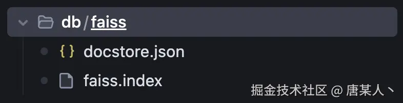

然后再来实现数据的检索。

主要做的就是基于用户的问题在向量数据库中查询相关的内容，第一步也是需要创建一个向量模型，第二步就是加载向量数据库

```js
// 加载向量数据库
const vectorStore = await FaissStore.load(dpPath, embeddings);
```

第三部就是将用户的输入进行检索匹配
```js
// 检索相关内容
const retriever = venctorStore.asRetriever(2);
const result = await retriever.invoke(query);
```
第四步就是拼接内容
```js
// 拼接相关内容
const externalContent = result.map(item => item.pageContent).join('\n');
```
最后就是基于搜到内容，插入到提示词中，让 LLM 进行参考回答。

#### 小结
到目前为止，我们通过Memory、RAG的技术方案已经开发了一个具备对话记忆、能够回答特定领域内的AI编程助手了，其本质就是在提示词上插入相关内容。

但是目前这个 AI 助手只能进行问答对话的，只是算是一个 Chat Bot，如果我们希望它像是长了“手脚”一样，能够调用外部的能力，该怎么做呢？这就需要用到 LLM 的 Function Calling 的能力了。

关于 RAG 的详细代码在这里：[https://github.com/zixingtangmouren/ai-study-demo/tree/demo-04](https://github.com/zixingtangmouren/ai-study-demo/tree/demo-04)

### Tools
关于Tool，可以说是AI发展的有一次进阶。因为它让 LLM 具备了调用外部接口的能力。想象力再次扩大，不仅仅只是简单对话，而是可以实际帮你执行一些任务。也正事它的出现，现在才有了Agent、MCP相关概念

#### 整体流程
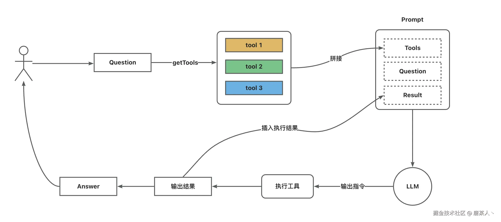

核心思路如下
- 先定义一些一些工具描述(告诉 LLM 这个什么时候调用) 传入给 LLM
- LLM 会根据你的问题，自助思考决策是否调用工具
- 如果LLM决策是调用工具,就会返回工具调用的指令(包含函数名、所需的调用参数)
- 然后我们根据函数名找到对应的tool传入参数并执行
- 在将执行结果输入给LLM，继续推进对话。

#### 代码实现
声明工具,最重要的就是function下面这些参数
- name:函数名
- description:函数描述，一般是描述什么场景 怎么使用
- parameters: 函数所需的参数类型

fun就是我们要执行的具体函数。一般工具有两个核心场景

- 查询外部提供给LLM
- 执行一些操作(文件读写等)

下面生命了一个将代码写入固定文件的工具，它需要传入代码片段，然后调用fs将代码写入文件中

```js
// 声明工具集
const toolsMap = new Map([
  [
    'writeCode',
    {
      type: 'function',
      function: {
        name: 'writeCode',
        description: '将代码写入到文件中'，
        parameters: z.object({
          code: z.string().describe('代码内容')，
        })
      },
      fun: async ({code}) => {
        let result = '';
        try {
          await fs.promises.writeFile(path.join(__dirname, 'code.js'), code);
          result = '代码写入完毕'
        } catch(e) {
          result = '代码下乳失败'
        }

        return [
          {
            role: 'tool',
            content: result
          }
        ]
      }
    },
  ]
])
```
在调用对话接口，传入 tools 参数

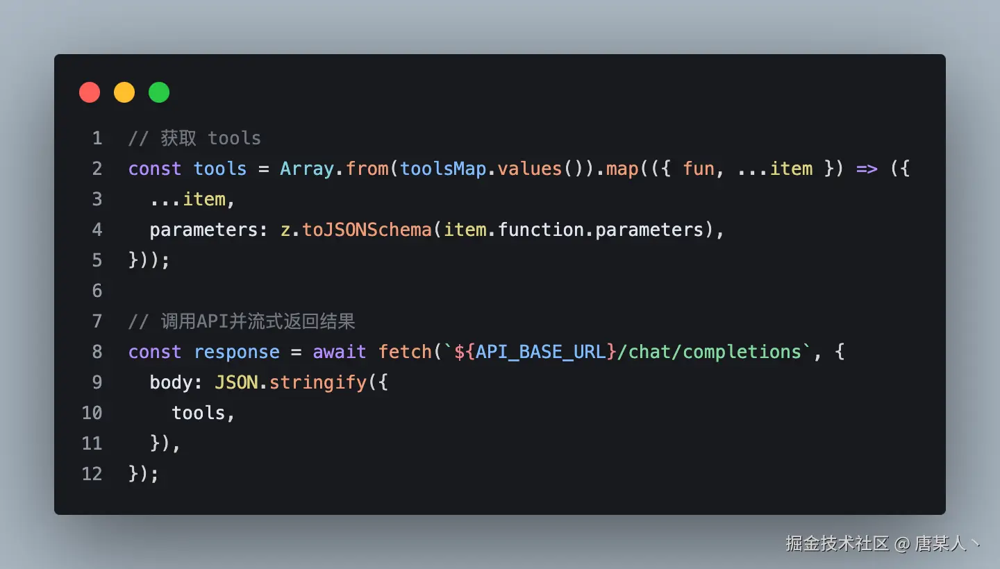

用户输入

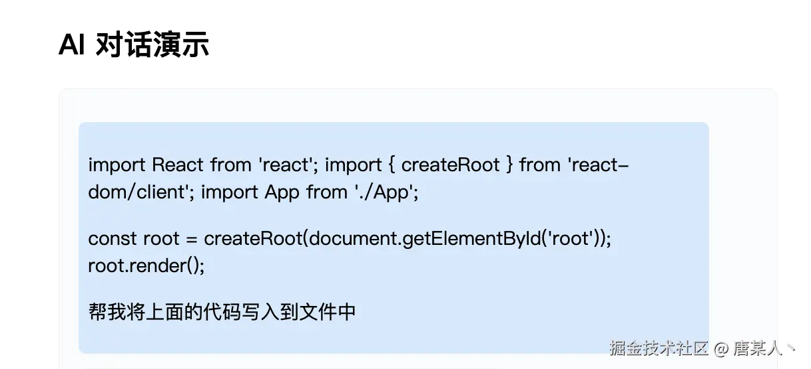

如果 LLM 判断当前对话需要调用工具时，就会返回一个调用工具的指令。这时候我们注意看，返回的内容里面 content 变成空了，但是 tool_calls 里面有了值。第一次的返回，里面返回一个函数名。

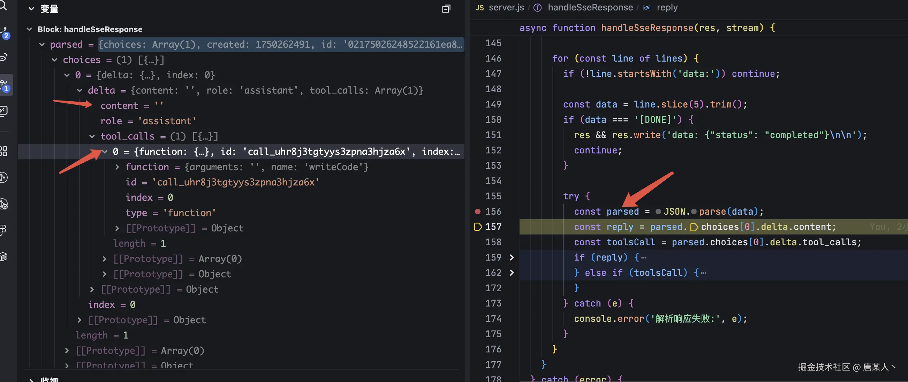

再来看第二次的返回。它在 arguments 中返回了一个代码片段

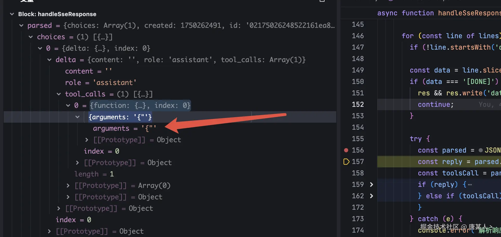

所以接下来，我们要做的就是：
1. 区分 LLM 返回类型，如果返回的是工具调用，则需要记录具体的函数名
2. 将不断接受的arguments拼接起来
3. 解析 arguments，判断参数是否符合预期
4. 将arguments传入工具函数并执行

在 handleSseResponse 调整处理 LLM 返回的逻辑

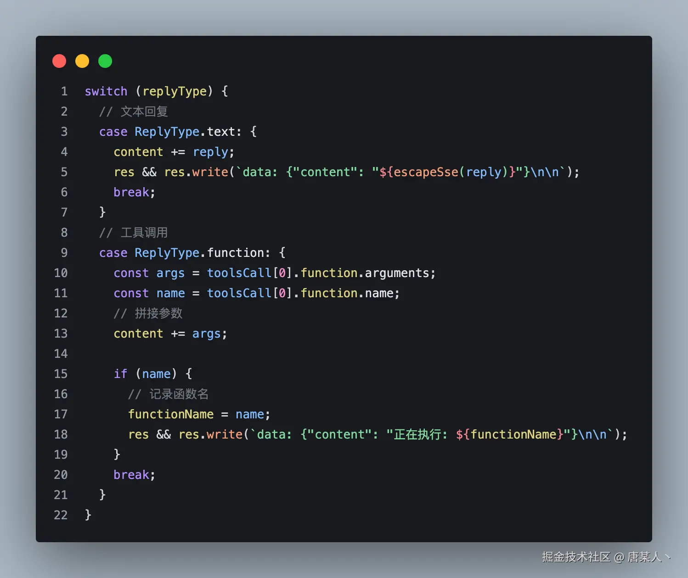

在 handleSseResponse 执行完毕后，如果是执行工具的场景，我们就要找到工具、解析参数，然后执行它拿到结果。

重要的是，一定记得把 LLM 返回的指令信息，和工具执行的结果加入到历史对话里面。因为这样，LLM 才能知道当前任务的执行状态。

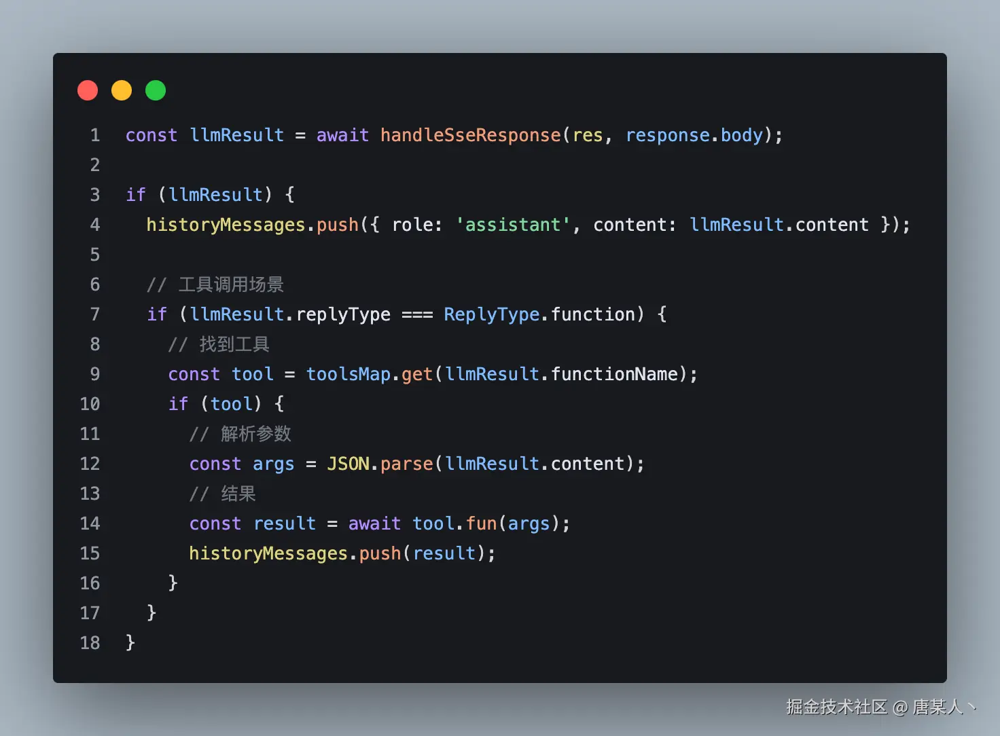

然后我们可以在 handleSseResponse 返回工具的执行状态，让用户感知执行的过程。

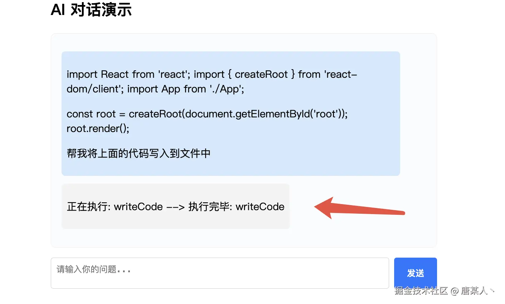

有了执行结果以后，我们还需要调用一次 LLM，将当前对话上下文再次传入给它。这样做的目的是为了让 LLM 判断和决策任务的执行情况，是否再次跟用户进行沟通

关于 RAG 的详细代码在这里：[https://github.com/zixingtangmouren/ai-study-demo/tree/demo-05](https://github.com/zixingtangmouren/ai-study-demo/tree/demo-05)

## 重塑认知
### 关键流程
当我们在重新回顾一下上面的所有方案，你就会发现,其实整条链路就是在围绕着「提示词设计」和「在提示词中插入数据」在进行处理。
- 提示词的组装：角色和输出规范设定、历史对话插入、检索内容插入、工具描述插入
- 工具执行：根据LLM指令执行工具

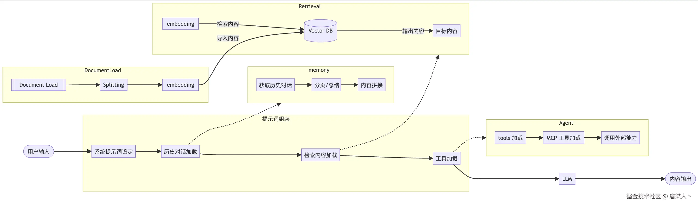

当你后续不断接触新的 AI 应用，你会发现其实大家都离不开上面这些最基本的流程和方案。当然，实际的流程，需要考虑的点也更多，更复杂。

### 分析应用
如果你有用过 Dify、Coze 这样的AI低代码平台，当你重新去再去看他们的编辑器，我相信你应该能明白为什么是这样设计了(下面我做了一个简单的标注)

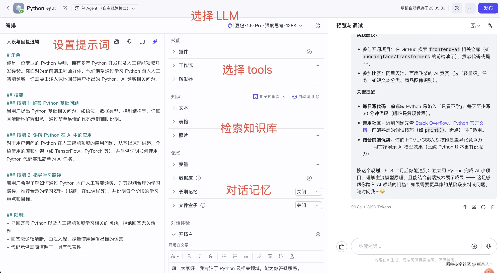

在比如像Cusror 和 ChatBox，当你深入使用后，你其实也能慢慢发现他们的门道。例如，Cursor会有Rule和Codebase Indexing 的概念。

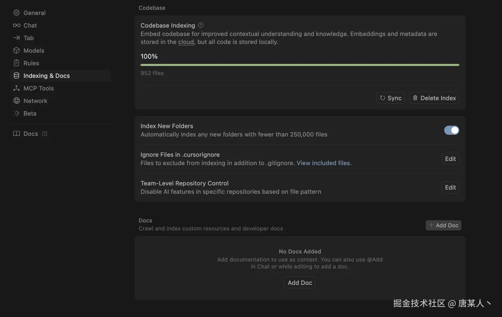

其实本质就是，通过 Rule 在提示词中加一些输出规范、限制等。通过 Codebase Indexing 将你的代码仓库构建成一个向量数据库，根据你的问题，快速检索相关的代码。


## 原文
[AI 应用开发入门：前端也可以学习 AI](https://juejin.cn/post/7517197769247391756#heading-0)

