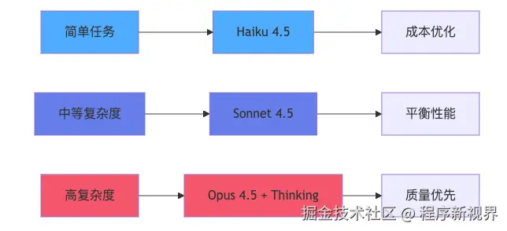
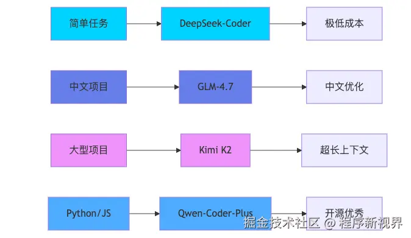
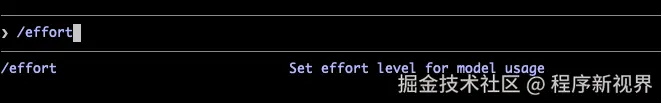

> 不要只优化Prompt，更要优化Context

Claude Code 很强大，这在前面的实践文章中我们已经验证过了，但与此同时，也有不少朋友说Token消耗过多，成本过高。

面对这个问题，很多人第一反应是：是不是Prompt写得太啰嗦了？

其实，很多时候真正“烧 Token”的，并不是输入的那句话，而是Claude背后带着的整段上下文。

它们可能包括：
- 之前的聊天记录
- 已经读取过的代码文件
- 工具调用输出
- 像 CLAUDE.MD这样的记忆文件
- 系统或后台注入的额外指令

也就是说，**当Token消耗越来越高时，问题往往不是Prompt不够简洁，而是上下文已经变得臃肿**

很多所谓的建议，比如"尽量缩短对话"，当然没错，但是太泛了，真正落地时帮助有限

真正有效的做法，是搞清楚Claude Code的上下文是怎么构建的、那些内容会被重复携带以及工作流里有哪些隐形成本正在不断累积。

这篇文章我们来讲7个真正实用的方法，在不牺牲效率的前提下，尽可能降低Claude Code的Token开销。

## 1. 根据任务复杂度切换模型
这一点最简单、单页最容易被忽视：**不是所有任务都值得最贵的模型**

如果使用按API计费，不同的模型成本大概有几倍的差距；如果使用订阅方案，那么更重的模型也会更快消耗额度

在执行任务时，可以做一个简单的分层
- 日常任务：写测试、简单改代码、解释逻辑、常规重构
- 复杂任务：多文件架构设计、棘手BUG排查、夸系统分析
- 轻量任务：查找、格式化、重命名、重复性操作

不同的任务采用不同的模型，像日常任务使用适中的模型即可，复杂任务则切换到能力更强，具备深度分析能力的模型，而且单纯的普通操作、机械性任务交给一般的低参数模型即可。

- 以国外模型为例：

  

- 国内模型参考

  

另外，不少人忽略了 /effort

就很直接的问题，适当降低effort level，可以减少模型的"思考预算"，从而直接降低输出token

一句话总结：**模型能力要和任务复杂度匹配，不要让高性能模型去做低价值工作**

## 2. 把CLAUDE.MD当"规则索引"，而不是"百科全书"
如果你经常在每次对话里重复输入项目约束、开发规范、测试方式，那其实在浪费Token。这正是CLAUDE.MD的意义所在。

在[《使用Claude Code最需要做的一件事：与AI签订一份契约（CLAUDE.md）》](https://mp.weixin.qq.com/s/EmTEA0ALoZMJmWLieF4iQw)一文中我们也有专门讲到。

CLAUDE.MD会在Claude读取代码之前就被加载，而且会在整个会话过程中一直驻留在上下文里

重点在于：**它不需要按需加载，也不会轻易被挤出去**

这意味着什么？如果你的 CLAUDE.md 有 5000 Token，那么每一轮对话几乎都要为这 5000 Token 付费。

不管你本次会话只有 2 轮，还是 200 轮，它都会持续产生成本。

### 那么，适合放进 CLAUDE.MD 的内容有哪些？
建议只放那些**长期稳定、反复要用到的**的规则，比如：
- 项目如何运行测试
- 使用哪个包管理器
- 代码格式要求
- 关键架构约束
- 哪些目录不要碰
- 团队通用的开发约定

### 不建议放进去的内容
很多团队会把下面的东西也一股脑塞进去
- 会议纪要
- 设计演进历史
- 冗长的实现说明
- 临时性的任务背景
- 很长的业务文档

这些都不合适

一个更好的原则是： **让CLAUDE.md像速查手册，而不是信息垃圾场**

写的越精炼，长期收益越高

## 3. 把啰嗦任务交给Subagent，但别滥用
这是一个非常值得重视的技巧，因为他能从跟上改变上下文膨胀的方式。Claude Code的 Subagent，本质上是一个**独立于上下文窗口中的Claude实例**

当你让Subagent去执行任务时，它产生很多的『过程性噪音』--比如:

- 文件检索
- 大段日志分析
- 多轮推理过程
- 中间步骤输出

当使用Subagent去执行任务时，可以避免上述噪声直接污染主会话

最终回到主线程，通常只是一个总结结果。这对于保持住上下文干净非常有帮助；

但这里有一个常见误区：**subagent 并不天然更省Token**

如果只是处理很小的任务，比如简单 shell 操作、快速 git 命令，Subagent 往往反而更浪费。

因为它本身也有启动成本，包括
- 子代理的初始提示
- 工具定义注入
- 额外的工具调用往返
- 独立上下文构建开销

所以，正确的使用原则不是："所有事情都交给Subagent";

而是应该是：『只有当他节省下来的主上下文污染，足以覆盖启动成本时，在使用它』

适合交给Subagent的任务，通常有以下特征
- 输出会很长
- 检索范围较广
- 过程信息多但结果摘要短
- 不需要主线程保留完整过程细节

## 4. 明确指定文件和行号，别让Claude在仓库里"自由发挥"

[原文](https://juejin.cn/post/7640677540941283378?utm_source=gold_browser_extension)