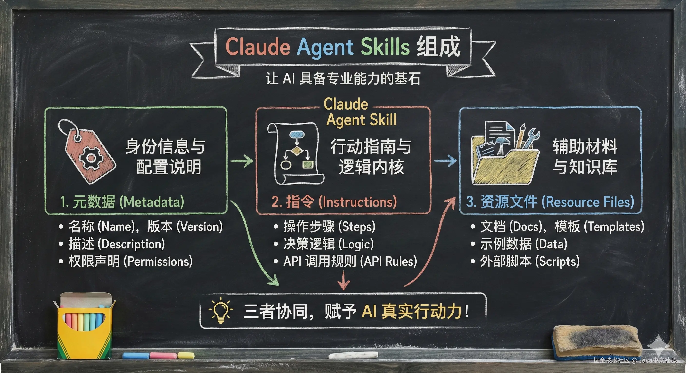
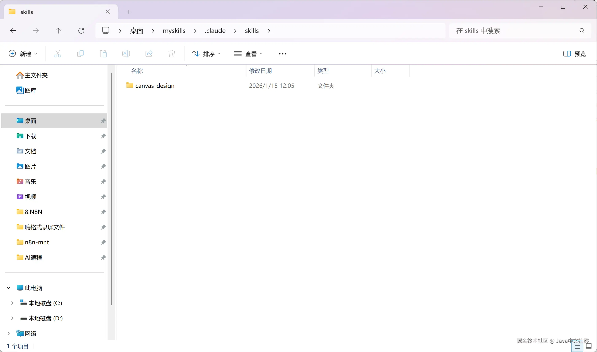
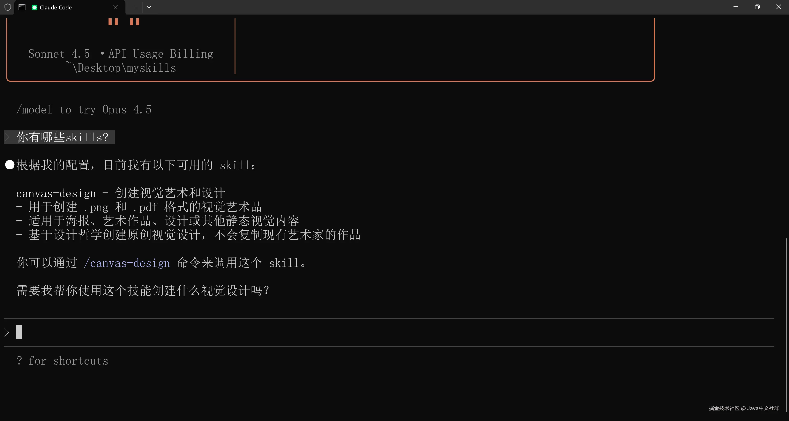
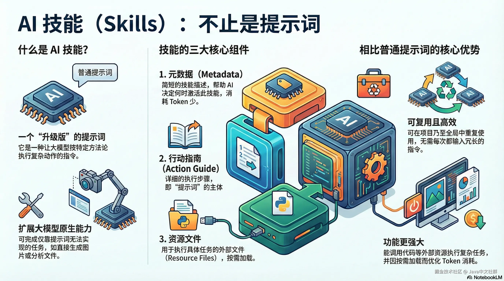

## 什么是Skills？
Skills翻译成中文就是技能

什么是技能，技能就是你执行某件事的方法论

:::tip
举个生活中的例子：我会打羽毛球。当球飞过来，我拿起球拍，在合适的时机、用合适的力度急求，让球准确落在对方场地，这一套操作逻辑，就叫做技能
:::
在AI界，Skills就是让大模型按照牟定特定的方法论去行动的机制

> 有人会说，这不就是提示词吗？

你可以把它理解为"超级进化版的提示词"，因为它比普通提示词强得多，通常由三部分组成

- 元数据(Metadata)：包含对这个技能的简短描述。它保存在全局上下文中，因为体积小，所以非常节省Token(省钱又省心)
- 行动指南(Action Guide): 这部分才是真正的提示词，规定了AI每一步该怎么做
- 资源文件(Resources): 这是最厉害的地方！它可能包含Python代码或其他执行程序，保证程序在调用skill时能完成复杂动作

## 举个例子：让AI突破次元壁
为什么说他是升级版

比如你问 DeepSeek 或者 Claude：“帮我画一张茶壶的海报。”

常规的大模型由于不具备绘图引擎，它顶多只能给你写一段描述图片的文字（Prompt），没法直接甩给你一张图片；

但有了skill之后，大模型就可以直接调用『绘图skill』。这个skill里面包含了绘图的python脚本，大模型在后台跑一下代码，啪的一声，海报图片就直接生成并保存到你的文件夹里了

**这就是Skills的魔力：让 AI 拥有了“手”和“工具”，不再只是“纸上谈兵”。**

## 实战上手：手把手教你配置skills
### 第一步：创建目录
在你的项目文件夹下，创建一个特定的目录结构 myskills/.claude/skills

> 注意：文件名必须严格遵守这个格式，建议使用英文路径，避免中文乱码报错

### 第二步：搬运『神仙技能』
现在网上有很多开源的skill项目(比如github上的优秀项目)。我们可以直接把别人写好的技能包(通常是一个文件夹，里面包含一个skill.md和一些脚本文件)下载下来，解压后直接粘贴到刚才创建的skills目录里。

### 第三部：启动与调用
- 打开命令行(CMD),进入你的项目目录
- 输入命令启动Claude
- 你可以问它： "你现在有哪些Skills?"

这时候AI就会扫描目录，告诉你："我已经加载了绘图技能、文件操作技能..."

## 效果展示：一句话生成海报
咱们测试一下。在命令行输入：
> "帮我制作一个茶壶的商品海报"

AI 会分析你的指令，发现需要调用 canvas（绘图设计）这个 Skill。它会询问你是否确认执行，你按下回车，后台的 Python 脚本就开始疯狂运转。

片刻之后，海报直接出现在你的文件夹里！甚至连设计理念、Markdown 说明文档都给你配齐了

## 为什么你一定要学会用Skills

相比于传统的满屏堆Prompt，Skills有两个无法拒绝的优势

- 全局通用，省时省力：你可以把Skill设置成项目级别或全局通用。不需要每次聊天都复制一大段长长的提示词，AI看到指令自动触发，非常丝滑
- 能力扩展，突破上限：很多复杂任务(如处理表格、批量重命名、自动化绘图)，光靠提示词是搞不定的。Skills允许加入代码附件，极大的扩展了AI的能力边界

**总结一下：Skill就是把"提示词" + 执行脚本 + 上下文优化 打包在一起的超级工具包**

[原文](https://juejin.cn/post/7595423767721164809?utm_source=gold_browser_extension)