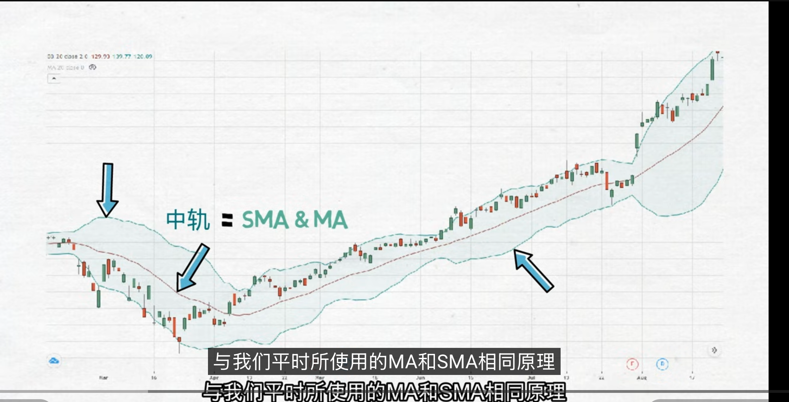
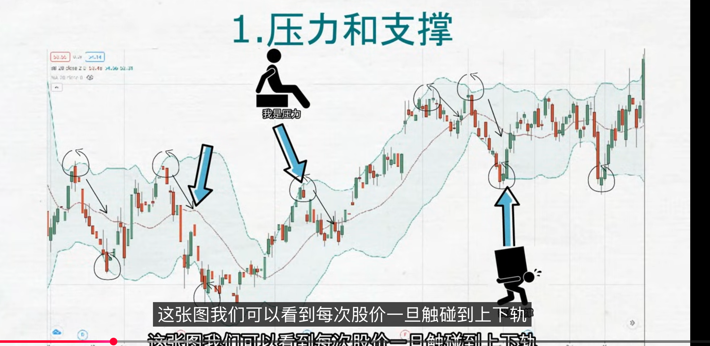
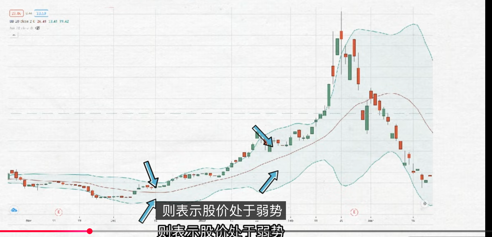
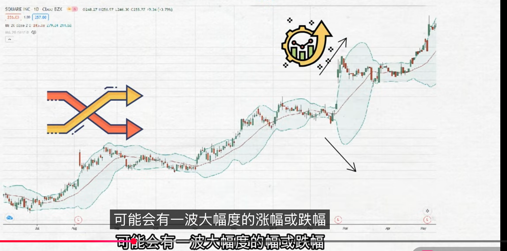
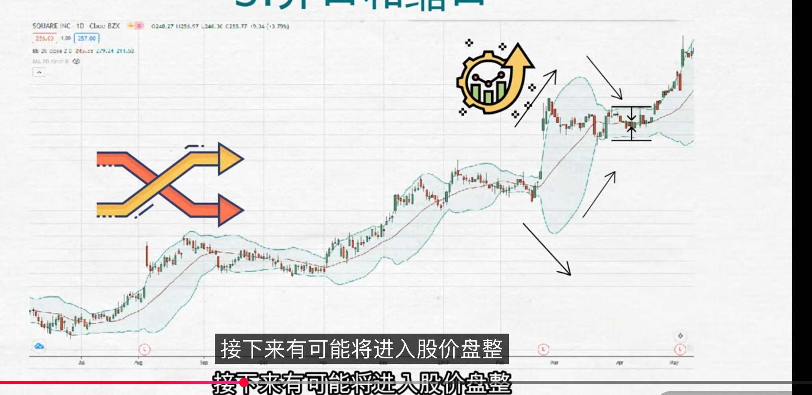
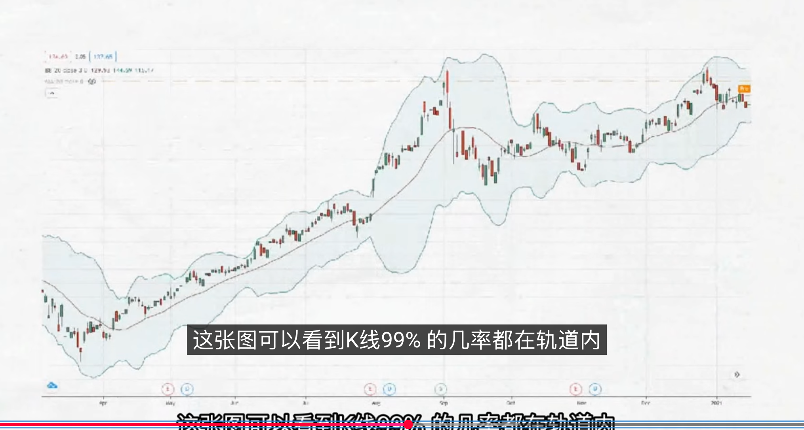
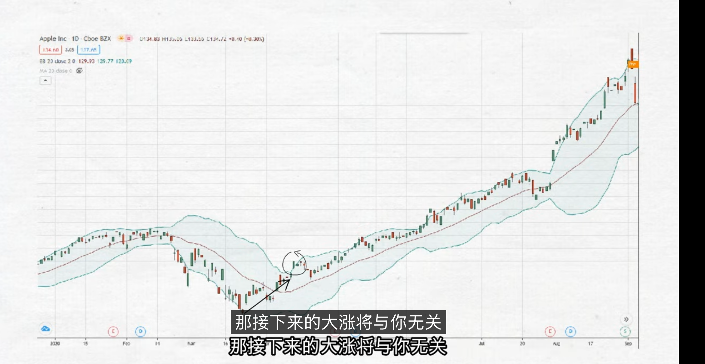
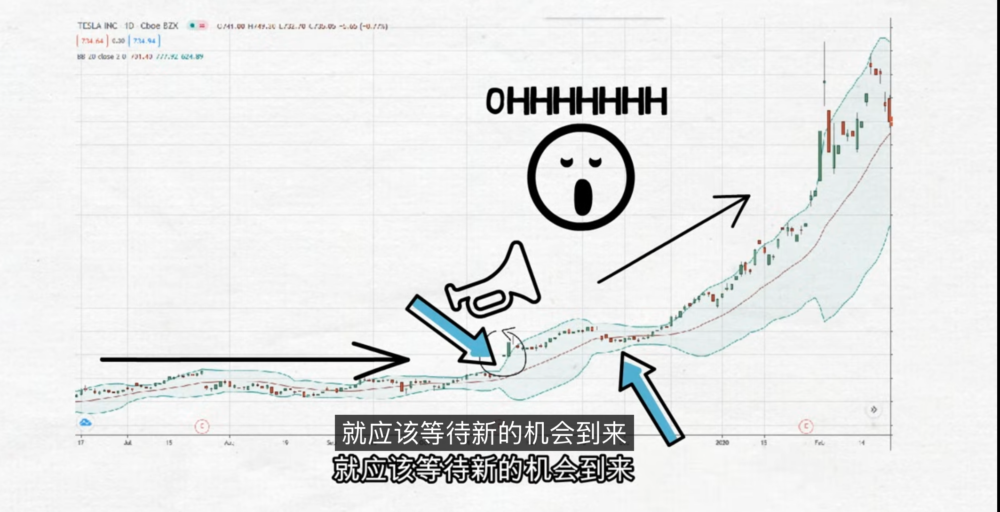
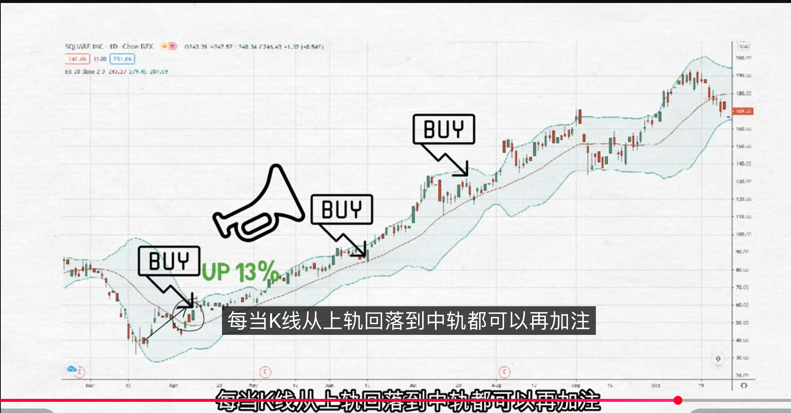
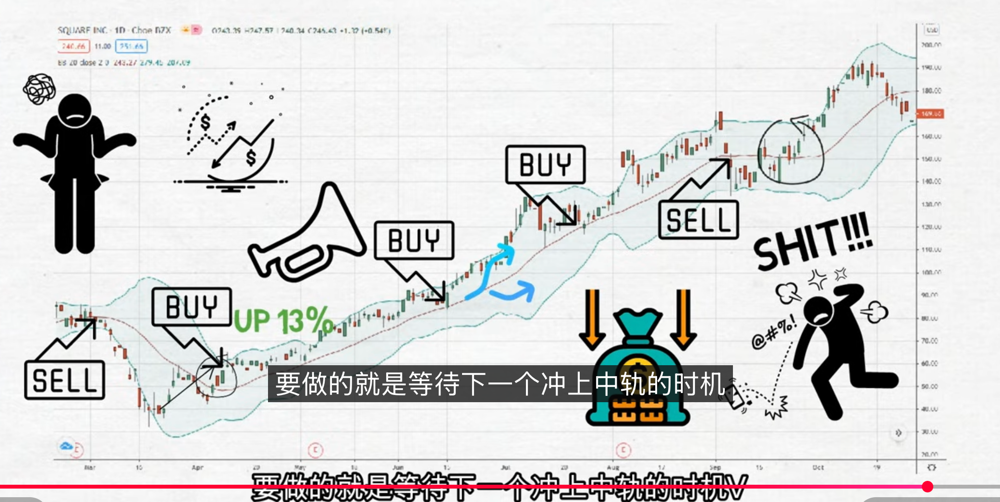

## 定义
布林线，也叫布林带，英文成为BOLL；布林线与MACD、RSI、KDJ等其他技术指标一样，是股市上技术分析常用工具之一；是美国经济学家约翰.布林格设计出来的一种技术分析指标；深受投资者喜爱，但布林线本身也有很大的盲点，如果错误使用的话，除了赚不到钱，还有可能导致亏损；

## 原理
布林线是由统计学原理中的标准差演变而来，从而了解股价波动走势；布林线主要有三条线组成；每条线具有不同的含义，通过了解判断分享寻找最好的交易时机

- 布林线的中轨其实就是我们所熟悉的移动平均线；就是将过去某个时间点的总和平均数，中轨平均线一般系统默认为20日月线

    

- 布林线的上轨和下轨就是中轨的两倍标准差，标准差其实就是一种概率的算法

由于标准差的关系，K先95%都会在布林线内运行；目前所有的主流软件已经帮我们计算布林线了，作为投资者我们只需要懂得如何驾驭布林线就可以了

## 使用
### 1. 压力和支撑
布林线有上轨、中轨、下轨；上轨用于压力，下轨用于支撑；

每当K线冲破压力或者支撑，短期内股价会有回弹；一旦突破上轨说明市场过热，价格已经超买，属于卖出信号；相反如果跌破下轨，说明价格已经超卖，属于买入信号

看起来很简单，但如果每次股价触碰到上轨就卖出的话，你将措施很多机会；稍后说到为什么

### 2. 股价强弱走势
布林线的中轨主要判断股价的强弱趋势，当股价在中轨和上轨之间，表示股价处于强势；相反如果股价处于中轨和下轨之间，则表示股价处于弱势；

当股价从下而上突破中轨的时候，说明股价从弱势到强势，属于买入信号；相反如果从强势到弱势，属于卖出信号；

### 3. 开口和缩口
这意味着股价波动幅度发生了变化，趋势走向可能发生了变化；
- 开口

    当布林线开始的时候，上轨先会向上移动，然后下轨会向下移动，最后中轨会向上移动；呈现一个喇叭的形态；表示股价波动幅度增大，可能会有一波大幅度的涨幅或跌幅
    
    

- 缩口

    缩口相反，当股价波动幅度缩小，布林线就会形成紧缩口状态，表示市场行情在压缩，接下来可能进入股价盘整
    
    

## 问题
布林线本身就是从均线演变而来，移动平均线就是使用过往的数据来解释今天的结果；很明显移动平均线只能够给你知道钱的股价的平均结果，而不能预测未来股价走势

布林线因为标准差的关系，上轨就是加2倍的标准差，下轨就是减2倍的标准差；所以K先才有95%都会在布林线内运行；

如果我们把标准差提到到3倍有什么情况，可以看到K先99%的几率都在布林线内运行；没有一个K先能够轻易摆脱布林轨道；不是因为布林线神准，而是因为布林线的定义，标准差的关系，导致布林线的上轨和下轨距离中轨的距离变大，导致K先99%的几率都在布林线内运行；

之前说一旦股价触碰到上轨或者下轨，表示市场超买或超买；这虽然说不是错误用法，但是有时候恰恰相反，如果我们跟着传统用法，会错过很多机会

苹果大跌反弹，如果使用布林线，觉得市场过热把手头的股票都跑完，那么后续大涨与你无关

深入想看，市场就是因为狂热，大量资金拥入，才有如此大的涨幅，这时候做的就是追高。所以布林线的超买和超卖并不太逻辑

**布林线的精髓就是开口和缩口**

## 个人布林线使用经验
- 使用布林线找买点

    简单来说就是K线从下轨穿出中轨就是第一个买点

    

- 使用布林线找卖点

    一旦跌破中轨就考考减仓获利

    

> 不是任何时候都可以交易，股票不活跃的时候，没有一个明显的趋势，这时候就需要布林线帮助；当布林线逐渐收缩，股价波动幅度正在缩小，其中的特点就是通道变得特别细，行情进入了盘整状态，k先也在中轨不停穿插，就很难做交易

润禾材料 奥比中光 南华期货