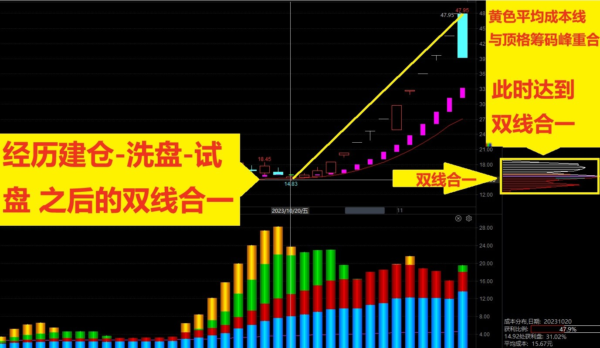
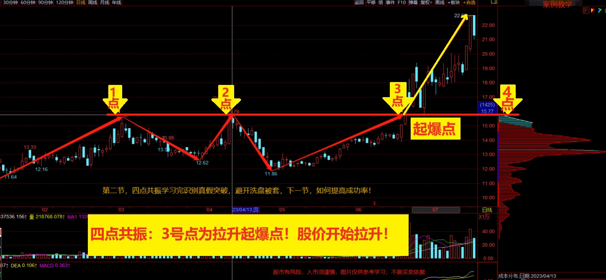

## 双线合一

双线合一是为了确定主力高度控盘的成本区间。市场上的个股大致分为主力高度控盘的个股和主力为控盘的个股；**只有主力高度控盘的个股才是我们的上上只选，因为只有他们才有可能大涨**

筹码分布是所有投资者持股成本的核心，这里的投资者包括机构、主力、游资、散户等所有参与股票的投资者

投资者持股成本中最核心的是主力成本，**双线合一就是主力成本和所有投资者平均持股成本完全相同或基本相同的时候**

**狭义的双线合一指的是散户的成本线(金黄色成本线)和主力成本线(紫色定格筹码)完全重合**

广义的双线合一只要求平均成本线在顶格筹码在一个筹码峰之内即可。

## 四点共振 

四点共振是精准阻击主力拉升的起爆点，解决我们的买点问题。四点共振分别是以下四点

- 前期的高点
- 主力试盘的高点
- 股价再次突破压力线的点位
- 筹码峰的高点

四点共振的含义：主力准备拉伸一只股票钱，一般都会把上方的套牢盘给洗干净。因为主力不会为普通投资者抬轿子

## 锁仓和破仓
锁仓和破仓是一个非常重要的功能，俗话说会买的不是师傅，会卖的才是师傅，锁仓破仓可以来提高我们交易的成功率，**其背逻辑前面我们说到了主力下本做多的地方一定是顶格筹码的地方，主力想要拉升，一般都会把上方套牢盘和下方获利盘的筹码都洗到自己的手中，才会考虑拉升**；

为什么顶格筹码峰是主力的筹码：因为散户不可能把这么多的筹码聚集在一起，那么当主力建仓洗盘的时候，下方的顶格筹码峰是一直在变动的，代表着主力在吸筹！

如果行情在走动的时候，下方的筹码和顶格筹码没有动那就说明是锁仓的状态，说明可以继续持有；如果下方筹码发生了松动，说明是破仓了，此时我们就需要注意要不要走了