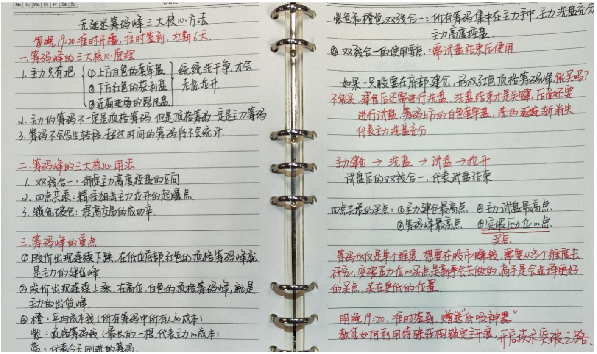
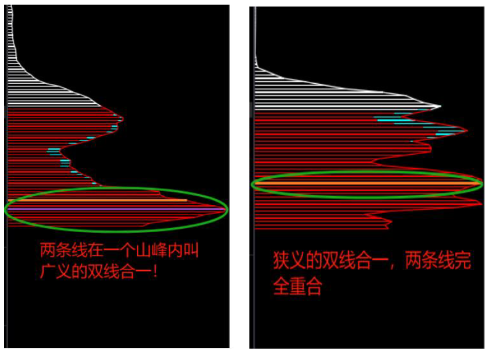
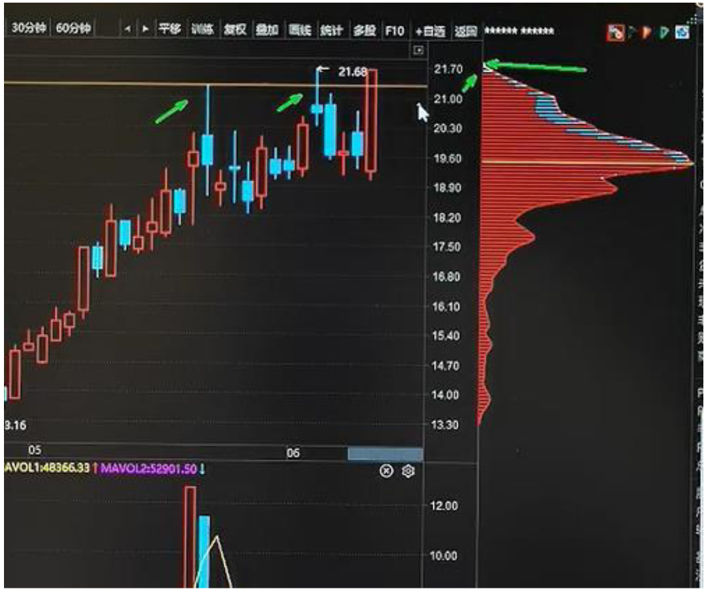
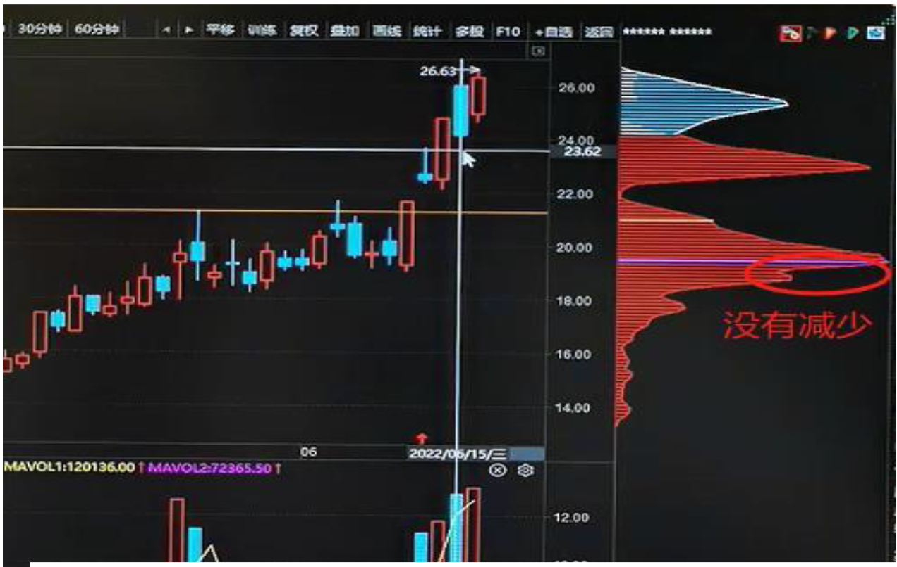
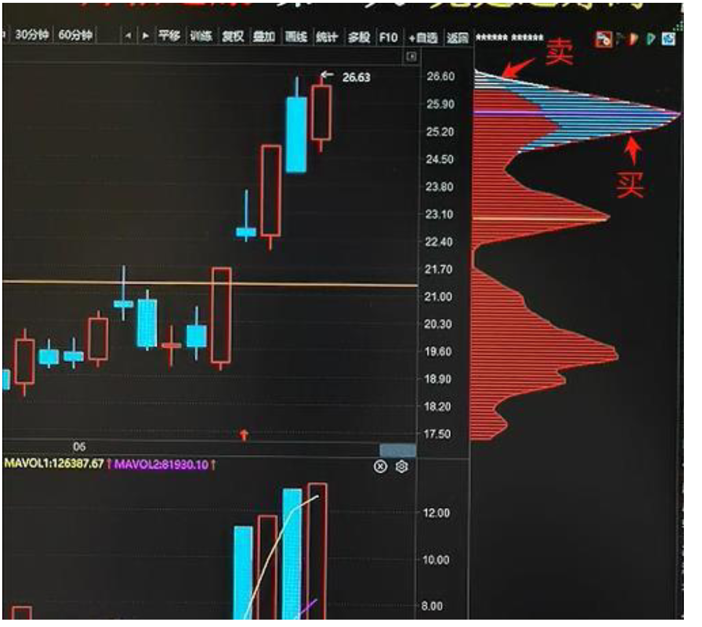
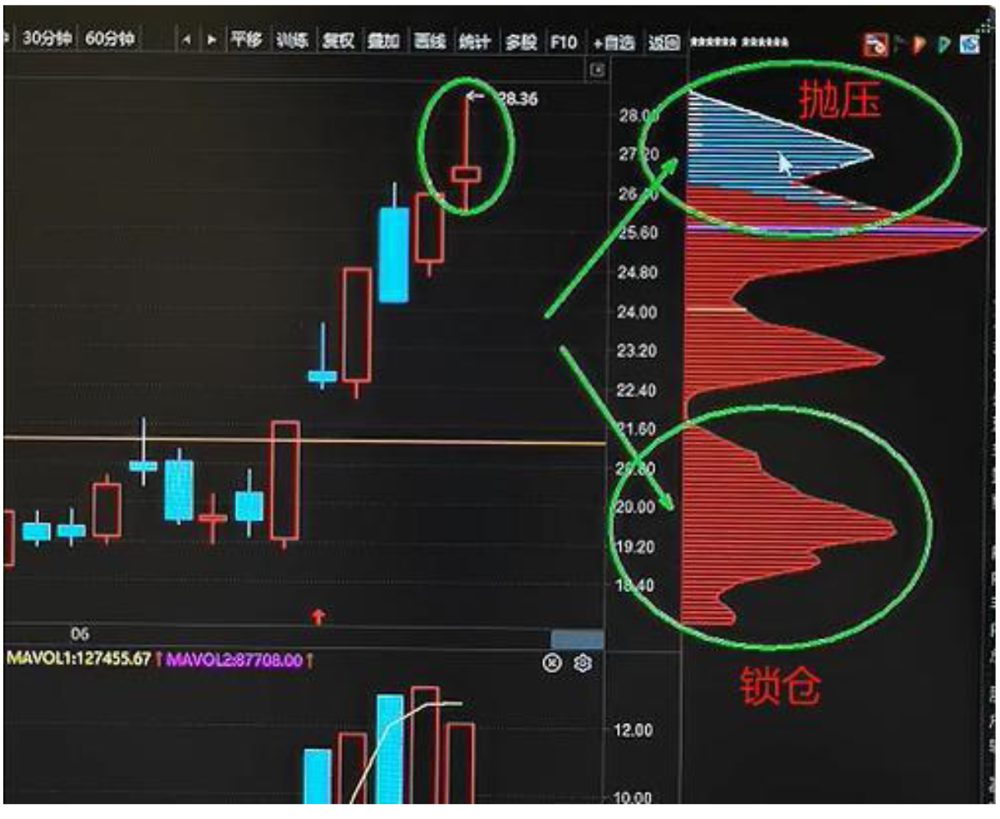
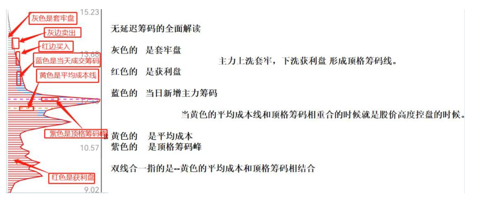
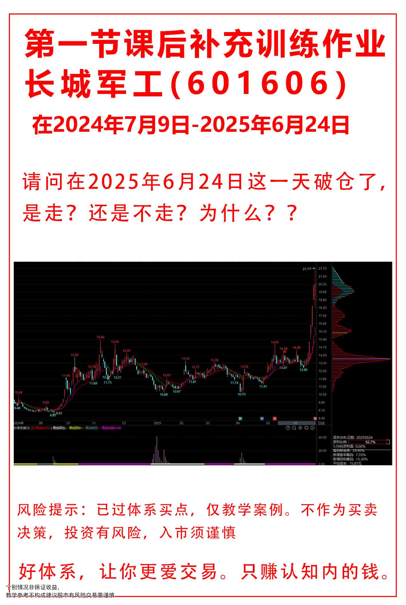

口诀：**锁仓看抛压，破仓看承接**

如果买入筹码大于卖出筹码的两倍以上 就说明有明显的承接

如果卖出筹码大于买入筹码的两倍以上 就说明有明显的抛压

跟换主力建仓 -》 洗盘 -》双线合一 -》 试盘 -》双线合一-》四点共振 是否突破 突破买入

## 筹码峰
筹码峰的核心作用方法只有三个：第一个叫双线合一，第二个叫四点共振，第三个叫锁仓破仓

- 主力建仓--下跌之后的地位建仓

### 双线合一的时候能不能去买呢？
双线合一只能代表主力洗盘充分，高度控盘，但是主力洗盘结束之后还有一件重要的事情就是试盘，试盘是主力拉升之前必须做的一件事情！ 所以主力减仓峰是不做票的，其背后逻辑是在试盘钱会有一个洗盘动作，洗盘之后在试盘！

:::tip
双线合一:双线合一代表的是主力高度控盘，那么主力高度控盘它肯定是一个区间，它不可能是某一天，也就是主力肯定是在一段时间之内，它其实都是高度控盘的!所以双线合一分为两种:一种是狭义的双线合一(就是两条线完全重合)，一种是广义的双线合一(在一个筹码山峰之内)
:::

双线合一的使用要点只有一个:双线合-一定要在主力试盘之后去使用，主力试盘之前的双线合一不能买;主力试盘之后的双线合一才是买点!

**主力的建仓最高点，试盘的最高点，筹码峰的最高点，买点，这四个点几乎在一条水平线(压力线)上，就是四点共振，其中码峰的高点也是至关重要的，筹码峰的高点必须在压力线的附近，说明上方已经没有什么套牢盘了，股价突破压力线就是买点!**

## 锁仓破仓
锁仓破仓:股价在上涨的过程中，如果下方红色的顶格攀码峰没有减少，那就说明主力是一个锁仓的状态,反之减少,就是主力处于破仓,箭要注意风险了

口诀：锁仓看抛压，破仓看承接

蓝色的筹码代表当天成交的筹码，是真正的无延迟码，在蓝色筹码上面有两个边框颜色，有红色和白色，红色代表买盘，白色代表卖盘!

买入筹码比卖出筹码大两倍以上，那就说明今天有承接，反之卖出的筹码比买入的筹码大两倍以上，说明今天有抛压!定要有两倍以及两倍以上!

- 思考：破仓为什么要看承接呢？

    因为下方筹码破仓，说明主力在出货，上方承接说明有新主力在进，说明这只股票在换庄。原本破仓是要走的，如果下方破仓上方有承接，是不箭要走掉的!

    

    :::tip
    思考:锁仓抛压，下方的顶格筹码峰没有动主力没有出货，上方的抛压筹码哪里来的?散户是很难抛压的，散户也不会无缘无故卖掉自己的股票所以上方抛压的位置很有可能是主力在偷偷的出货，所以锁仓看抛压!抛压过大就要注意出货!
    :::

## 作业

B 抛压没有那么重