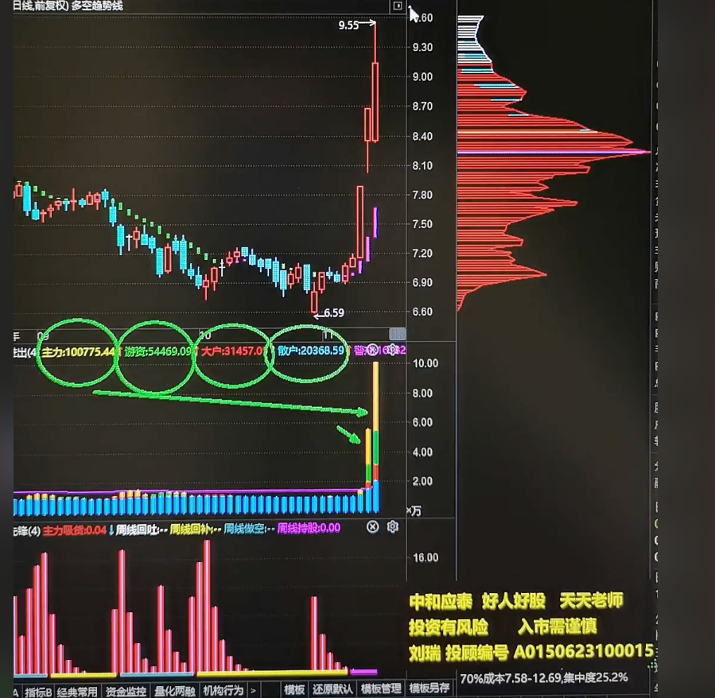
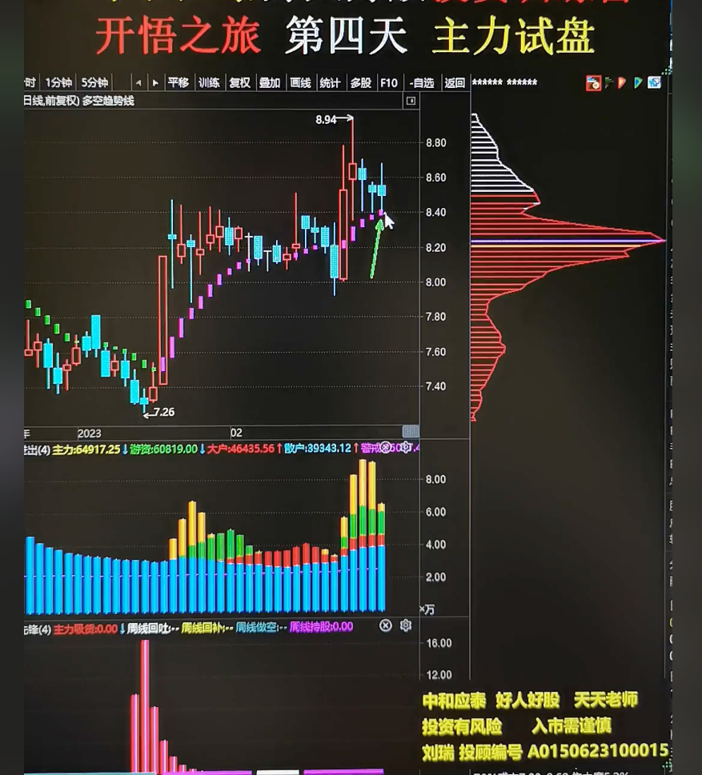
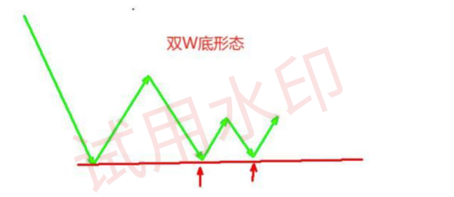
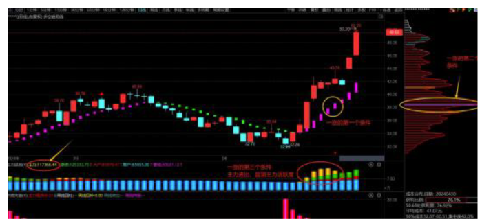
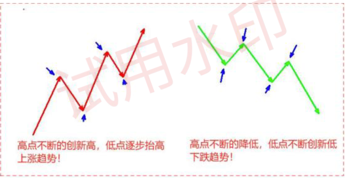
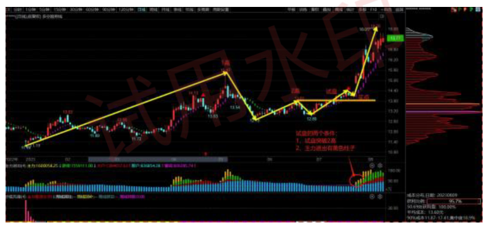

:::tip
趋势定义
上涨趋势，--高点不断创高新高，低点不断创造新高

下跌趋势，--低点不断创新低，高点不断创造新低

所以只有试盘突破二高才能考虑下跌趋势扭转
:::

一涨条件，新增一个条件，主力资金进场
    - 第一个条件，建仓--出现红色顶格筹码峰
    - 第二个条件多空趋势线，绿色变成紫色(变成上涨趋势)
    - 主力资金进场

- 二回
    - 不能跌破一涨的最低点
    - 必须有个N字结构(下上下)

- 主力试盘--突破二高
    - 有主力资金进场
    - 突破二高
- 黄金坑
    - 达到趋势线附近
    - 双线合一

    

:::tip
分析下A股股票中，出现一个上涨的趋势(条件一、出现红色顶格筹码峰，条件二、多空趋势线，绿色变成紫色、条件三、主力资金进场)；然后出现一个二回(
条件一、股价不能跌破一涨的最低点，条件二、必须有个N字结构(下上下))，等股价突破二高N字结构中下上下中的高点，等后续回踩洗盘黄金坑(条件一、达到趋势线附近，条件二、双线合一)就是买点；
根据以上条件帮我挑选下股票

看涨停板然后确认是否主力在试盘(短则两三天)
:::

## 问题

思考：上图双W底可以买吗？

**为什么不能抄底的原因**：底层逻辑是你永远不知道左侧下跌最红的底部位置在哪里，下跌还要多久止跌我们不知道，如果抄底很容易被洗出，所以永不抄底

**为什么第一波上涨不能做**：因为成功率真的很低，因为第一波上涨是主力建仓，你想赚主力的钱真是一个很难的事情，哪怕你知道前面是一个底部区间，但是你不知道在哪里去买

**抄底先锋**：一波大跌出现抄底先锋，说明这个票已经出现了严重的超跌，抄底先锋的数量越多，颜色越深表示下跌的越充分

**一涨的两个条件**：1. 股价上涨中出现顶格筹码；2.多空趋势线由绿色转为紫色，由下降趋势转为上涨趋势；3.主力进出要有黄色柱子(主力进入，新增维度)

什么样的一涨能够扭转前面的整个下跌趋势呢，那就是有主力资金进场的一涨，通过主力进出这个指标，只要在一波上涨中有出现黄色柱子，代表有主力资金进场

**二回的两个要求**： 1. 回调不能跌破一涨的起涨点；2. 回调要出现N字型

## 如何看趋势
- 上涨趋势，高点在不断的创新高，低点逐步的抬高
- 下跌趋势，高点在不断地降低，低点不断地再创新低

如果试盘没有突破2高，说明下跌趋势还在延续，这就是为什么试盘一定要突破2高的核心原因，因为只有突破了2高，下跌趋势才真正意义上的发生了扭转！

## 试盘的两个条件
- 一定要有主力资金进场，主力进出指标要出现黄色柱子
- 必须要突破2高，不突破2高表示试盘失败

