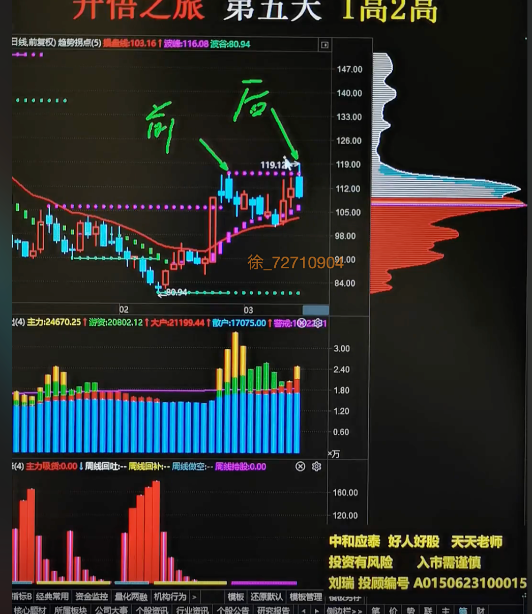
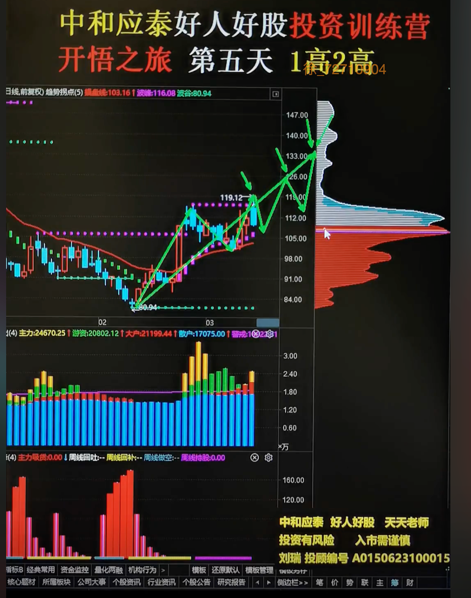
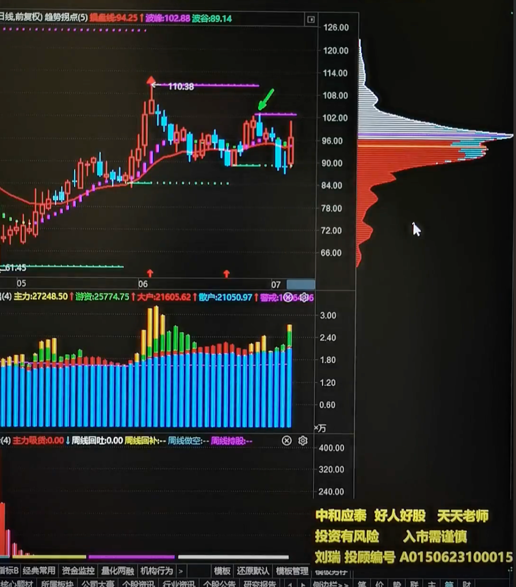
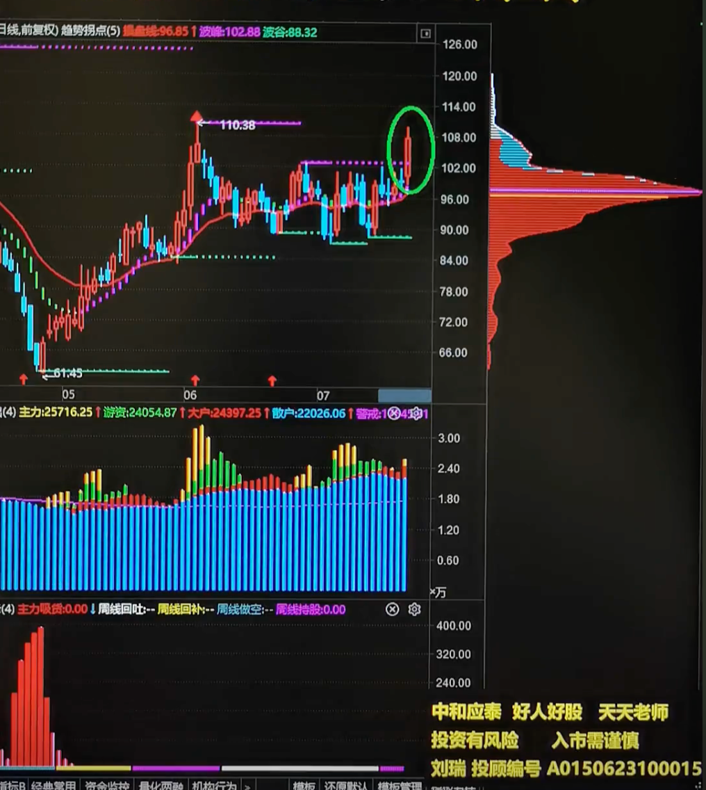
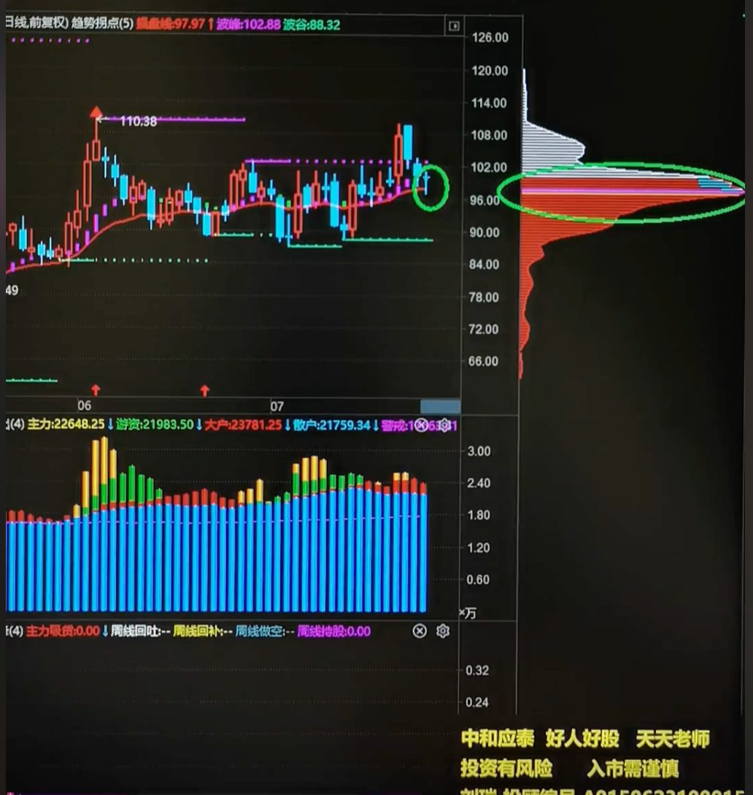
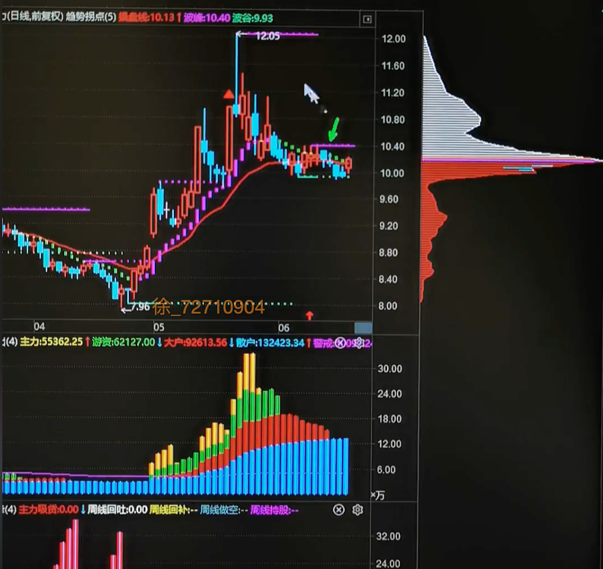
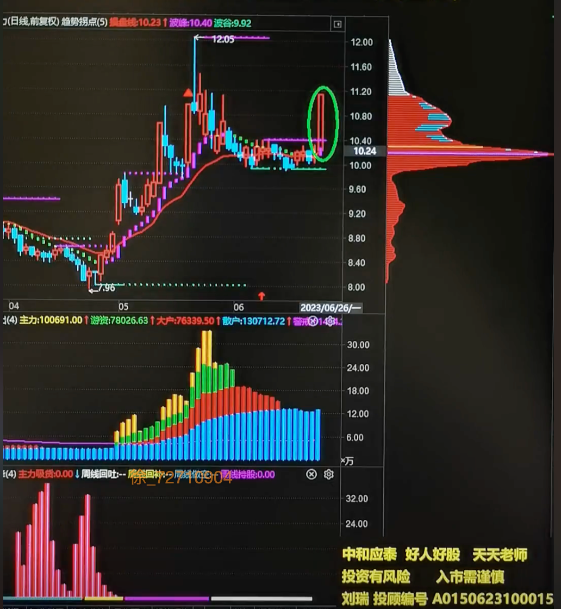
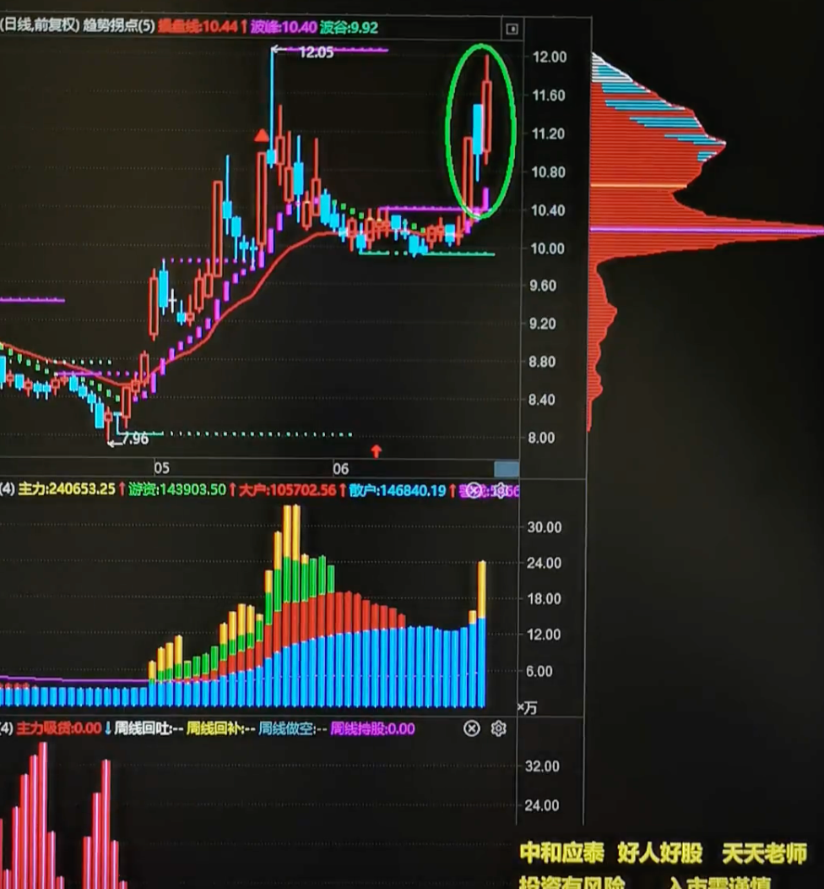
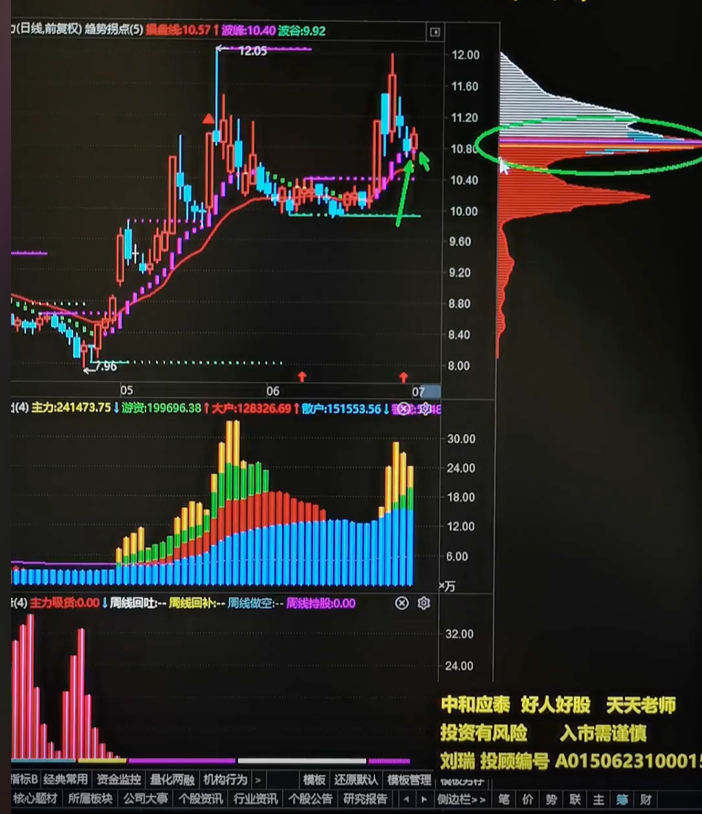
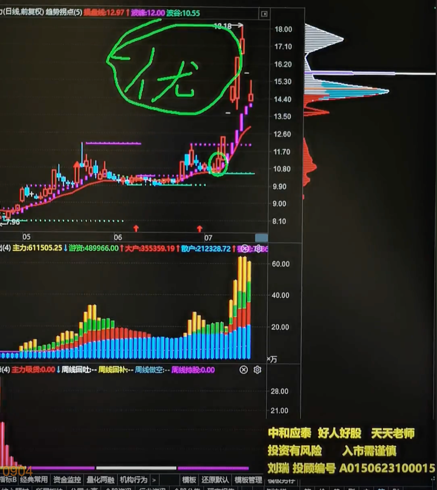

龙头--领涨的是龙头
:::tip
大跌--出现抄底先锋(就是有主力资金流出的大跌),最好从前面最高点下跌50%
一涨---1. 出现红色顶格筹码峰 2. 多空趋势线绿->红(跌到涨) 3. 主力资金流入--黄色柱子(主力资金流入信号)；最好涨幅在2倍以内，且最好有涨停板
二回-- 1. 不能跌破一涨的最低点，且二回中高点不能高于一涨的最高点 2. 出现下上下N字结构
试盘-- 1. 主力试盘突破二高 2，主力资金流入信号--黄色柱子；突破二高的上涨中最好有涨停板
买点(黄金坑)-- 1.回踩紫色多空趋势线 2. 筹码峰双线合一
优先考虑龙头股
:::

趋势拐点指标

连续下跌之后的反弹--深海鱼钩
## demo1
### 一高确认

后面的为一高

一高为上涨的最高点

### 二高确认
出现紫色多空趋势高点线--**二高一定一高要低，不然就是新的一高**

### 试盘
1. 主力试盘突破二高 2，主力资金流入信号--黄色柱子

### 买点

## demo2
### 一高二高确认

### 突破二高
1. 主力试盘突破二高 2，主力资金流入信号--黄色柱子

没有主力黄色柱子 ---只能说明主力咩有用大资金就拉涨停了，说明市场比较强

所以在试盘中 之后面一两天主力进入也可以算是满足要求

### 买点

