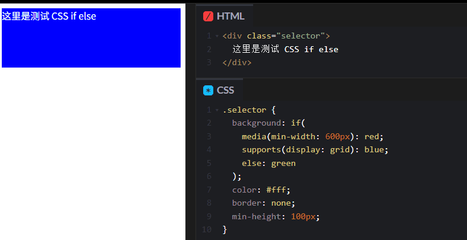

从Chrome137开始，CSS引入了一个全新函数--if()，让我们可以在样式里写if/else逻辑了

## 为什么会关注CSS if/else
在平时开发中，我们经常会根据不同条件切换样式，比如响应时布局、特性检测、主体切换等。传统CSS的做法通常是使用媒体查询
```css
@media (orientation:landscape) {
    .card { flex-direction: row; }
}

@media (orientation: portrait) {
    .card { flex-direction: column; }
}
```
这样大量的媒体查询分散在不同地方，维护起来比较麻烦，很多时候逻辑和样式分离，阅读和修改也不直观

## 什么是if()
### 基本语法
CSS if()函数的运作方式是使用一系列条件--值对，其结构如下所示
```css
property: if(
    condition-1, value-1,
    condition-2, value-2,
    /**.... */
    condition-n, value-n
)
```
- 每个条件后面跟一个冒号和对应的样式值
- else是可选的，表示默认值

### 支持三种条件
- media(): 媒体查询(如屏幕尺寸、方向等)
- supports():特性检测(浏览器是否支持某个CSS功能)
- style(): 样式值判断(通常配合CSS变量，用于状态切换)

### 举个例子
```css
.selector {
    background: if(
        media(min-width: 600px): red;
        supports(display: grid): blue;
        else: green
    );
}
```
- 浏览器会先判断 media(min-width: 600px)，如果成立就用red，后面条件不在判断
- 如果第一个不成立，在判断 supports(display:grid)，成立就用blue
- 如果都不成立，才用else的green。

> 也就是说，如果有多个条件同时成立，只有排在最前面的那个会生效

上述代码会以媒体查询产生相同的结果

```css
/**1. 先判断 min-width:600px */
@media(min-width: 600px) {
    .selector {
        background: red;
    }
}
/**2. 如果不满足 min-width:600px,在判断是否支持display:grid*/
@media all and (min-width:600px) {
@supports(display: grid) {
    .selector {
        background: blue;
    }
}
}

/**3. 如果都不满足，使用默认值 */
@media all and (min-width: 600px) {
    @supportsnot(display: grid) {
        .selector {
            background: green;
        }
    }
}
```



## 使用场景
除了上面举例的内联媒体查询场景可以使用外，CSS的if()函数还在内联兼容查询和基于状态样式设置场景中非常受用

### 内联兼容查询
是否支持 :has选择器
```css
.card {
    outline: if(
        supports(selector(:has(*))):
            2px solid red;
        else:
            1px solid #ccc
        )
}
```
css 功能的不断增强，很多新特性(如has()、subgrid等)虽然强大，但并不是所有浏览器都已全面支持。这时候我们可以使用if()函数配合 supports()，按需提供降级样式，即兼容老浏览器，又能充分发挥新特性的能力

### 基于状态样式设置
```html
<div class="card" data-status="complete">
    ...
</div>
```
```css
.card {
  --status: attr(data-status type(<custom-ident>));
  border-color: if(
                style(--status: pending): royalblue;
                style(--status: complete): seagreen;
                else: gray);
  background-color: if(
                style(--status: pending): #eff7fa;
                style(--status: complete): #f6fff6;
                else: #f7f7f7);
}
```
尝尝需要根据元素的业务状态(如"待处理"等)来动态调整样式。以前需要借助JS动态加class，或者用多个CSS类去维护。现在借助if()函数和css变量，我们可以只通过一个属性里啊控制全部状态样式--更优雅和灵活

## 兼容性
目前，if() 只在最新版的 Chrome 137+、Edge 137+ 支持，Safari、Firefox 等 还不行。

### 建议：
- 生成环境慎用，或加好降级方案
- 可以在实验性项目、内部工具尝鲜使用