[原文](https://blog.csdn.net/qq_39235055/article/details/111995373)

## 什么是Electron
### 介绍
- 使用Javascript、HTML、CSS等技术开发跨平台(Windows、Linux、MacOS)桌面应用--这是Electron的官网简介
- 最初被Github开发，2013年4月11日以Atom Shell为名起步，2014年5月16日开源，2015年4月17日改名为Electron。

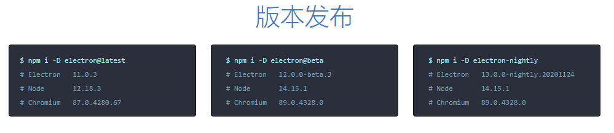

### 组成

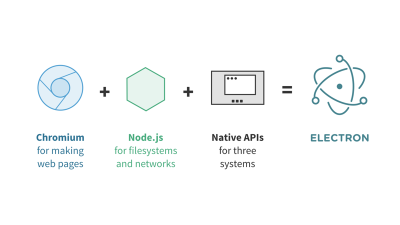

- Chromium: 为Electron提供了强大的UI能力，可以不考虑兼容性的情况下，利用强大的Web生态来开发界面。(本质上就是Chromium--chrome开源版本)浏览器，有最新的东西都会在Chromium中更新，所以electron可以体验最新的api，这有是好处之一

    Chromium 多进程架构图
    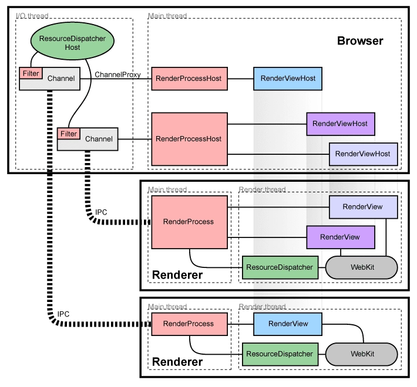

    简单描述下。

    主进程中的RenderProcessHost和render进程中的RenderProcess是用来处理进程间通信的(IPC -- Inter-Process Communication进程间通信)

    Render进程中的RenderView内容基于 WebKit(浏览器引擎)排版展示出来

    Render进程中ResourceDispatcher是用来处理资源请求的。Render进程中如果有请求则创建一个请求ID，转发到IPC，由Browser进程中处理后返回

    Chromium是多进程架构，包括一个主进程，多个渲染进程

- Node.js：让Electron有了底层的操作能力，比如文件的读写，甚至是集成C++等等操作,并可以使用大量开源的npm包来完成开发需求
- Native API: Native API让Electron有了跨平台和桌面端的原生能力，比如说它有统一的原生界面、托盘、消息通知这些

通过三者巧妙组合，我们开发应用变得十分高效

### Electron架构
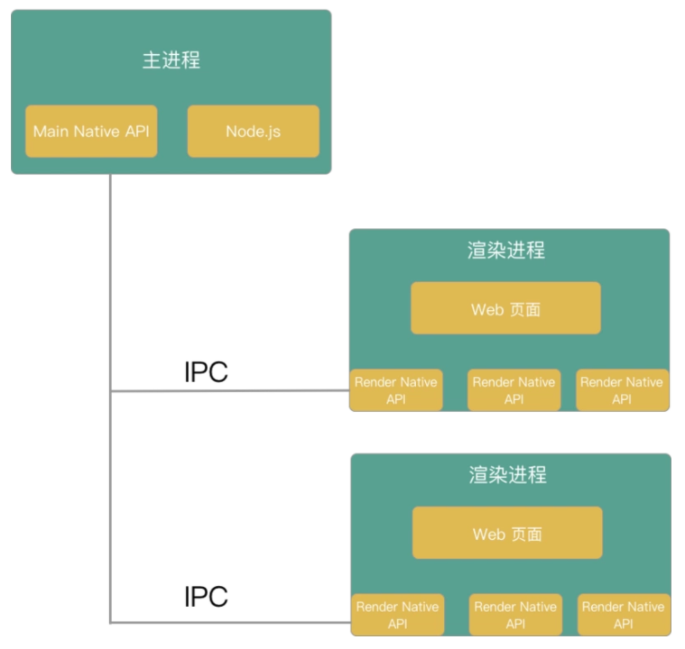

Electron 架构和 Chromium 架构类似，也是具有1个主进程和多个渲染进程。但是也有区别
- 在各个进行中暴露了Native API，提供了 Native 能力
- 引入了Node.js，所以可以使用Node能力
- 但是渲染进程使用node需要配置，下文会有所提到

:::tip
可以简单的理解为Electron为web项目套上了Nodejs环境的壳，使得我们可以调用Node.js丰富的API。这样我们可以用Javascript来写桌面应用，拓展很多我们在web端不能做的事情
:::

### 示意图

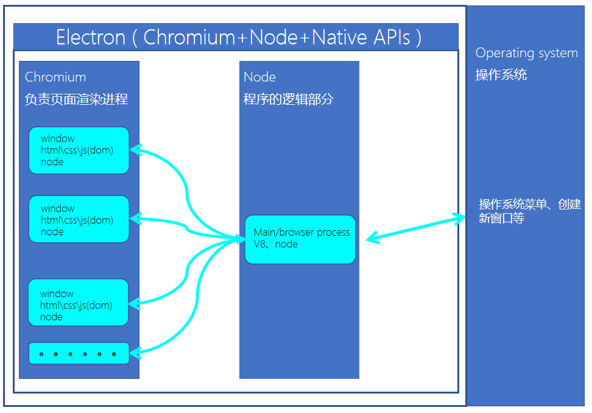

## Electron 进程
Electron核心我们分成2个部分，主进程和渲染进程

### 主进程

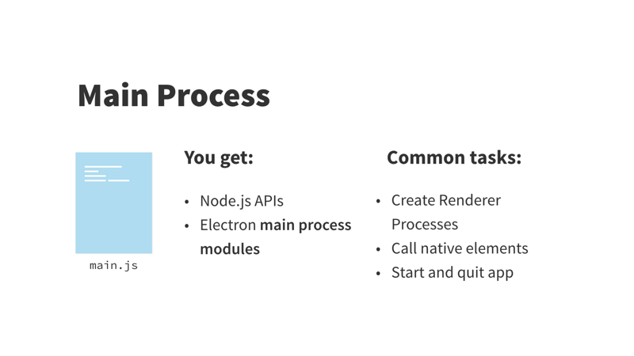

Electron 运行 package.json的main脚本的进程被称为主进程(只有一个)

主进程特点
- 主进程连接着操作系统和渲染进程，可以把她看做页面和计算机沟通的桥梁
- 进程间通信、窗口提醒
- 全局通用服务
- 一些只能或适合在主进程做的事情。例如浏览器下载、全局快捷键处理、托盘、session。
- 维护一些必要的全局状态

### 渲染进程
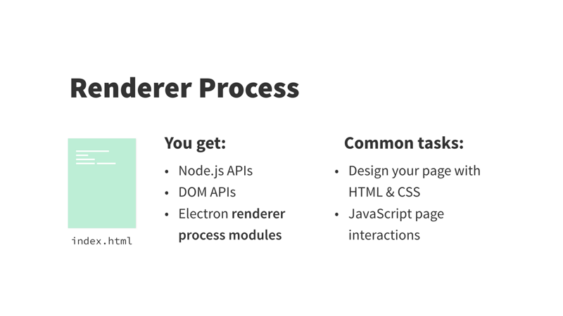

渲染进程就是我们所熟悉前端环境了。只是载体改变了，从浏览器变成了window。

> 出于安全考虑，渲染进程是不能直接访问本地资源的。因此都需要在主进程完成。

渲染进程特点
- Electron 使用了 Chromium 来展示web页面，所以 Chromium 的多进程架构也被使用到
- 每个web页面运行在它自己的渲染渲染进程中。每个渲染进程都是相互独立的，并且只关心他们自己的网页。
- 使用 BrowserWindow 类开启一个渲染进程并将这个实例运行在该进程中，当一个 BrowserWindow 实例被销毁后，相应的渲染进程也会被终止
- 渲染进程中不能调用原生资源，但是渲染进程中同样包含Node.js环境，所以可以引入Node.js

### 主进程与渲染进程的区别
- 主进程使用 BrowserWindow 实例创建网页
- 每个 BrowserWindow 实例都在自己的渲染进程里运行着一个网页。当一个 browserWindow 实例被销毁后，相应的渲染进程也会被终止
- 主进程管理所有页面与之对应的渲染进程
- 由于在网页里管理原生GUI资源是非常危险而且容易造成资源泄露，所以在网页调用GUI相关APIs是不被允许的。如果理想在网页里使用GUI操作，其对应的渲染进程必须与主进程进行通讯，请求主进程进行相关的GUI操作

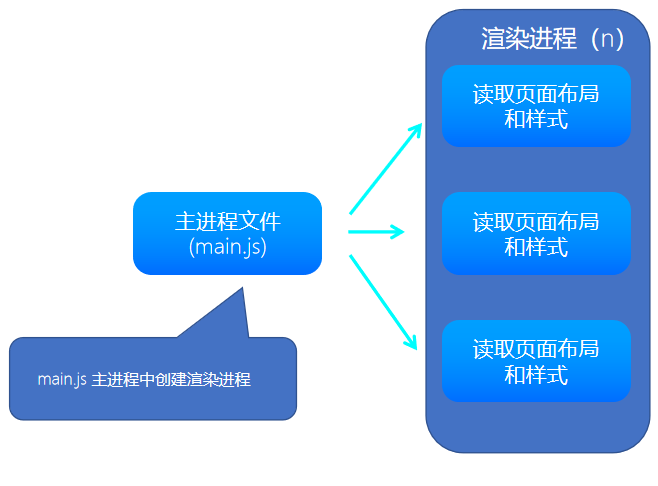

### 把它们想象成这样
Chrome(或其他浏览器)的每个标签页(tab)，就好比Electron中的一个单独渲染进程。即使关闭所有标签页，Chrome依然存在。这好比Electron的主进程，能打开新的窗口或关闭整个应用

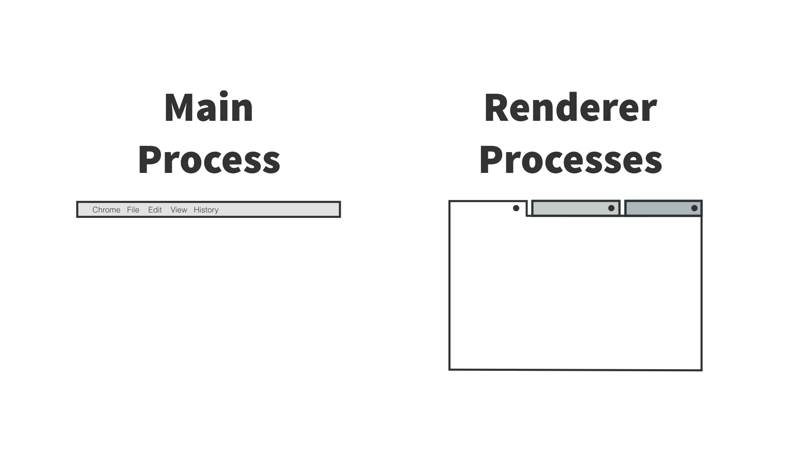

## Electron 优缺点
### 优点
- 上手简单--HTML、CSS、JS、Node、npm包、UI框架，方便高效，能很轻松的实现很好看的UI
- 多端运行- 快速构建跨平台(Windows、Linux、MacOS)桌面应用
- 开发时间短--相对其他跨平台方案，更稳定，bug少，毕竟之哟啊浏览器外壳跑起来就可以了，当然坑也不少的
- 再不用兼容多浏览器-- 只针对谷歌，弹药兼容mac、linux

### 缺点
- 安装包体积略大(打包了Chromium)至少包含了一个浏览器的体积，没装一个app就相当于装了一chrome
- 性能不如原生应用，mac下丝滑一些，window就有点掉帧
- 卡、启动慢、新开一个进程，起步价价就是一个nodejs的内存开销
- loadURL加载远程页面白屏时间长，优化可采用vscode骨架屏

## 有哪些著名应用是用Electron开发

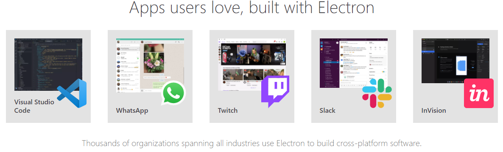

Postman、uTools、Typora、Atom、Brave浏览器 ......... 成千上万

## Hello world
### 创建项目
最简单的目录
```
├── package.json
├── main.js
└── index.html
```
生成package.json文件并修改 npm init
```js
{
  "name": "electron-app",
  "version": "1.0.0",
  "main": "main.js",
  "scripts": {
    "start": "electron ."
  },
  "devDependencies": {
    "electron": "^10.1.5"
}
```

> 注意：控制台中文乱码可以使用

```shell
"start": "chcp 65001 && electron ."
// utf8的值是65001
```

安装 Electron
```shell
npm install electron --save-dev
// npm 安装会十分的慢，甚至是失败，可以先使用cnpm 淘宝镜像去下载，速度快
```

创建main.js文件

```js
const { app, BrowserWindow } = require('electron');

let mainWindow = null;
app.on('ready', () => {
    mainWindow = new BrowserWindow({
        width: 500, 
        height: 300,
        webPreferences: {
            nodeIntegration: true // 设置为true就可以在这渲染进程中调用Node.js
        }
    });

    mainWindow.loadFile('index.html'); // 加载本地文件
    // mainWindow.loadUrl()    

    mainWindow.webContents.openDevTools({ mode: 'bottom' });  // 控制台开关

    mainWindow.on('close', e => {
        // 在窗口要关闭的时候触发
        e.preventDefault(); // 避免进程以为关闭导致进程销毁
    })

    mainWindow.on('closed', () => {
        // 当窗口已经关闭的时候触发
    })
})
```
app模块是为了控制整个应用的生命周期设计的： BrowserWindow参数：[BrowserWindow | Electron中文文档](https://wizardforcel.gitbooks.io/electron-doc/content/api/browser-window.html)

创建index.html文件
```html
<!DOCTYPE html>
<html lang="en">
<head>
    <meta charset="UTF-8">
    <meta name="viewport" content="width=device-width, initial-scale=1.0">
    <title>Hello World!</title>
</head>
<body>
    <h1>Hello World!</h1>
</body>
</html>
```
启动项目
```shell
electron .
```


运行过程

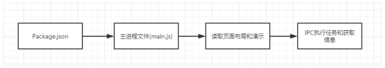

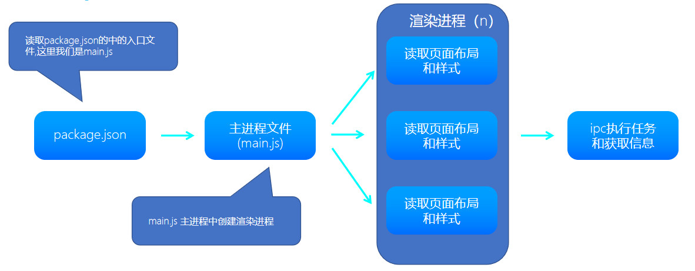

也许你现在还不能理解这个流程，但是你需要记住这个流程，只有我们记住这个流程后，在以后程序出现问题时，才可以很快的定位问题

### 自定义菜单
使用到的模块

- Menu模块
    
    menu类可以用来创建原生菜单，它可用作菜单和[context菜单](https://developer.mozilla.org/en-US/docs/Mozilla/Tech/XUL/PopupGuide/ContextMenus)，这个模块是一个主进程的模块，并且可以通过remote模块给渲染进程调用，每个菜单有一个或几个菜单项[menu items](https://wizardforcel.gitbooks.io/electron-doc/content/api/menu-item.html),并且每个菜单可以有子菜单

- Tray模块

    用一个Tray来标识一个图标，这个图标处于正在运行的系统的通知区，通常被添加到一个context menu上

- remote模块

    提供了一种在渲染进程(网页)和主进程之间进行进程间通信(IPC)的简便途径

窗口菜单
```js
// 创建菜单模板
const template = [{
      label: '凤来怡洗浴会所',
      submenu: [
        {
          label: '精品SPA',
          click:()=>{
            console.log('SPA');
          }
        },
        {label: '泰式按摩'}
      ]
    },
    {
      label: '大浪淘沙洗浴中心',
      submenu: [
        {label: '来杯奶茶'},
        {label: '来个拔罐'}
      ]
    }
  ];
// 一定是在ready生命周期中 创建进程时设置菜单
app.on('ready', () => {
  const m = Menu.buildFromTemplate(template); // 创建菜单模板
  Menu.setApplicationMenu(m);
});
```

> 需要注意的是，Menu属于主线程下的模块，要在渲染进程中使用的话需要借助remote模块

自定义右键菜单
```js
const { remote } = require('electron');
const rightTemplate = [
        {
        label: '粘贴',
        click: () => {
            // 事件
        }
    },{
        label: '复制',
    }
]
const m = remote.Menu.buildFromTemplate(rightTemplate); // 创建菜单模板
window.addEventListener('contextmenu', e => {
    // 阻止当前窗口默认事件
    e.preventDefault();
    // 把菜单模块添加到右键菜单
    m.popup({
        window: remote.getCurrentWindow()
    })
})
```
渲染进程使用 remote 模块的前提
```js
webPreferences: {
    enableRemoteModule: true // 在初始化窗口的时候 允许渲染进程使用Remote模块 否则报错
}
```
托盘图标菜单
```js
let appIcon = null;
app.on('ready', function() {
    appIcon = new Tray(require('path').join(__dirname, './assets/ban.png')); // 最好用path.join绝对位置方式应用图片
    const contextMenu = Menu.buildFromTemplate([
        {
            label: '退出',
            click: function() {
                app.quit();
            }
        }
    ]);
    // 设置托盘悬浮提示
    appIcon.setToolTip('never forget');
    // 设置托盘菜单
    appIcon.setContextMenu(contextMenu);
    // 单机托盘小图标显示应用
    appIcon.on('click', function() {
        // 显示主程序
        if(currentWin.isVisible()) {
            currentWin.hide();
        } else {
            currentWin.show();
        }
    })
})
```
> 注意：appIcon必须声明在app.on('ready')之外，防止被垃圾回收机制回收，导致托盘图标消失 let appIcon = null;

### 进程之间通信

主进程和渲染进程之间可以通过ipcRender模块和ipcMain模块通信

通信使用到的模块
- ipcMain模块
 
    是类EventEmitter的实例，当在主进程中使用它的时候，它控制着由渲染进程(web page)发送过来的异步或同步消息，从渲染进程发送过来的消息将触发事件

- ipcRenderer模块

    是一个 EventEmitter 类的实例. 它提供了有限的方法，你可以从渲染进程向主进程发送同步或异步消息. 也可以收到主进程的相应.

主进程-> 渲染进程
```js
// 入口文件 main.js中 例如菜单中触发
 {
     label: '泰式按摩',
     click:()=>{
         console.log('泰式按摩 ');
         currentWin.webContents.send('message','我是主进程发送的参数');
    }
}
 
// 渲染进程 / web页面中 html （第一种方式）
 <script>
        const {ipcRenderer} = require('electron')
        ipcRenderer.on('message', (event, data) => {
           console.log('>>>>>>>>params',data) //我是主进程发送的参数
        });
</script>
 
//在创建窗口时  (第二种方式)  现阶段已经不推荐这样使用 容易报错坑多
currentWin.webContents.executeJavaScript(`
    const {ipcRenderer} = require('electron')
    ipcRenderer.on('message', (evt, data) => {
       console.log('>>>>>>>>params',data) //我是主进程发送的参数
        });
`)
```

渲染进程->主进程
```js
// web 页面中
<body>
    <h1>渲染进程 —> 主进程</h1>
    <button id="btn">发送参数</button>
    <script>
        const {ipcRenderer} = require('electron');
        let btn = document.getElementById('btn');
        btn.onclick = function () {
            ipcRenderer.send('params','我是渲染进程发送的参数');
        }
    </script>
</body>
 
//main.js文件中
ipcMain.on('params',(event,data)=>{
    console.log('>>>>>>>>params',data) // 我是渲染进程发送的参数
})
```
进程1 -> 渲染进程2

```js
// 渲染进程1   web 页面中
<script>
  const {ipcRenderer} = require('electron')
   ipcRenderer.send('params','9453913')
</script>
 
// 渲染进程2   web 页面中
<script>
    const {ipcRenderer} = require('electron')
    ipcRenderer.on('params','9453913')
</script>
// 主进程作为中转
// 渲染进程1 -> 主进程 -> 渲染进程2
// 渲染进程2 -> 主进程 -> 渲染进程1
```
### 项目打包
通过electron-packager及electron-builder两种方式，将已有的electron应用打包成msi格式和exe可执行文件

:::tip
electron-builder就是有比electron-packager更丰富的功能，支持更多平台，同时也支持自动更新。除了这几点以外，由electron-builder打出的包更为清凉，并且可以打包出不暴漏源码的setup安装程序
:::

```shell
npm install electron-builder --save-dev
```

在package.json中做如下配置
```js
"scripts": {
    "start": "electron .",
    "pack": "electron-builder --win --x64"
},
"build": {
    "appId": "test.app",
    "productName": "测试项目",
    "mac": {
        "target": ["dmg", "zip"]
    },
    "win": {
        "target": ["nsis", "zip"]
    }
}
```

>注意：mac的dmg包 需要macos签名，所以最好mac打dmg包

## 常见报错

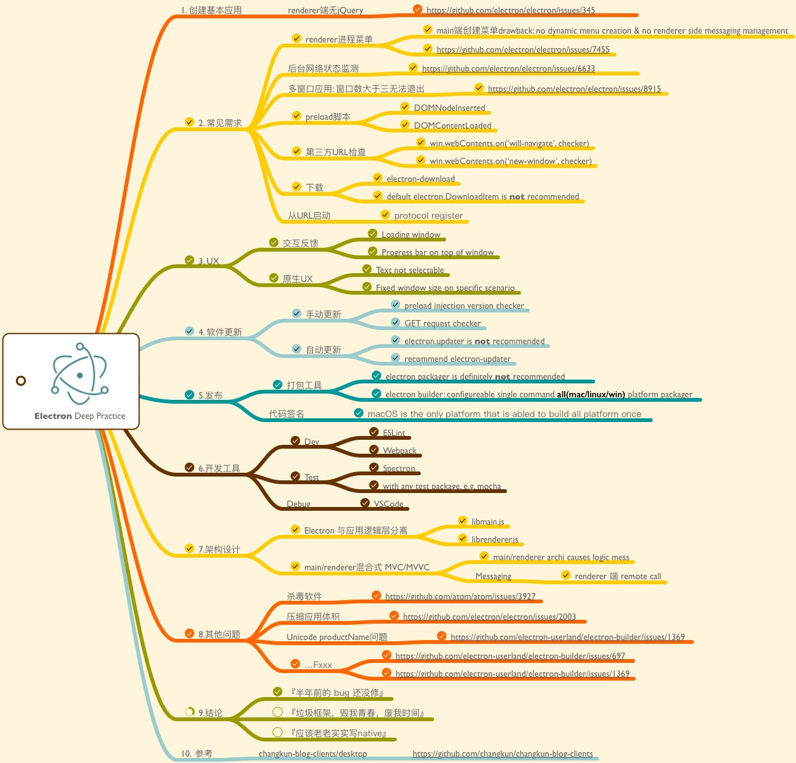

require is not defined

远程渲染页面(loadURL),页面使用require('electron')，容易报require错误undefined等，以下方法可解决

```js
// 配置窗口时，添加 prefload
webPreferences:  {
    nodeIntegration: true, // 渲染进程允许使用node
    preload: path.join(__dirname, '../static/preload.js') // electron 与独立vue项目使用
}
```
preload.js
```js
/**
 * 挂载electron 在全局，在远程页面中可以读取
 */
window.electron = require('electron')
```

