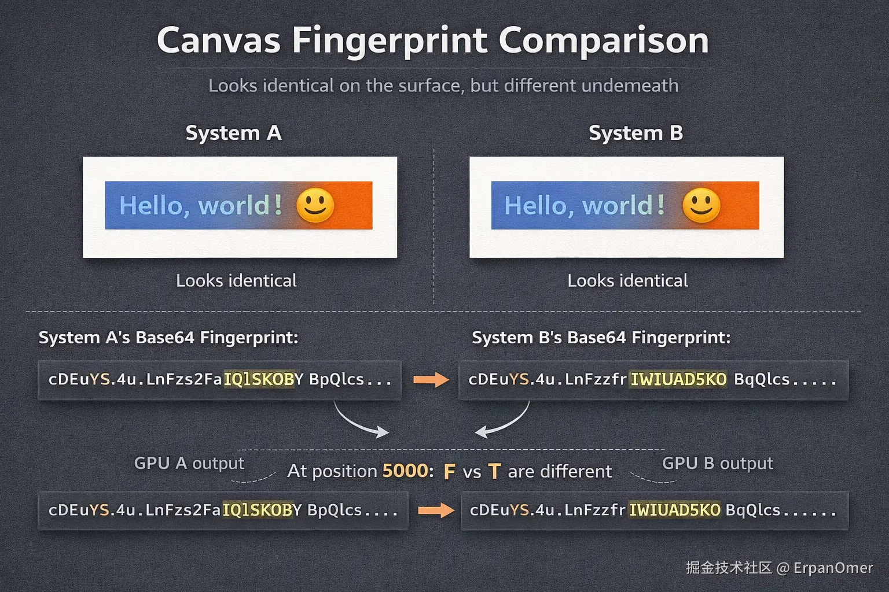
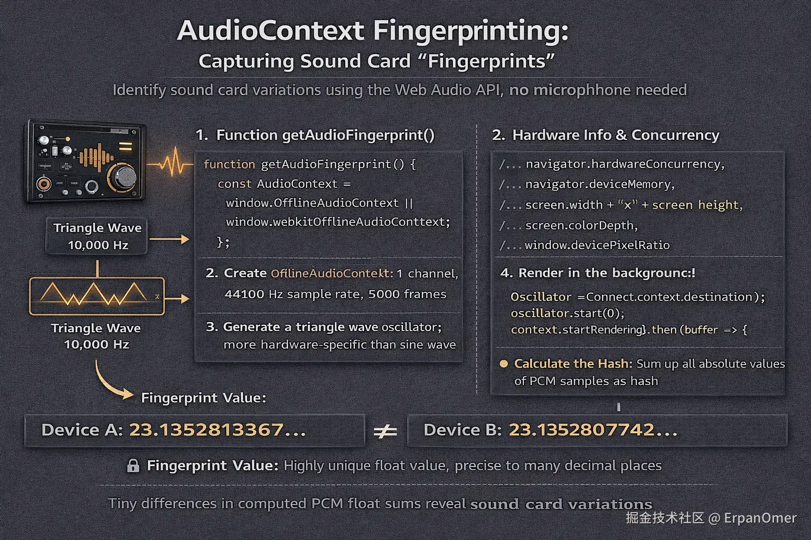
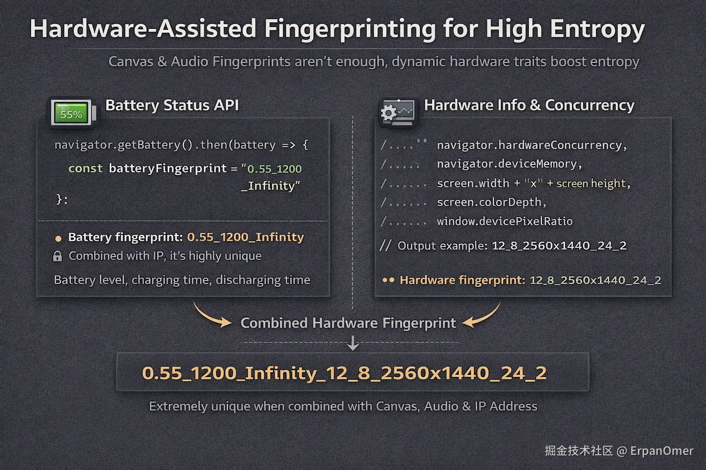

## 什么是设备指纹？
在讲实现之前，先纠正一个误区：设备指纹(Device Fingerprint)不是为了知道你是张三，而是为了知道这台设备是编号 9527

它的核心逻辑逻辑只有一条：**利用浏览器的硬件底层差异(显卡、声卡、电池)，组合出现高熵值的唯一ID**。

就算你清空了Cookie，换了IP，只要你的硬件没变，这套代码算出来的Hash值永远不变

下面直接上代码代码，吃啊接最核心的三种实现方式

[在线体验](https://erpanomer.nurverse.com/tools/device-fingerprint)

## Canvas指纹
这是目前最成熟、识别率最高的技术

### 实现原理
Canvas 绘图不仅仅依赖浏览器引擎，它极度依赖底层的 **GPU绘图指令、操作系统图形驱动 以及 抗锯齿(Anti-aliasing)算法**

当你命令浏览器画一个红色的矩形，里面写上Hello world时候：

- NVIDIA的显卡和AMD的显卡，在处理边缘像素的混合(抗锯齿)时，算法有微小的数学差异
- Windows和Mac在字体渲染上，对笔画粗细的处理不同
- 这就导致了：**同一段Canvas代码，生成图像像素数据(rgba),在不同设备上是完全不同的**

### 核心代码实现方式
我们不需要画多复杂的图，关键是要触发差异。通常会用到：光影叠加、异形字体、emoji(监测字体库)

```js
function getCanvasFingerprint() {
    // 1. 创建一个不会挂载到DOM上的画布
    const canvas = document.createElement('canvas');
    const ctx = canvas.getContext('2d');
    canvas.width = 200;
    canvas.height = 50;

    // 2. 文字干扰：利用字体渲染差异
    // textBaseline: 设置top/bottom 会触发不同的垂直对齐算法
    ctx.textBaseline = 'top';
    ctx.font = '14px Arial';
    ctx.fillStyle = '#f60';
    ctx.fillRect(125,1,62, 20); // 背景块

    // 3. 叠加混合：触发GPU的颜色混合算法
    ctx.fillStyle = '#069';
    // 写入带特殊符号的文字，测试系统字体支持度
    ctx.fillText('Hello world! \ud83d\ude03', 2, 15);

    // 再次叠加，利用rgba透明度触发抗锯齿差异
    ctx.fillStyle = 'rgba(102, 204, 0, 0.7)';
    ctx.fillText("Hello, world! \ud83d\ude03", 4, 17);

    // 导出指纹
    // toDataURL 会返回base64字符串
    // 同样的图像，不会显卡生成 base64 字符串的 CRC 检验码是不同的
    const b64 = canvas.toDataURL().replace("data:image/png;base64,", "");

    // 5. 将超长字符串 Hash 化（这里用简单的hash示例，生成环境可以用 MurmurHash3）
    let bin = atob(b64);
    let crc = bin2hex(bin.splice(-16, -12));
    return crc;
}
```


差异在哪？

肉眼看这两张图是一模一样的

但如果你把两台电脑生成的 Base64 字符串哪去对比，会发现可能在 第 5000 个字符处，有一个字母不一样。那就是显卡留下的签名

## AudioContext指纹
既然显卡有差异，声卡(Audio Stack)自然也有

### 原理
Audio指纹不是录音(不需要麦克风权限)

它是利用 Web Audio API 生成一段数学上的声音信号(正弦波、三角波)，然后经过一些列的处理(压缩、滤波)

由于计算机浮点数运算的精度差异以及底层音频处理单元(DSP)的视线不同，最终生成的PCM音频数据流会有及其微小的差别

### 代码实现
通常OfflineAudioContext(离线音频上下文),它可以在后台静默渲染音频，不需要用户听到声音速度极快。

```js
function getAudioFingerprint() {
    // 兼容性处理
    const AudioContext = window.OfflineAudioContext || window.webkitOfflineAudioContext;
    if (!AudioContext) return null;

    // 1. 创建离线上下文：1个声道，44100采样率，5000帧
    const context = new AudioContext(1, 5000, 44100);

    // 2. 创建振荡器 (Oscillator)
    // 三角波 (triangle) 比正弦波更容易暴露硬件处理的非线性差异
    const oscillator = context.createOscillator();
    oscillator.type = 'triangle';
    oscillator.frequency.value = 10000;

    // 3. 创建动态压缩器 (Compressor) - 核心步骤
    // 压缩器的算法在不同浏览器/硬件上实现差异很大
    const compressor = context.createDynamicsCompressor();
    compressor.threshold.value = -50;
    compressor.knee.value = 40;
    compressor.ratio.value = 12;
    compressor.reduction.value = -20;

    // 4. 连接节点：振荡器 -> 压缩器 -> 输出
    oscillator.connect(compressor);
    compressor.connect(context.destination);

    // 5. 开始渲染
    oscillator.start(0);
    context.startRendering().then(buffer => {
        // 6. 获取渲染后的 PCM 数据
        // 这是一个 Float32Array 数组
        const data = buffer.getChannelData(0);
        
        // 7. 计算 Hash
        let sum = 0;
        // 简单累加所有采样点的绝对值，作为指纹
        for (let i = 0; i < data.length; i++) {
            sum += Math.abs(data[i]);
        }
        console.log("Audio Fingerprint:", sum);
    });
}
```


不同设备跑出来的 sum 值，会精确到小数点后十几位，那个微小的位数差异就是指纹。

## 电池与硬件并发
> 由于隐私争议太大，Firefox 和 Safari已禁用，但Chrome(部分版本)和Android webview中依然可能获取

这玩意的逻辑非常粗暴

电量百分比，充电/放点时间这个组合在特定时间点是极具有唯一性的

```js
// 核心代码
navigator.getBattery().then(battery => {
    const level = battery.level; // 例如 0.55
    const chargingTime = battery.chargingTime; // 例如 1200 (秒)
    const dischargingTime = battery.dischargingTime; // 例如 Infinity
    
    // 指纹因子：0.55_1200_Infinity
    // 结合 IP，能把用户锁定得死死的
    const batteryFingerprint = `${level}_${chargingTime}_${dischargingTime}`;
});
```
如果我在在一分钟内连续两次请求，发现你的电量从0.42变成0.41,这个变化曲线也是一种强指纹

### 硬件并发数与内存
这些是 Navigator 对象上赤裸裸的硬件参数
```js
const hardwareInfo = [
    navigator.hardwareConcurrency, // CPU 核心数，如 12
    navigator.deviceMemory,        // 内存大小 (GB)，如 8
    screen.width + 'x' + screen.height, // 分辨率
    screen.colorDepth,             // 色彩深度，如 24
    window.devicePixelRatio        // 像素比，如 2
].join('_');

// 输出示例：12_8_2560x1440_24_2
```


虽然这些参数但看很普通，但如果你把 CPU + 内存 + 分辨率 + Canvas指纹+ Audio指纹 拼接在一起，全球几十亿设备中，能和你撞车的概率，几乎为0

## 总结
所谓的前端指纹技术，本质上是找不同的一种方式

开发者利用一切可以调用API(Canvas,Audio,Webgl,硬件信息)，强迫浏览器进行某种复杂的运算。由于硬件和驱动的细微差别，运算结果必然存在差异。

这些差异被收集起来，生成一个字符串。

这就是浏览器在互联网上的唯一ID。

[设备指纹生成器](https://erpanomer.nurverse.com/tools/device-fingerprint)