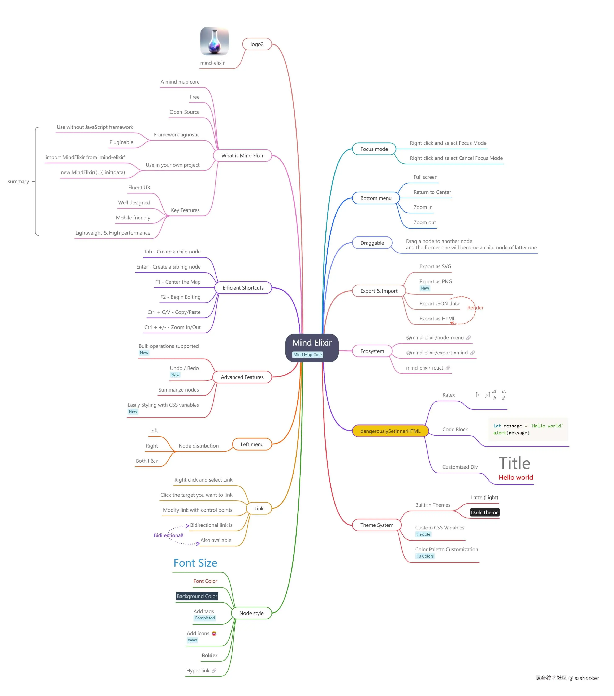
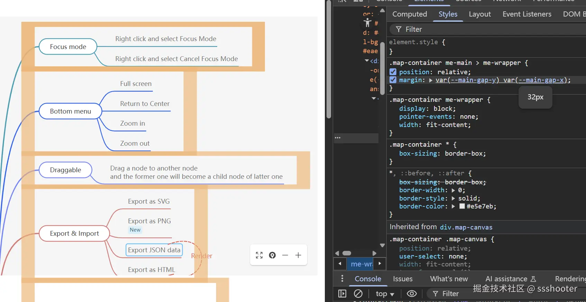
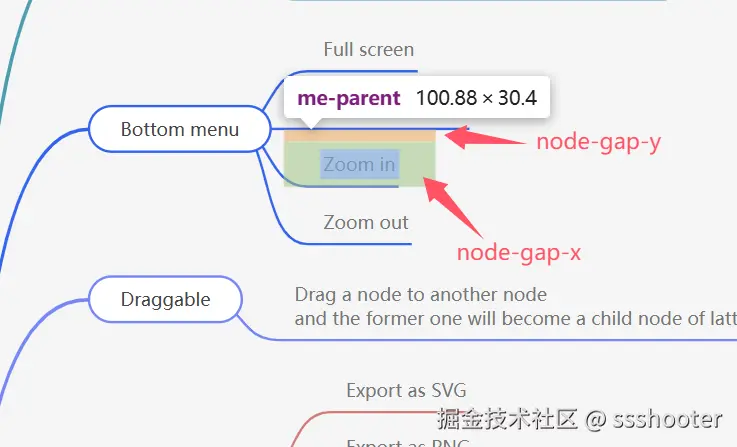

在信息爆炸的时代，我们每天都要处理大量复杂的信息和想法。传统的线性笔记往往难以展现思维的跳跃和关联性，而思维导图作为一种**半自动挡的笔记工具**，能够帮助我们更好的整理思路、梳理知识结构、激发创意灵感，同时操作又比白班、画图软件的操作更便利。

无论是构建知识管理平台、在线教育网站 ，还是协作工具，集成思维导图功能都能显著提升用户体验，让复杂信息的展示和交互变化的更加高效。

如果你想在自己的web项目中集成思维导图功能，借助[Mind Elixir](https://github.com/SSShooter/mind-elixir-core),最快只需几行代码就能在你的网站中添加专业级的思维导图功能。比如在个人博客中，你可以用思维导图来展示文章的知识结构、制作交互式的学习笔记，这样的功能不仅能让内容更加生动又去，还能显著提升博客的专业度



开源的Javascript 思维导图内核 Mind Elixir，拥有以下核心功能
- 流畅的用户体验 交互顺滑、反馈自然，支持移动端
- 轻量且高性能 小体积，快速加载与渲染，确保复杂图形下依然保持高频率
- 框架无关：无论是React、Vue、Svelte，还是原生项目，都可以轻松集成或独立运行
- 插件式架构:灵活的插件系统，支持光放扩展或自定义插件，自由组合功能模块
- 支持导出PNG/HTML:将思维导图导出为图片或HTML页面，方便分享与嵌入
- 节点摘要/节点连接：支持节点摘要、连接线、标签等多重节点样式，满足不同需求
- 支持撤销/重做：完整的操作历史栈，任何修改都可快速回退或重做，放心操作
- 高效快捷键支持：丰富的键盘快捷方式，提升专业用户的操作效率。
- CSS变量样式自定义: 通过CSS变量轻松控制节点样式和整体主题，实现高度定制化美观布局

下面简单介绍一下怎么快速在你的项目中集成 Mind Elixir吧

## 超简易接入
安装依赖
```bash
npm i mind-elixir -S
```
引入 Mind Elixir
```js
import MindElixir from 'mind-elixir';
import 'mind-elixir/style'; // 5.0后的版本需要主动引入样式
```
当然你也可以直接用script 引入：
```html
<script type="module" src="https://cdn.jsdelivr.net/npm/mind-elixir/dist/MindElixir.js"></script>
```
在初始化前，我们还需要调整下你的挂载目标元素样式。准确来说是需要给他一个明确的宽高，尤其注意高度哦。被CSS折磨过的前端朋友都知道，高度100%是一个比较难于驾驭的设定。下面就直接以500px高的div为例

```html
<div id="map"></div>
<style>
    #map {
        width: 500px;
        height: 500px;
    }
</style>
```
接着是正式初始化，如果不考虑其他初始化选项，只需要传入挂载元素即可！
```js
import MindElixir from 'mind-elixir';
import 'mid-elixir/style';

let options = {
    el: '#map', // or HTMLDivElement
}

let mei = new MindElixir(options);
const data = MindElixir.new('new topic');
mei.init(data);
```
到这里就已经完成了最基础的接入了

> 在Codeopen试玩 [https://codepen.io/ssshooter/pen/vEOqWjE](https://codepen.io/ssshooter/pen/vEOqWjE)

## 事件监听
在你的项目里用上思维导图之后，最常见的需求便是监听事件了，你需要监听各种节点操作，然后对用户操作做出响应。例如用户新建了一个节点，你需要及时把它保存起来。

Mind Elixir 使用 bus 派发事件，这个词来源于"总线"这个概念，所有事件都会由"总线"派发。使用上跟浏览器 addEventListener 类似，你就可以在任何地方监听事件。

截止到最新版 Mind Elixir 5.0,有以下事件

```js
type EventMap = {
	operation: (info: Operation) => void;
	selectNode: (nodeObj: NodeObj, e?: MouseEvent) => void;
	selectNewNode: (nodeObj: NodeObj) => void;
	selectNodes: (nodeObj: NodeObj[]) => void;
	unselectNodes: (nodeObj: NodeObj[]) => void;
	expandNode: (nodeObj: NodeObj) => void;
	linkDiv: () => void;
	scale: (scale: number) => void;
	move: (data: { dx: number; dy: number }) => void;
	updateArrowDelta: (arrow: Arrow) => void;
	showContextMenu: (e: MouseEvent) => void;
};
```
其中大部分节点操作事件都被归到 operation 事件中，Talk is cheap! 哎项目中加上然后再操作一下节点就很好懂了
```js
mei.bus.addEventListener("operation", (operation) => {
    console.log(operation);
})
```
有时候监听监听事件还不够，如果你需要确保数据插入到数据库之后，在让它显示出来，那就要用到操作拦截了。在 options 中加入 before 选项，这是一个对象，key为你需要拦截的操作，如果你需要拦截 addChild 操作，可以这样写：
```js
let mei = new MindElixir({
    // ...
    before: {
        async addChild(el, obj) {
            try {
                await saveToDatabase(obj);
                return true;
            } catch(error) {
                console.error('Error adding child: ', error);
                return false;
            }
        }
    }
})
```
这样在 saveToDatabase() 运行成功之后才会真正添加子节点，运行失败会取消插入操作

> 更多事件监听和操作拦截请参考 [https://codepen.io/ssshooter/pen/EajBbrM](https://codepen.io/ssshooter/pen/EajBbrM)

## 思维导图重绘
除了使用 Mind Elixir 内核的默认行为更新思维导图，你还可以通过直接更新节点数据来重绘思维导图

完整的节点数据结构如下

```js
export interface NodeObj {
	topic: string;
	id: Uid;
	style?: {
		fontSize?: string;
		color?: string;
		background?: string;
		fontWeight?: string;
	};
	children?: NodeObj[];
	tags?: string[];
	icons?: string[];
	hyperLink?: string;
	expanded?: boolean;
	direction?: Left | Right;
	image?: {
		url: string;
		width: number;
		height: number;
		fit?: "fill" | "contain" | "cover";
	};
	branchColor?: string;
	dangerouslySetInnerHTML?: string;
	note?: string;
}
```
通过修改节点数据可以在节点插入图片、标签、超链接等元素。举个例子，你可以通过读取 Mind Elixir 实例的 nodeData 获取到当前的思维导图数据，然后对他进行修改，最后调用 refresh 方法重绘思维导图

```js
const data = mind.nodeData;
console.log(data);
data.topic = data.topic + 'new Data';
mind.refresh();
```
但是如果你想把整个思维导图更新到全新的数据呢？也可以，把符合 Mind Elixir 格式的数据传到 refresh 方法，就能立即更新全图

```js
import data from "https://esm.sh/mind-elixir/dist/example.js";
mind.refresh(data);
```

> 更多重绘方法请参考 [https://codepen.io/ssshooter/pen/vEOqpOX](https://codepen.io/ssshooter/pen/vEOqpOX)

## 重新设计的自由
Mind Elixir赋予你重新设计思维导图的自由。

首先你可以通过 theme 和 cssVar 简单调整整个思维导图的风格。内核自带明暗两种主题 MindElixir.DARK_THEME 和 MindElixir.LIGHT_THEME 可供选择，如果需要自定义主题，可以按照主题格式写一个对象传入 Mind Elixir.

一个完整的Mind Elixir 主体和使用方式如下
```js
const PROFESSIONAL_THEME = {
	name: "Professional",
	type: "light",
	palette: ["#2c2c2c", "#404040", "#555555", "#6a6a6a", "#7f7f7f", "#949494", "#a9a9a9"],
	cssVar: {
		"--node-gap-x": "32px",
		"--node-gap-y": "12px",
		"--main-gap-x": "68px",
		"--main-gap-y": "48px",
		"--root-radius": "8px",
		"--main-radius": "6px",
		"--root-color": "#ffffff",
		"--root-bgcolor": "#1a1a1a",
		"--root-border-color": "#333333",
		"--main-color": "#2c2c2c",
		"--main-bgcolor": "#ffffff",
		"--topic-padding": "4px",
		"--color": "#4a4a4a",
		"--bgcolor": "#fafafa",
		"--selected": "#666666",
		"--panel-color": "#2c2c2c",
		"--panel-bgcolor": "#ffffff",
		"--panel-border-color": "#e0e0e0",
	},
};

let mind = new MindElixir({
	el: "#map",
	theme: PROFESSIONAL_THEME,
});
```
注意 data 本身也可以包含 theme，且会覆盖掉 options 中的 theme。这是为了保证每个思维导图都可以有独立的主题，如果你需要固定主题，记得在初始化时把data的theme置为 undefined。

> P.S.在初始化后想要再次修改主题，可以使用 changeTheme 方法。

cssVar 中比较常用的 main-gap 可以调整主节点间的间距：



node-gap 可以调整节点内部的间距



> 更多主题请参考 [https://codepen.io/ssshooter/pen/azOgVKX](https://codepen.io/ssshooter/pen/azOgVKX)

其他不能通过 css 变量调整的参数,你也可以直接通过 css 覆盖来微调

在深入一点，可以通过 generateMainBranch 和 generateSubBranch 调整连线样式(例子请看下的codepen链接)

写好合适的 generateMainBranch 和 generateSubBranch 之后,如果你发现展开收缩的按钮位置不对，可以通过CSS进行微调。默认样式如下：
```css
// 主节点（根节点的下一级节点）的展开收缩按钮样式
me-main > me-wrapper > me-parent > me-epd {
	top: 50%;
	transform: translateY(-50%);
}
// 其他子节点的展开收缩按钮样式
me-epd {
	top: 100%;
	transform: translateY(-50%);
}
// 左侧的展开收缩按钮专用调整
.lhs {
	& > me-wrapper > me-parent > me-epd {
		left: -10px;
	}
	me-epd {
		left: 5px;
	}
}
// 右侧的展开收缩按钮专用调整
.rhs {
	& > me-wrapper > me-parent > me-epd {
		right: -10px;
	}
	me-epd {
		right: 5px;
	}
}
```
> 更多样式调整请参考 [https://codepen.io/ssshooter/pen/WNmZMmq](https://codepen.io/ssshooter/pen/WNmZMmq)

## 节点样式
要是除了整体风格，你对节点也有自定义需求，节点本身是可以设置style的
```css
// ...
//...
{
  fontSize?: string
  color?: string
  background?: string
  fontWeight?: string
}
// ...
```
如果你对节点有非常强的自定义需求，觉得这点 style 配置根本不够用，那也没问题，还可以满足你！

你还可以通过 dangerouslySetInnerHTML 玩得更花，例如：

```js
const data = {
	nodeData: {
		id: "me-root",
		topic: "Mind Elixir",
		tags: ["Mind Map Core"],
		children: [
			{
				topic: "Customized Div",
				id: "c00a2264f4532615",
				children: [
					{
						topic: "",
						id: "c00a2264f4532614",
						dangerouslySetInnerHTML:
							'<div><style>.title{font-size:50px}</style><div class="title">Title</div><div style="color: red; font-size: 20px;">Hello world</div></div>',
					},
				],
			},
		],
	},
};
```
## 导出图片

## 在端渲染框架使用

## 其他Mind Elixir 选项

## 结语


[原文](https://juejin.cn/post/7524732017956208690)
