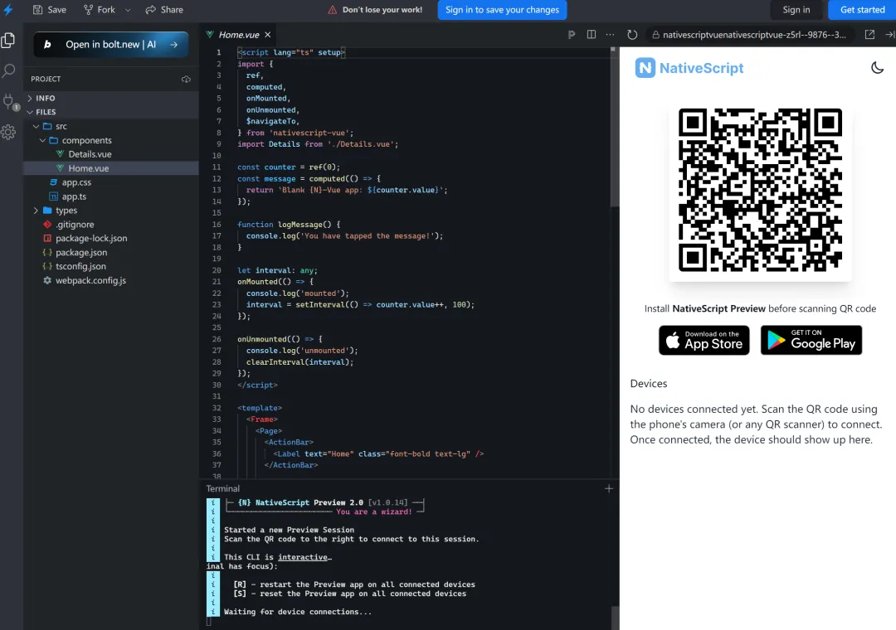

Vue3原生App开发曾存短板,uni-app多端部署虽便捷，但性能、原生能力及生态锁定问题突出。

NativeScript-vue 3出现，填补了Vue生态与React Native抗衡的床原生跨平台空白，获尤雨溪认可。


## 为何弃用uni-app？

uni-app表现 | 核心痛点
--- | ---
WebView/弱原生混合渲染 | 启动卡顿、掉帧、长列表不畅
自定义SDK需大量桥接代码 | 维护成本高，迭代易兼容断层
绑定DCloud生态 | 工程化配置慢，新特性滞后
Vue3/CompositionApi支持不足 | 类型推断异常，插件易踩坑

NativeScript-vue精准匹配需求：Vue语法 + 原生渲染 + 插件机用

## 尤雨溪推荐

尤雨溪转发推荐Vite + NativeScript-Vue3,TS Demo印证三大优势
- 兼容Vue3 及 CompositionApi
- Vite毫秒级热重载
- 直调ios/Android原生接口

## 核心优势


- 无webview，JS基于V8/JavaScriptCore运行
- 模板直编为原生组件(UILabel/TextView)
- 兼容全量原生依赖(NPM/CocoaPods)
- 性能比肩React Native，保留Vue习惯

## 快速上手
1. 环境准备

    ```shell
    # node >= 18
    npm i -g nativescript
    ns doctor # 全绿即完成
    ```
2. 初始化项目

    ```shell
    ns create myApp --template @nativescript-vue/template-blank-vue3@latest
    cd myApp
    ```

    预置Vite/Vue3/TS/ESLint，零配置开发

3. 运行调试

    ```shell
    ns run ios # 真机/模拟器
    ns run android # 真机/模拟器
    ```

    毫秒级热重载，日志直出终端

4. 目录结构

    ```shell
    myApp/
    ├─ app/（组件/入口/Pinia）
    ├─ App_Resources/（原生资源）
    └─ vite.config.ts（预置插件）
    ```

5. 打包发布

    ```shell
    ns build android --release # 生成apk
    ns build ios --release # 生成ipa
    ```

遵循原生流程，适配CI部署

- 脱离WebView，JS代码基于V8/JavaScriptCore引擎运行

## 插件适配情况
适配检测技巧

插件 | 状态 | 说明 
--- | --- | ---
Pinia | ✅ 可用 | 零改动接入
VueUse | ⚠️ 部分可用 | 无DOM依赖可用
vue-i18n 9.x | ✅ 可用 | 功能正常
Vue-Router | ❌ 不可用 | 用原生导航
Vuetify等UI哭 | ❌ 不可用 | 依赖DOM/CSS

## Vue DevTools调试
官方插件支持实时查看组件/状态，沿用桌面调试习惯

配置：https://nativescript-vue.org/docs/essentials/vue-devtools

## 生态与原生能力
- 700+官方插件：ns plugin add @nativescript/camera...

- 直引原生SDK：import { CBCentralManager } from '@nativescript/core'

## 🔖 核心资源

官网：https://nativescript-vue.org

插件清单：https://nativescript-vue.org/docs/essentials/vue-plugins

安装教程：https://docs.nativescript.org/setup/

