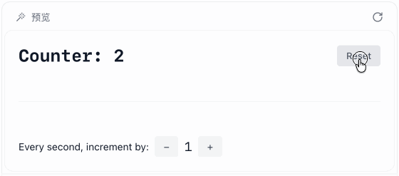

在社区里，部分Vue使用者，会常常因为React中存在闭包陷阱，而认为Vue是一个更加优秀的框架。个别极端的Vue使用者，还会因此而遍地React，认为闭包陷阱是React的一个设计缺陷。

那么，这真的是React的设计缺陷吗？

Vue中没有闭包陷阱，那它是否也为此付出了什么代价呢？

## 前置知识
我们来思考一个场景。在一个单独的模块A.js中定义一个变量
```js
// A.js
let a = 20;
```
然后再模块B.js中,我们想要访问这个变量a,并且能够修改这个变量a的值，应该怎么办呢？
```js
// B.js
import A from './A.js'；

// 如何访问模块A中变量a
```
我们发现无法直接访问，因此，我们通常的做法是在模块A中，导出一个专门用于反问 变量A的函数和一个专门用于修改变量a的函数
```js
// A.js
let a = 20;

export function getA() {
  return a;
}
export function setA(value) {
  a = value;
}
```
然后我们在模块B中，就可以调用 getA 函数来访问变量a，也可以调用 setA 函数来修改变量a的值
```js
// B.js
import { getA, setA } from './A.js';

const value = getA();
console.log(value)
setA(30);
// 此时，value的值会变成30吗？
```
此时，我们就遇到一个景点问题：<span style="color:red;font-weight:bold;">当我调用了 setA 的值之后，上面的代码中的 value的值会发生变化吗？ 答案是：不会</span>

这就很有意思了，为什么 value的值不会发生变化呢？

这是因为我们通过 getA 函数访问的是变量 a 的值,而不是变量 a 的引用.因此，如果想要得到新的值，我们还需要重新调用依次getA函数。

```js
// B.js
import { getA, setA } from './A.js';
const value = getA();
console.log(value);
setA(30);
// 此时得到最新值
const value2 = getA();
console.log(value2);
```
那我们能不能不通过调用 getA 函数，就能够直接访问到变量a的值呢？

<span style="color:red;font-weight:bold;">答案是不行的</span>

现在，我们对这种传统的方式进行两种思路的调整。

第一种是稍作修改，模仿成React语法的样子
```js
// A.js
let a = 20;

// 充当了 get角色
function useState() {
    return [a, setA];
}

function setA(value) {
    a = value;
}
```
```js
import { useState } from './A.js';

const [a, setA] = useState();
console.log(a);
setA(30);
console.log(a); // 20
```
我们会发现，这个情况，就跟React中，我们修改了 state 值之后，无法直接访问到最新的state值一样了。

所以我经常说，无法获取到最新值，不是React的设计去西安，而是JS语言特性就是如此

第二种，我们可以通过重新定义 a 的类型，来避免使用 getA 才能访问新值

重新修改 A.js 模块，代码如下所示

```js
let a = {
    value: 20
}

// 充当get的角色
export function ref() {
    return a;
}
```
```js
// B.js
import { ref } from './A.js';

const a = ref();
console.log(a.value);
// 充当 set的角色
a.value = 30;
// 此时通过 .value访问到最新值
console.log(a.value); // 30
```
此时，我们拿到的直接是一个引用类型，因此，我们可以通过 .value 的方式，做了一个访问的动作，从而得到最新的值。

此时，我们就可以发现，虽然上面的代码演变，一直都是框架无关的，但是我们只需要少做调整，就可以完全一致的分别还原 React 与 Vue的语法


## Vue付出的代码是什么?
接下来，我们要思考的是，当我们通过调整变量的类型结构，把基础类型包装成引用类型之后，Vue付出了什么代码？

首先第一个明显的代价就是：**语义不一致**

在Vue中,当我们使用 ref 定义一个响应时状态时，认为这个状态应该是一个基础类型。但是实际上，我们拿到的是一个引用类型。

通过 ref 传入的基础类型必须包裹到一个引用类型中，才能让能力变得正常。

因此，我们必须使用 .value 的方式来访问最新值

不少开发者会觉得这种方式不够优雅

所以，在某个阶段，Vue团队也曾经解决这个问题，并提出了如下这种方案

```js
let count = $ref(0);

// 直接访问，无需 .value
console.log(count);

function increment() {
    count++;
}
```
这种方式是通过在编译时，自动添加 .value 的方式来访问最新值。但是最终由于要解决的问题更多，还是放弃掉了这种方案，ref也被扩展到可以传入对象，并被官方团队推荐使用

其次，由于语义的不一致， .value的使用，在tempate、watch、深层监听、组件传参等问题中，用法也不一样，比较混乱

如下所示
```js
const x = ref(0);
const y = ref(0);

// 不用 .value
watch(x, (newX) => {
    console.log(`x is ${newX}`);
})

// 使用 .value 
watch(
    () => x.value + y.value
    (sum) => {
        console.log(`sum of x + y is: ${sum}`);
    }
)

// 不用 .value 与使用 .value混用
watch([x, () =>  y.value], ([newX, newY]) => {
    console.log(`x is ${newX} and y is ${newY}`);
})
```
加入你是一名Vue新玩家，看到这样的使用场景，你会不会感觉有点懵？

于是，在使用Vue的时候，有的同学老有一个我使用这个值，到底有没有被监听到、还有没有响应性的心里负担存在。

事实上，为了与React在底层的视线保持差异，Solidjs在语法上也付出了与Vue类似的代价，

如下所示，就是Solidjs的案例
```js
const CountiingCoponent = () => {
    const [count, setCount] = createSignal(0);
    const interval = setInterval(() => {
        setCount(count => count + 1)
    }, 1000)

    onCleanup(() => clearInterval(interval));

    return <div>Count value is {count()}</div>
}
```
这里我们要非常关注的是，状态count返回的不是一个值，而是一个函数。他虽然不需要通过.value返回一个函数，并通过调用该函数的方式，才能得到最新值

所以使用的时候就变成这个样子了
```html
<div>Count value is {count()}</div>
```
但是于此同时,他的set方法中回调函数的参数，又不是一个函数，而是一个状态值，所以下发就与外面的 count() 不一致

```js
setCount(count => count + 1);

// or
setCount(count() + 1);
```
也正因为如此，Vue语法不一致、状态易丢失响应性的坑，Solidjs一个也避免不了。特别是在组件传props时，迷惑性很强。也是采用了一堆语法糖来修修补补

这就是代价

所以当你觉得React的闭包陷阱，是一个设计缺陷的时候，不妨也想想 Vue 与 Solidjs 为了不出现闭包陷阱，都付出了什么样的代价，也许你会有一样的答案。

我的观点是，并不存在谁的设计理念更先进，这也算在没有完美方案之下的权衡而已

## 3. React是如何思考的？
实际上，在React中，也有通过访问引用类型的方案，直接获取值的语法，这就是 useRef();

```js
const count = useRef(0);

// 通过 .current访问最新值
cnosole.log(count.current)
```
但是区别就是，我们使用 useRef 定义的值，不具备响应性，他只是一个普通的JS变量，不与组件状态绑定。那React为什么要这么做呢？

React基于一个很重要的原则：**使用 useState 定义的值，只与组件状态绑定，而使用 useRef 定义的值，则仅参与逻辑运算，不与组件状态绑定，更新时也不影响组件的重新渲染**

而状态值的更新，会引发组件重新执行，此时 useState 就会自然得到一次执行机会，从而获取到最新值。

因此，在理想情况下,如果使用者能正确分清楚：哪些是状态值，哪些是逻辑值，就能极大避免需要获取最新值的场景出现。

**但是麻烦的地方在于，一部分React开发者由于自学的缘故，所有并没有意识到应该去区分状态属性问题**。于是就有一种情况出现，他们在项目中，会疯狂滥用 useState，定义任何变量都是 useState

这种情况之下，闭包陷阱就非常容易出现

## 4. React中更麻烦的情况

[点击阅读该案例更详细的解读](https://mp.weixin.qq.com/s?__biz=MzI4NjE3MzQzNg==&mid=2649871858&idx=1&sn=e211aa92e9501727d01035b717cc57a9&scene=21&poc_token=HIcH_2ijFI7o8V1zJss0_NwHj_OPqJkOx5xtu8EM)

前面我们提到了要区分状态值和逻辑值，但是这个时候，会存在一个更麻烦的情况，那就是，在少部分情况下，有一个状态，他即是状态值，又是逻辑值，事情就麻烦了

这就会非常容易导致闭包陷阱的产生。就如这个案例的 increment 变量，它即是状态值，又是逻辑值

面对这种情况，我们通过将该状态值一分为二方式来解决，分别定义一个状态值，一个逻辑值。如下所示



```js
export default function Timer() {
    const [count, setCount] = useState(0);
    const [increment, setIncrement] = useState(1);
    const incrementRef = useRef(1);

    useEffect(() => {
        const id = setInterval(() => {
            setCount(c => c + incrementRef.current);
        }, 1000);
        return () => {
            clearInterval(id);
        }
    }, [])

    function incrementHandler() {
        setIncrement(i => i + 1);
        incrementRef.current += 1;
    }
    function decrementHandler() {
        setIncrement(i => i - 1);
        incrementRef.current -= 1;
    }

    function resetHandler() {
        setCount(0);
    }
    return (
        <div className='p-4'>
            <div className='flex items-center justify-between'>
                <div className='text-2xl font-bold font-din'>
                Counter: {count}
                </div>
                
                <Button onClick={resetHandler}>Reset</Button>
            </div>
            <hr />
            <div className='flex items-center gap-2'>
                Every second, increment by:
                <Button disabled={increment === 0} onClick={decrementHandler}>–</Button>
                <span className='text-lg font-din'>{increment}</span>
                <Button onClick={incrementHandler}>+</Button>
            </div>
        </div>
    )
}
```
**我们希望他以逻辑值的身份参与到 useEffect 的回调函数中，而不是以状态值的身份去添加到依赖项中**

因此，在过往的解决方案中，我们为了绕开闭包陷阱，但是又不想把 increment 作为依赖项，我们就会把这个变量一分为二，分别定义一个状态值，一个逻辑值

```js
// 状态值驱动UI变化
const [increment, setIncrement] = useState(1);

// 逻辑值参与 useEffect 的回调函函数逻辑运算
const incrementRef = useRef(1);
```
然后再更新时候，保证状态值与逻辑值的同步更新
```js
setIncrement(i => i + 1);
incrementRef.current += 1;
```
**这样，我们就可以保证在 useEffect 的回调函数中，使用的 increment 值始终是最新的值，又不用把 increment作为依赖项**

## 5. 总结
很显然，在如何访问到最新值上面，Vue和React做了不一样的选择。但是，也并不是没有付出任何代价。<style color="red">Vue的代价是语义不一致,React 在逻辑上付出了需要区分状态值和逻辑值的代价。</style>

两种方案都不完美，这只是一种根据实际情况做出的选择，而不存在谁一定比谁更好，谁一定就是最优解的说法。

对于我个人而言，我更倾向于 React 的选择。这是因为，随着我们对 React 的理解越来越深，我可以通过提高自己个人开发能力的方式合理的区分状态值与逻辑值，从而避免闭包陷阱的产生。

但是 Vue/solidjs 语义不一致的问题，却永远都会存在。

如果是你，你会更倾向于哪种方案呢？


[原文](https://mp.weixin.qq.com/s/AfPzsCuazdWOp4I4j5xXOw)

