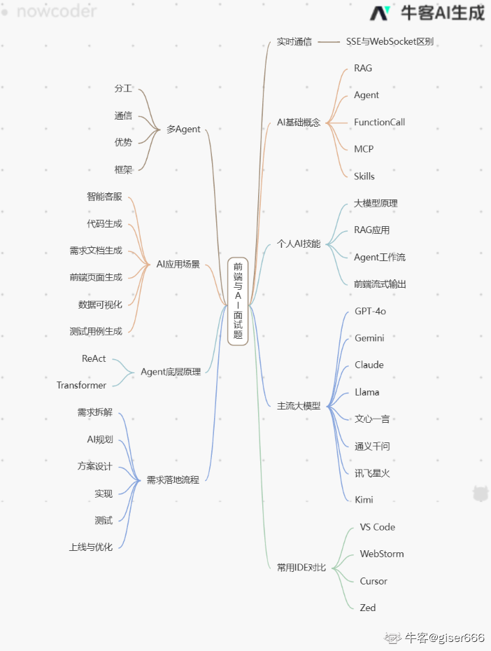

1. SSE与WebSocket区别

    - 通信方向:SSE是服务端单向推送给客户端，WebSocket是双向全双工
    - 协议：SSE基于HTTP,WebSocket是独立的ws/wss协议
    - 数据类型：SSE只支持文本，WebSocket支持文本和二进制
    - 重连：SSE浏览器自带自动重连，WebSocket需要自己写心跳和重连
    - 使用成本：SSE非常简单,前端用EventSource就行；WebSocket需要服务端支持协议升级
    - 使用场景：SSE适合通知、日志流、Ai流式输出;WebSocket适合实时聊天、游戏、协同编辑、直播

    简单理解：
    - SSE：客户端连上去，服务器一直发消息过来
    - WebSocket：客户端和服务器随时可以互相发消息

2. 对AI基本概念了解:RAG、Agent、FunctionCall、MCP、Skills
    - RAG:先检索外部资料，在让模型回答，用来解决模型瞎编、知识过时的问题
    - Agent: 能自己思考、做计划、调用工具、一步步完成任务的智能体
    - FunctionCall: 模型调用外部接口或函数的标准方式，比如查天气、查数据库
    - MCP: 模块和外部系统、工具之间通信的统一协议，方便对接各种能力
    - Skills: 把常用功能封装成可复用的技能，比如写代码、生成图标、总结文档

    他们的关系：
    用户提需求-> Agent作为大脑 -> 用RAG查资料、用FunctionCall调用工具、用Skills执行能力 -> 通信靠MCP协议

3. 个人AI技能了解(可直接背)
    - 了解大模型基本原理和提示词工程
    - 能基于RAG搭建私有知识库问答
    - 理解Agent工作流程，会使用FunctionCall
    - 能做前端+AI项目，比如对话界面、流式输出
    - 了解多Agent协作和常用框架
    - 能独立完成需求拆解、AI方案设计与落地

4. 了解主流模型有哪些及各自特点、应用场景
    - 国际模型
        - GPT-4o:总和能力最强，多模态好，代码、推理都很强
        - Gemini: 谷歌多模态，图片、视频理解能力突出
        - Claude: 擅长超长文本、安全性、合规性好
        - Llama: 开源模型，可以本地部署、二次开发
    - 国内模型
        - 文心一言：中文理解好，知识覆盖全面
        - 通义千问：阿里生态，适合电商、客服、业务系统
        - 讯飞星火：语音能力强，教育、医疗场景多
        - Kimi: 超长上下文，适合度文档、总结资料
5. 用了什么IDE及对比
    - VS Code:生态最丰富、轻量、插件多，日常开发助理
    - WebStorm: 智能提示、代码重构强，适合大型项目和团队
    - Cursor: AI原生编辑器，代码生成、对话一体，AI开发首选
    - Zed: 启动快、操作流畅，最求高效编码可以用

    总结：日常用vs code，大型项目用webstorm，AI项目用cursor，高效编码用zed

6. 多Agent有了解吗？
    
    多Agent就是多个智能体分工合作，像一个团队一起完成复杂任务
    - 分工：有的负责规划，有的负责搜索，有的负责写代码，有的负责测试
    - 通信：智能体之间可以传递信息、对齐目标
    - 优点：复杂任务更稳定、逻辑更清晰、更容易维护
    - 常用框架：AutoGen、CrewAI、LangGraph

    简单流程：

    用户提需求->主管 Agent 分配任务 -> 各个智能体分别执行 -> 汇总结果返回给用户

7. AI在实习部门中应用场景
    - 智能客服、内部问答：用RAG + 对话界面
    - 代码生成、自动补全、代码解释：用Cursor、Copilot这类工具
    - 需求文档、接口文档自动生成与总结
    - 前端页面自动生成-- 根据描述或草图生成代码
    - 数据可视化、报表自动生成：自然语言转图表
    - 测试用例、测试脚本自动生成

8. Agent底层原理：ReAct、Transformer了解
    - ReAct
        - 就是推理 + 行动
        - 流程：先思考要做什么 -> 调用工具或执行动作 -> 观察结果 -> 在思考-> 直到完成任务
        - 是现在大多数智能体的核心逻辑
    - Transformer
        - 是现在所有大模型的基础框架
        - 核心是自注意力机制，能理解上下文、语义关联
        - 前端层面只要知道：它是模型用来理解语言、生成内容的底层架构

9. 现有需求如何用AI实现：拆解小需求、AI规划、实现、测试、包含/plan、/spec；标准流程
    1. 需求拆解：把大需求拆成小需求，明确每个模块做什么
    2. AI规划/plan: 明确目标、执行步骤、输入输出、依赖项、时间安排
    3. 方案设计/spec: 确定接口、数据结构、页面逻辑、提示词、异常处理
    4. 实现：前端界面 + 模型调用+ RAG或FunctionCall集成
    5. 测试：测试功能是否正常、有没有幻觉、流式输出是否稳定、异常情况是否处理
    6. 上线与优化：根据效果迭代提示词、流程、模型参数

简单模板
- /plan: 目标-> 步骤 -> 分工-> 时间
- /spec: 接口-> 字段-> 页面-> 提示词 -> 异常处理

