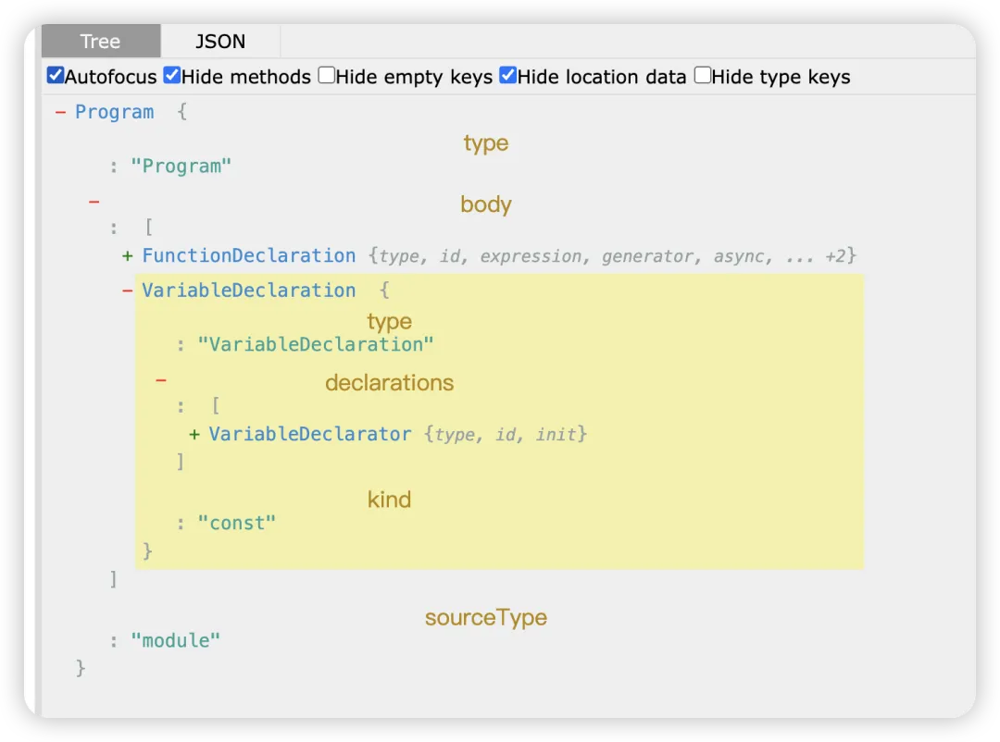
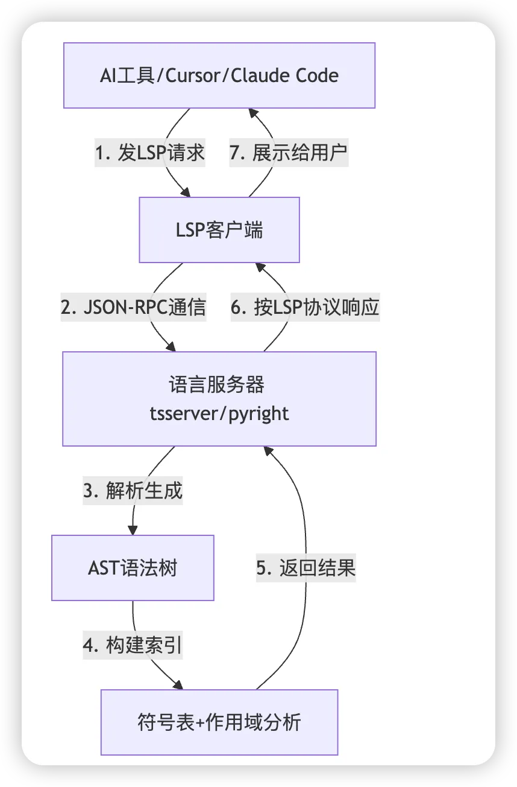
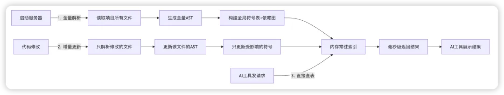

## 前言
你有没有好奇过：Cursor、Claude Code、OpenCode这些AI工具，为什么能精准找到函数定义、秒级定位引用，而不是像grep那些瞎匹配

答案藏在两个核心技术里：** AST(抽象语法树)和 LSP(语言服务器协议)**

本文将从"是什么->为什么->这么工作->怎么用"，用JS代码实战 + 流程图，彻底讲透两者的关系、LSP的核心原理，以及AI工具偏爱他的底层逻辑

## 一、先搞懂基础: AST 和 LSP 分别是什么？
在聊关系之前，先用 『大白话 + 类比』 搞懂两个核心概念，避免被术语劝退

### 1. AST: 代码的"结构化骨架"
AST(Abstract Syntax Tree, 抽象语法树)是把源代码经过『词法分析->语法分析』后，生成的结构化树形数据。

#### 核心作用：让机器"读懂"代码
纯文本代码对机器来说是"一串字符"，而AST会把代码拆成现有逻辑关系的"零件"
- 哪个是函数、哪个是变量、哪个是循环
- 函数的参数、返回值是什么
- 代码的嵌套关系、作用域边界

##### JS代码->AST直观例子
原始JS代码
```js
function add(a,b) {
    return a + b;
}

const result= add(1, 2);
```
生成的简化AST(可通过 AST Explorer 查看完整结构,该工具支持实时展开节点、高亮对应源码，文本附件技巧)：https://astexplorer.net/



```shell
Program (整个程序)

├─ FunctionDeclaration (函数声明)

│  ├─ id: Identifier (name: "add")  // 函数名

│  ├─ params: [Identifier(a), Identifier(b)]  // 参数

│  └─ body: BlockStatement  // 函数体

│     └─ ReturnStatement  // 返回语句

│        └─ BinaryExpression (+)  // 加法表达式

└─ VariableDeclaration (变量声明)

   ├─ id: Identifier (name: "result")  // 变量名

   └─ init: CallExpression  // 函数调用

      └─ callee: Identifier (name: "add")  // 调用的函数名
```
#### 关键总结
AST是底层数据结构，是代码静态分析的"原材料",但它太"原始"--需要手动遍历、分析才能用，直接用成本极高

### 2. LSP:代码语义的』标准化接口『
**LSP(language Server Protocol, 语言服务器协议)**是微软推出的开放标准(GitHub 开源仓库：[microsoft/language-server-protocol](https://github.com/microsoft/language-server-protocol))，本质是一套"客户端-服务器"通信协议

#### 核心作用：同意提供代码智能能力
- 客户端：编辑器(VS Code)、AI工具(Cursor)
- 服务器：语言服务器(tsserver、pyright)
- 能力：找定义、查引用、代码补全、重命名、语法报错

#### 类比理解
AST是『食材』，语言服务器是"厨师"(把食材做成菜)，LSP是『菜单』(表转化的点菜方式)--你不用管厨师怎么处理食材，按菜单点就能吃到菜

## 二. 核心关系：AST是地基，LSP是高速路
一句话讲透：AST是LSP的底层依赖，LSP是AST的上层封装

#### 层级架构图(Mermaid)


#### 关系拆解(3个关键步骤)
1. 语言服务器先解析AST:启动时读取代码、生成AST,在基于AST构建"符号表"(记录变量/函数的定义位置、类型、作用域)
2. LSP封装AST的能力: 把"找定义、查引用"等基于AST的操作，包装成标准化接口(如textDocument/definition)
3. AI工具直接调用LSP: 不用自己解析AST、遍历树，直接发LSP请求，就能拿到精准的语义结果

#### 关键区别对比表
维度| AST | LSP 
--- | --- | ---
本质 | 代码结构化数据结构 | 客户端-服务器通信协议
作用 | 提供代码语法结构(原材料) | 统一提供语义能力(成品服务)
层级 | 底层基础 |  上层应用
易用性 | 难用(需手动遍历、分析) | 易用(直接调用接口)
AI工具用法 | 自己解析成本极高 | 直接发请求拿结果

## 三、实战对比：JS代码->AST -> lsp的全过程
用之前的JS代码，完整演示"AI工具找add函数定义"的全过程，直观感受AST 和LSP的配合

### 原始JS代码
```js
// 定义函数
function add(a, b) {
    return a + b;
}

// 调用函数
const result = add(1,2)
```
#### 步骤：AST解析(语言服务器内部)
生成的AST中，关键节点：
- 函数定义：FunctionDeclaration(name: 'add')
- 函数调用：CallExpression

#### 步骤2：构建符号表(语言服务器内部)
遍历AST后生成的"语义索引表"
符号名 | 类型 | 定义位置 | 作用域
--- | --- | --- | ---
add | 函数 | 第1行第8-10列 | 全局
a | 参数 | 第1行第11列 | add内
b | 参数 | 第1行第14列| add内
result | 变量| 第5行第6-12列 | 全局

#### 步骤3：AI工具发LSP请求
当你在第5行add处点击"找定义",AI工具会发如下LSP请求：
```js
{
    "method": "textDocument/definition",
    "params": {
        "textDocument": {"uri": "file://test.js"},
        "position": {"line": 5, "character": 6}
    }
}
```
#### 步骤4：LSP服务器返回结果
语言服务器直接查"符号表"，返回精准位置：
```js
{
  "uri": "file:///test.js",
  "range": {
    "start": { "line": 0, "character": 8 },
    "end": { "line": 0, "character": 10 }
  }
}
```
#### 结论
AST负责"拆解代码",LSP负责"精准回答"--AI工具不用碰底层的AST,只通过LSP就能拿到懂语义的结果

## 四、为什么AI工具都用LSP?和Grep的碾压级对比
AI代码工具(Cursor/Claude Code/OpenCode)放弃grep、拥抱LSP,核心是解决了"慢、不准、高成本"三大痛点

### 对比表
维度 | grep(纯文本搜索) | LSP(语义检索)
--- | --- | ---
原理 | 字符串匹配 | AST + 符号表 + 作用域分析
找定义 | 匹配add字符串，误报多(注释/变量) | 精准定位定义的位置(文件 + 行 + 列)
查引用 | 漏间接调用、别名导入 | 全量返回真实调用(含重命名)
速度(千文件) | 分钟级 | 毫秒级(内存查表)
Token消耗 | 高(读大量无关文件) | 低(减少40%-60%)
使用场景 | 小型脚本、找注释 | 中大型项目、代码语义分析

### 直观例子：找add引用
如果代码改的复杂一点(别名导入)：
```js
// 导出函数
export const calcAdd = add;
// 其他文件导入
import { calcAdd as sum } from './test.js';
sum(3,4); // 间接调用add
```
- grep: 只能找到add字符串，找不到 calcAdd 和sum的间接引用
- LSP: 能识别别名关系，返回sum(3,4)也是add的引用

## 五、LSP语言服务器内部原理：为什么这么快？
很多人会疑惑："每次请求都解析ast、建符号表？那不是很慢？"--答案是：绝对不是

LSP服务器的核心设计：长进程、常驻内存、增量更新。

### 1. 工作模式流程图(Mermaid)



### 2. 三大核心机制(保证效率)
- 长进程+ 常驻内存

    - 服务器启动后一直运行，AST和符号表永远在内存中
    - 请求时只做『查表』，不重复解析代码(O1时间复杂度)

- 增量解析
    - 代码修改时候，只重新解析"修改的文件"，而非全项目
    
    例如：改了add函数的参数，只更新该文件的ast和add符号记录

- 依赖图追踪

    - 建立文件间的依赖关系
    - 如果A文件依赖B文件，B文件修改时，只更新A文件受影响的符号(而非全量更新A)

### 结论
LSP服务器本质是一个"实时更新的代码语义数据库"--启动时『全量建库』，修改时『增量更新』，请求时直接查询，这就是他快的核心原因

## 六、多语言支持：LSP如何管理混合语言项目

### 1. 核心原则：LSP是"语言专属"的，一门语言一个服务器
- 每种主流语言都有独立的LSP服务器(如JS用tsserver、Python...),由官方或社区专门开发
- 服务器与语言绑定，因为不同语言的语法、类型系统、编译规则差异极大，需要针对性解析 AST 和构建索引

### 2. 多语言项目启动逻辑：自动识别，并行启动多个服务器


[原文](https://mp.weixin.qq.com/s/C3WsyqhnImcUKAWbFsBIAg)