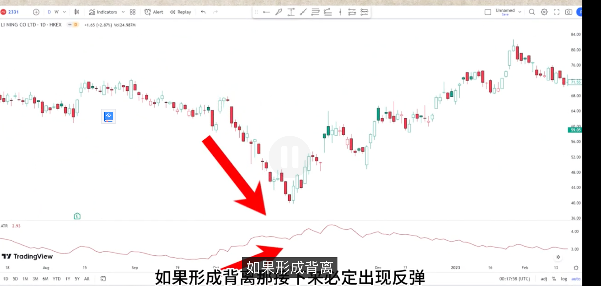
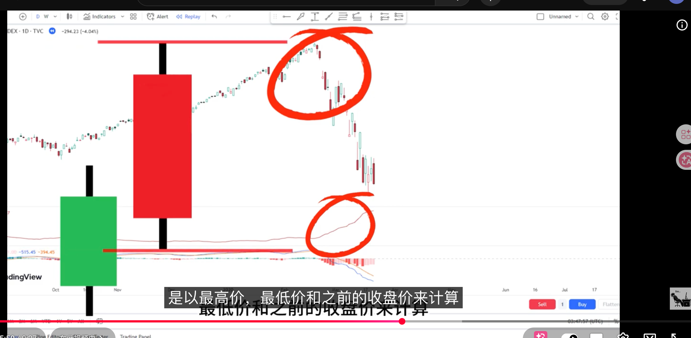
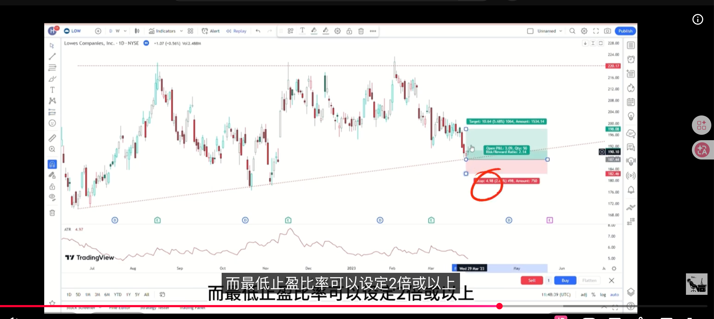

中文名：真实波动幅度均值

ART其实就是一根K线从最高点到最低点的计算

A代表average 平均数

ATR = (最高价 - 最低价价) / 2

真实值：TR = 最高价 - 最低价价

公式：
```shell
TR = MAX(High - Low);
abs(High - previousClose); # 当天最高价减之前的收盘价
abs(Low - previousClose); # 当天最低价减之前的收盘价
# 从上面三种情况中取最大的值作为TR
```

ATR指标的值越高，说明市场目标统一

ART指标值越低，表示市场出现分歧

和RSI一样，如果形成背离那接下来必定出现反弹,这是错误的；RSI是根据百分比；ART是根据价格差




从根本上我们可以完全无视这个ATR指标，只要知道当时ATR数字就可以了,但是ART最重要的是控制风险，帮助我们设置止盈止损点；

