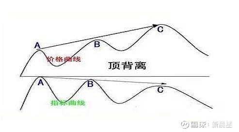
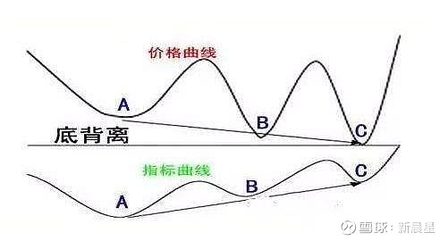

MACD这个指标可以说是家喻户晓，到了人见人爱的地步。但若要真的用好它，却不是一件简单的事情

## MACD底背离
### M头W底等形态
形态分析：MACD属于趋势性指标，而传统形态分析中绝大部分也都是根据趋势理论逐步总结出来的，故此从原理上来看二者有较大的共通性，这也决定了MACD底背离也可用一般的形态理论进行分析，如头肩底、双底、三底、圆弧底、平台扎底等，此类形态分析中常用的量度幅度、阻力或支持位等评判理论也可适用，顶背离则反之运用

另外，MACD指标的柱状线也可以看图形形态来研判行情

当MACD的红柱或露珠构成的图形双重顶底(即M头和W底)、三重底部等形态时候，也可以按照形态理论的研判方法来加以分析研判

### 顶背离和底背离
MACD指标的背离，就是指MACD指标的图形的走势正好与K线图的走势方向正好相反。MACD指标的背离有顶背离和底背离两种

- 顶背离

    当价格走势K线图上的走势一峰比一峰搞，价格走纸一直上涨，而MACD指标图形上的由红柱构成的图形走势一峰比一峰低，即当价格走势高点比前一次的高点高，而MACD指标的高点比前一次的高点低，就叫顶背离

    顶背离现象一般是价格走势在高位即将反转走势的信号，表明价格走势短期内即将下跌，是卖出投资品种的信号

    

    股价经过一段涨，MACD的顶背离是指股价与前面的高股价平或高(宏观的看股价趋势)MACD指标中的DIFF(DIFF线表示收盘价短期、长期指数平滑移动平均线间的差)哺育同步线上反而低或平了。

    价格是看趋势,不是一定要按什么最高、最低、收盘价，是看一个大概样子，而下面的DIFF是要和前面的峰比大小的，所以要精准

    发挥用法就是不看上面价，只看MACD的DIFF的最高点,只要这个新出来的高峰没有前高就算是背离了，一般往下至少有15%的跌幅

    这里要说明的就是教科书上所说的MACD背离是股价与MACD指标中的MACD比，而这里的是股价与MACD指标的DIFF比。

    **MACD指标顶背离是逃顶的方法。一般来说，抄底急不来，逃顶要有速度。根据这一说法来说，当MACD在高位出现背离迹象时，我们要做的就是迅速撤退平仓，而不管他之后又多少利润**

    但有的时候我们注意，MACD指标与股价现了顶背离后，股价并未立即见顶，MACD在下行，而股价还略有上冲。这种情况我们只能看做是主力的一种诱多行为

- 底背离

    底背离一般出现在价格走势的低位区。当价格走势K线图上的投资品种走势，价格走势还在下跌，而MACD指标图形上的由绿柱构成的图形的走势一底比一底高，即价格走势的低点比前一次的地点高，而指标的低点比前一次的地点高，这叫底背离现象。底背离现象一般是预示价格走势在低位可能反转向上的信号，表明价格走势短期内可能反弹向上，是短期买入投资品种的信号

    

    在实践中，MACD指标的背离一般出现在强势行情中比较可靠，价格走势在高位时,通常只要出现一次背离的形态即可确认价格走势即将反转，而价格走势在低位时，一般要反复出现几次背离后才能确认。因此，MACD指标的背离研判的准确性要高于底背离，这点投资者要加以留意

[原文](https://xueqiu.com/7021965736/224675817)
