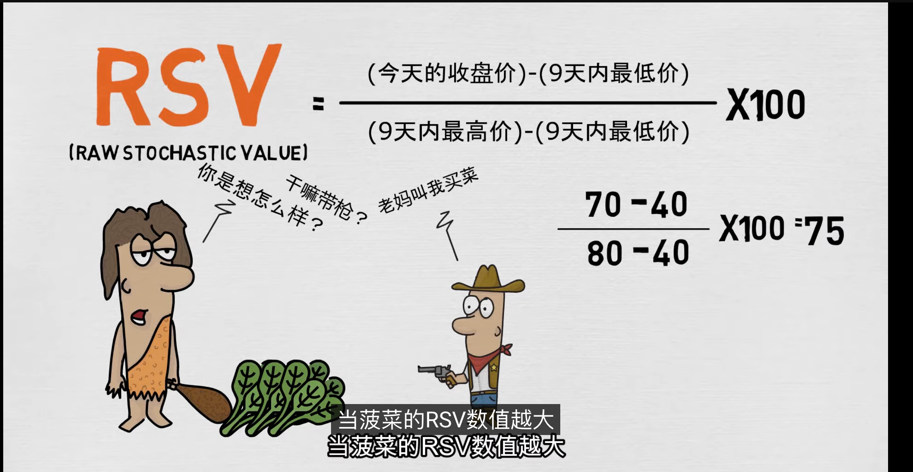
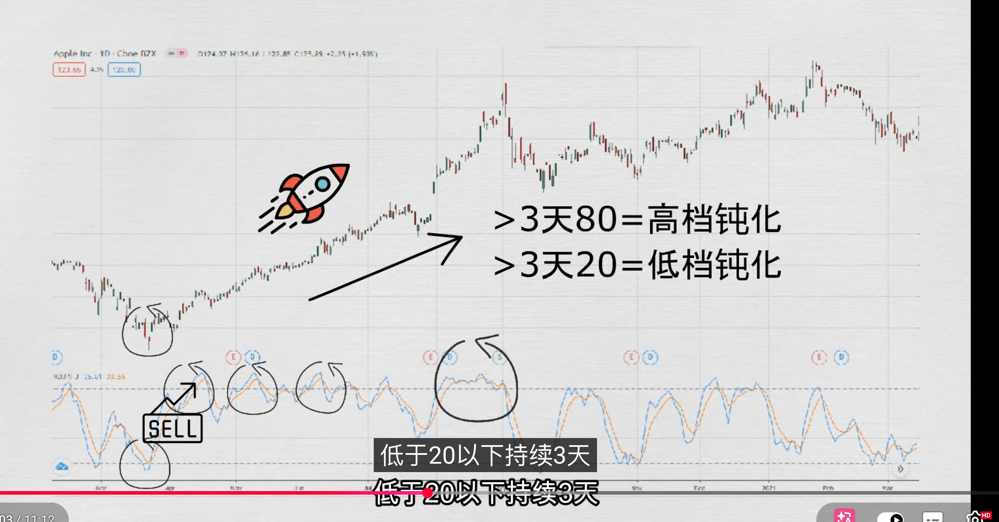

## KDJ指标
一个总和考虑了股票的最高价、最低价、收盘价的技术指标；在初期的时候有两个部分：k值和d值，所以就成为了KD指标；随着股市分析技术的发展，才慢慢演变成今天的KDJ指标；

## 计算
KDJ的计算方式相比起自己的兄弟MACD和RSI来说复杂许多；这家伙就是喜欢把高大上的数学题搞得眼花缭乱，但还是逃不掉使用过去的股价走势，预测未来的老套路

首先计算出RSV(未成熟随机值)，以下将失眠上常用默认9天周期做例子
:::tip
RSV = (收盘价 - 最低价价) / (最高价 - 最低价价) * 100
RSV就是使用今天的收盘价-过去9天的最低价，除以九天内的最高价-九天内的最低价，再乘以100，得到一个0-100之间的随机值
:::

当RSV的值表达，就表示越接近9天内价格最高价的80，也就是原理了最低价的40；讲人话就是今天菠菜价格偏贵了；

简单来说RSV所计算出来的就是一个0-100区间的值；

当有了RSV就能计算出K值；k值就是：将前一天2/3的K值 + 1/3当天的RSV值;而明天的K值就是今天的2/3的K值 + 当天1/3的RSV值

而D值就是前一天2/3的D值 + 1/3当天的K值；而明天的D值就是今天的2/3的D值 + 当天1/3的K值，以此类推

最后的J值就是根据KD值每一天移动的情况来判断股价强弱走势；也就是当天3倍的D值减去当天2倍的K值

所有必须有了RSV才能计算出KD值，有了KD值才能计算出J值

**k值变动会比D值来得快，而J值会比K值来的快**

## 使用
1. 超买超卖
    当KD线位于50以上表示股价强势，低于50以下表示股价处于弱势；在50上线表示趋势不明，需要继续观察；目前市场上都是以超过80和地域20为趋势反转作为参考；当KD线大于80表示股价进入超买区，意味着上涨太多，这时需要提高警惕，短期内可能有回落的现象；相反当KD线小于20，表示股价已经进入超卖区，意味着股价下跌太多，这时候可以抓紧机会，可能会有反涨的现象；

    超卖和超买适用法有一个致命的问题，那就是钝化，KD先也无法摆脱这个问题；一旦出现钝化超买超卖就没有意义了；这个情况一般出现先一些暴涨股

    

2. 交叉使用法

    当K线穿过D线，我们称之为黄金交叉，股价可能将会往上走，这是买入信号；相反，当K先跌破D线，我们称之为死亡交叉，股票可能将会往下走，这是卖出的信号

    但Kd先的交叉使用法相比起MACD更加难以琢磨；相比KD线，J线移动更为频繁，但它有很好的导向性，能够反映出K线与D线的差距的大小；当J线在0以下反弹向上并穿越0线时，我们称之为J线金叉，这是买入信号；相反，当J线在100以上反弹向下并穿越100线时，我们称之为J线死叉，这是卖出的信号
