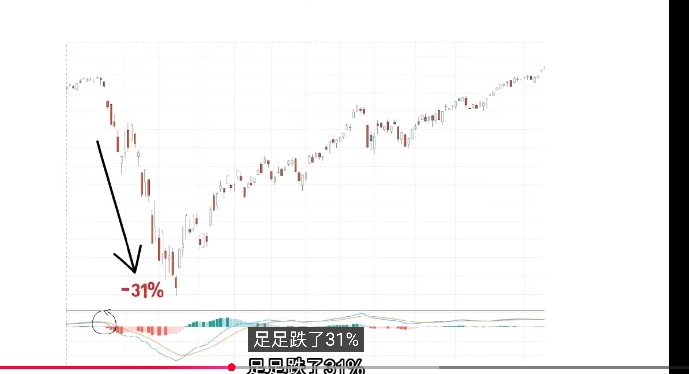
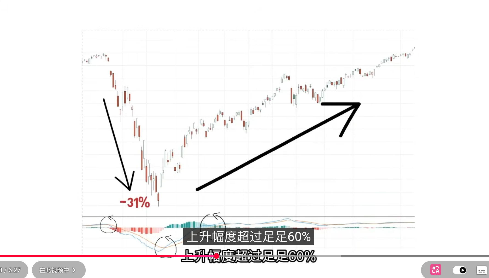
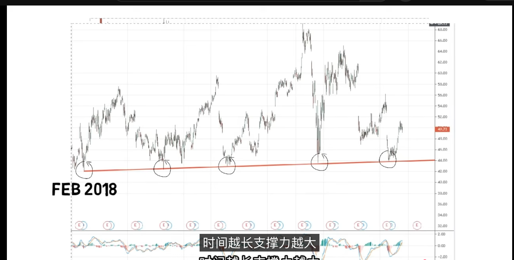

## MACD指标
MACD指标是指数平滑异同移动平均线，用于判断股票价格趋势，判断未来买卖点。英文名：Moving Average convergence

MACD是全世界最常用的技术面指标之一

## 组成
MACD指标由三部分两条线和中间的柱状图组成：
- 蓝线叫做DIF-反应在一段时间内股价的变化情况，称之为快线
- 红线叫做DEA-是DIF的均线，它相对平稳一些，称之为慢线
- 红绿柱成为BAR柱状图，柱体在上面显示绿色，在下面会显示红色；中间线为0轴
### 算法
- DIF算法：12日均线减26日均线
- DEA算法：DIF的9日均线
- BAR柱算法：DIF减DEA;DIF和DEA的两条线距离越长，柱体就越大，说明市场趋势越明显
所以Dif会移动比较快

## 用法
1. 看快线和蛮闲两个线的位置；当两条线都在0轴以上时，说明市场趋势向上；当两条线都在0轴以下时，说明市场趋势向下
2. 观察两条线交叉的情况，找出买卖点；当快线超过慢线时，买入信号，说明市场趋势向上，市场上成为黄金交叉；当慢线超过快线时，说明市场趋势向下，卖出信号，市场上成为死亡交叉
3. 通过观察BAR柱状图可预测股市走向，就像红绿灯，绿灯买入红灯卖出；当柱体位于0轴上方时就会显示绿色，表示市场趋势向上，当柱体位于0轴下方时就会显示红色，表示市场趋势向下

## 示例
- 死亡交叉

    

- 黄金交叉

    

## 问题
如果单纯使用macd，坦白说你将会损失大量金钱；因为macd指标使用的是均线计算，信号往往会比较迟，需要经过一段的涨跌，才会预计将来的走势；在V形反弹上很难在最短时间内知道，往往需要涨到一定的信号通知你买入，这时你已经损失了一开始上涨的利润；当趋势往下走时，MACD信号也会迟到；个人不要只使用MACD做主要决策，使用MACD做参考，就算在0轴一下也会做多

我们使用K线图最好本身有几个技术指标;就算MACD没有信号，你也可以行动，如果等到所有信号都确认，这时候你才进场，那一定是晚了，能够赚到的利润也少了，可能行情都结束了；如果你看好一个长期强势的公司，一家赚钱的公司不可能长期衰退，总有一天会反弹，抄底的几率就越高；MACD最大的好处就是抱长线，看的是长期走势，黄金交叉和死亡交叉往往会比较落后，比较不适合做短线买卖；

**如果做长线就可以使用MACD指标**
- MACD
- RSI
- STOCHASTIC
- SMA