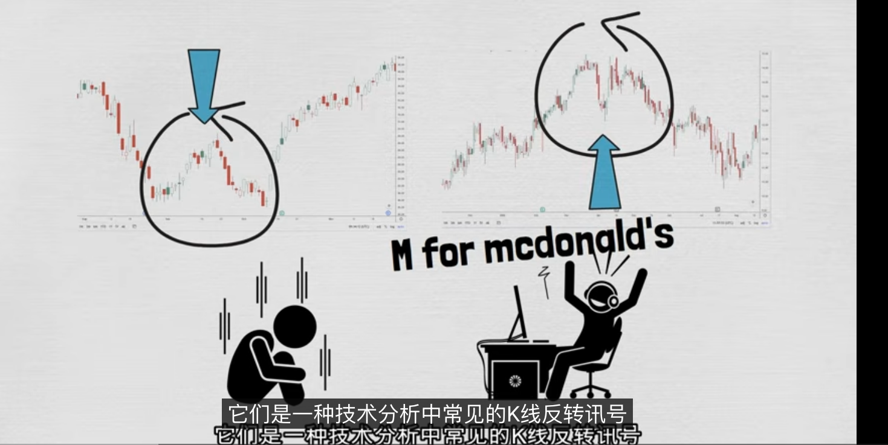
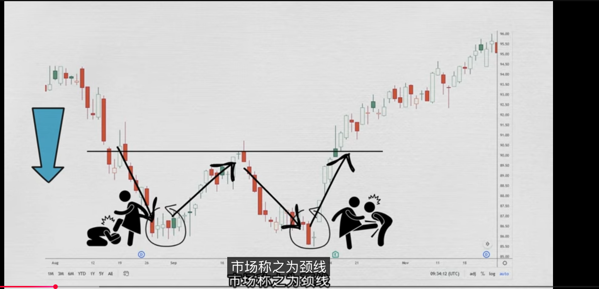
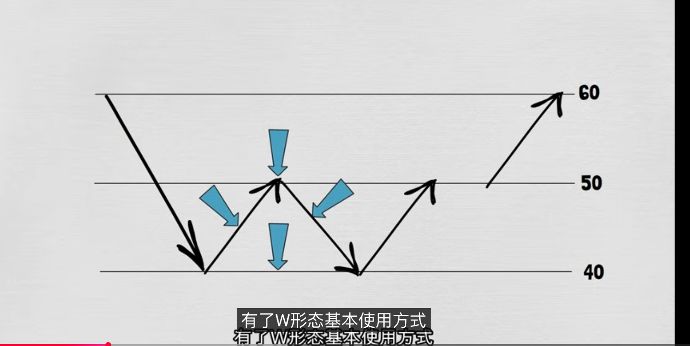
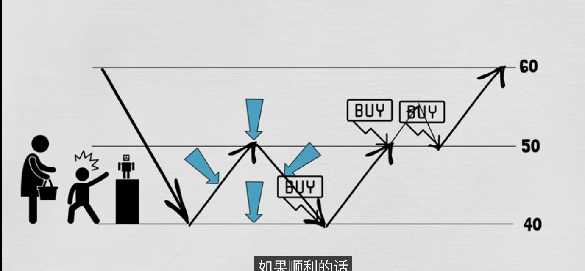
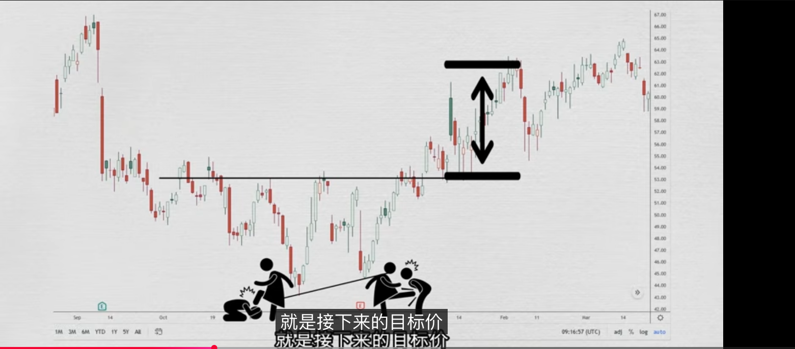
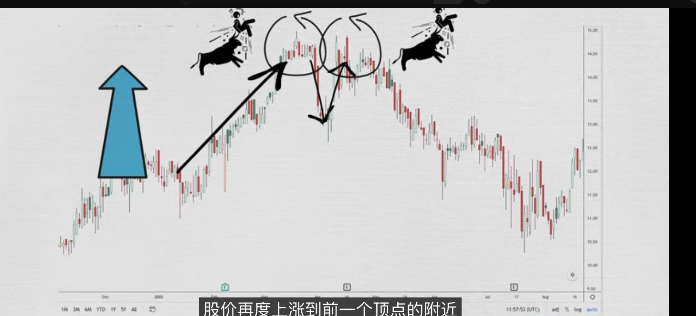

## 概念
w低和M顶它们是形态中占有相当重要的地位，能够基于当时行情，预测将来的走向；

它们是一种技术分析中常见的K线反转信号；底部是一w形态反转；顶部就是以M形态反转；

它们除了能够预测股价反转趋势，更厉害的就是能够预测未来股价的支撑阻力的能力

## 分析
### W底
W低也叫双底，最为明显的是拥有双底的结构；它属于一种中后期底部的形态，一般发生在波段跌势后期，意味着股价在连续两次下跌低点同时形成的形态；

是一种重要的见底信号；当一个股价经过长期跌势末期，达到一个最低的低点，市场上一些人抄底买入，把股价往上拉形成一个v形反弹，但空方还在继续卖压，股价再度回落到前期低点附近，而看涨的人把股价再度拉上来，形成一个w形形态。

有了在W的初步形态，就能计算出接下来的目标价，在w的中间点画上一条线，市场上称之为颈线；下面两个左右脚连成一条直线，从颈线到左右脚的线的比例，就是接下来突破上涨的幅度

 

## 买卖点
- 当创造出第二个地点时候就是第一个买点
- 一旦股价突破颈线就是第二个买点
- 如果股价回调颈线确认后，并且不跌破颈线以下，就是第三个买点

### M顶
M顶也称之为双重顶，最为明显的是拥有双顶结构，它属于一种中后期顶部的形态，一般发生在波段上涨后期；意味着市场连续两次攻顶所形成的形态，是一种重要的见顶信号；

