## 介绍
"波浪理论"是由美国经济哲学家拉尔夫.艾略特创立，1938年他在研究历史股价走势变化，发现这些行形态上会不断重复，上上下下走势很像『海浪』，会不断重复且有节奏方式出现，因此命名为："波浪"

这些波浪有一定的结构规律，小波浪会连结成规划更大且相同形态的大波浪，不断重复且延续发展，用来总结归纳这些波浪现象的理论成为"波浪理论"。因此简历了以他名字命名的理论，并在之后的多年内不断完善这套技术理论

艾略特认为，市场就是人类行为的总和。艾略特波浪理论沿用到今天，仍然是预测金融市场行为的最佳交易理论之一。

交易更需要的是风险管理，而不是比较交易决定的正确与否。艾略特波浪理能够带来很好的风险回报比，因此有利于风险管理。本文希望向大家介绍艾略特波浪理论、以及如何使用它来进行交易

## 基本形态"5波推动，3波调整"
**艾略特波浪的基本形态是『5波推动，3波调整』，由此形成一个完整的"8波循环"，其中推动波的目的是推动市场价格的主要趋势，调整波则是对趋势的回调或修正**

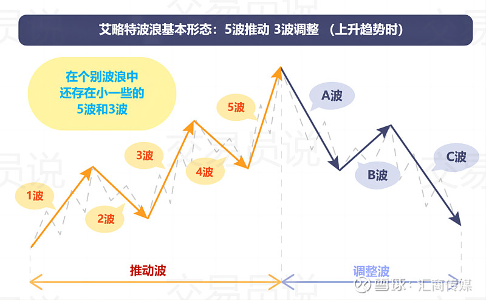

上图是上涨趋势时的艾略特波浪，1至5的上涨是"推动波"， A至C的下跌是"调整波"

在分析市场时，掌握好现在的价位处于什么位置，可以更容易预测今后的走势

然而，波浪可能会比这个理想模型更复杂，这就引入了“延伸波”的概念。

在艾略特波浪理论中，“延伸波”是指在一个8波循环中，推动波（通常是第1、3或5波）变得格外地长，超出了其它波的长度，这种情况下，这个特别长的波会被分解成好几个小波，而不是一个单独的波

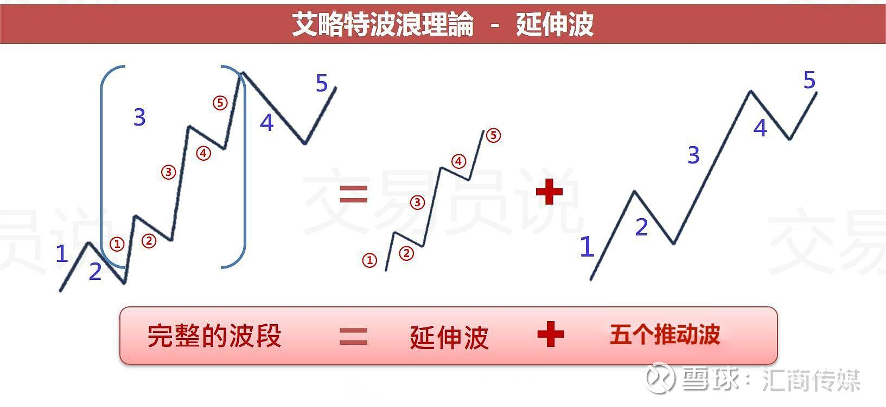

举例来说，如果第三波变成了一个延伸波，那么我们会看到一个更细的波动结构出现在第三波中，形成一种小震荡、小回调不断出现的模式，而不是一般的大波动，这种细致结构可以帮助我们更准确的预测市场价格走势

总的来说,"延伸波"在艾略特波浪理论中是一个重要的概念，它反应了市场价格变动的复杂性和非线性特性，并且可以帮助投资者更准确的预测和理解市场

### 艾略特波浪的3个原则

艾略特波浪有以下3个原则
- 原则1: 推动波中的第3波的持续时间是1波、2波、5波中最长的
- 原则2：推动波中的第2波在调整时候不能低于第一波的起始点
- 原则3：推动波中的第4波的波低不能低于第一波的高点

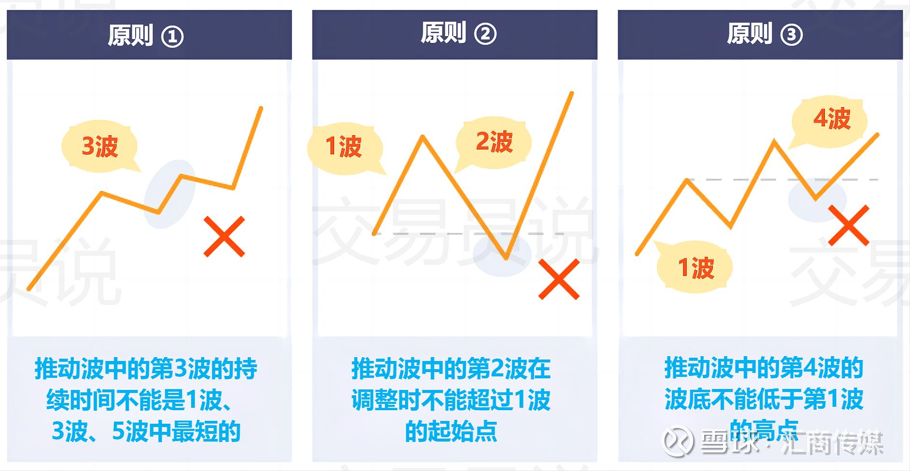

> 这里所谓的推动波就是冲击波

<span style="color: red;">满足以上原则后艾略特波浪理论将成立，可以更容易预测以后得调整。不过即使满足以上原则，走势也不一定按照艾略特波浪规律波动，还需要多加注意</span>

### 艾略特波浪理论的规则
正如上面所言，最基本的波浪理论是由8个波组成，分别为5个推动波(Impulse Waves)、3个调整波(Corrective Waves)，以下我们用图片与表格做详细介绍

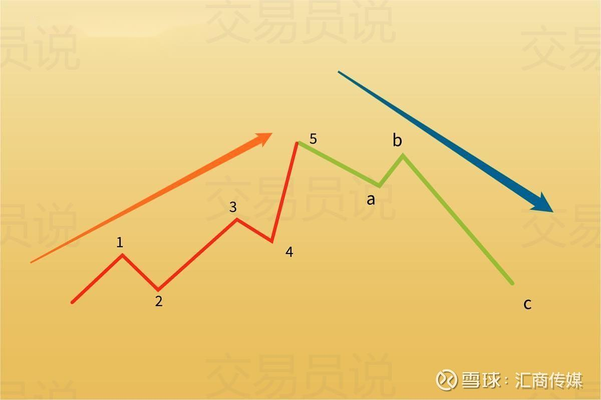

波浪| 特征
---|---
波浪1| 第一波的起涨较为不明显，基本面消息通常为负面。市场情绪普遍看跌，成交量相对较低
波浪2| 通常是波浪1的回撤走势，但不会跌破波1的起点.市场情绪扔小，成交量小宇波浪1
波浪3 | 通常伴随着大量成交量和价格上涨；是推动波中较长的波浪，其高点可能超越第一波的波峰
波浪4 | 呈现平缓的盘整或回撤。底部价格不会低于第一波的高点。回撤幅度通常低于波浪3，具有较长时间横盘震荡的特性
波浪5 | 是住到趋势方向的最后一段波浪，市场情绪高涨。可能比破浪3波动大，且技术指标出现被离。上涨幅度可能延伸到非常大的规模。眼看他高楼起，眼看他楼塌了，迅速翻转又称为『邪恶第5波』
波浪A | 在完成五个推动波后，市场进入下跌阶段；是牛市的修正，但不是买入的好时机；交易量反向趋势中增加
波浪B | 许多人进场抄底，导致价格呈现向上的假反弹；通常反弹不会超过第五波的高点
波浪C | 波浪b之后，波浪c的波幅出现；价格呈现头肩底，与波浪4和波浪a形成相似的地位。波浪c通常与波浪a涨幅相当，甚至波浪c会延伸扩张

简单来说，交易者可以把波浪理论是为三种区块的变化
1. 形态：上升波和调整波的变换
2. 逼里：上升波和调整波之间的逼里变化
3. 时间：两波之间的持续时间分析、平衡变化

### 多空行情时的波浪规则
一般来说，艾略特波浪理论还是有他的基础的规则存在，但是市场是瞬息变化，以下提出多空三铁律与交易者分享，当注意到价格走势与铁律相违背，请一定要提高警觉注意波浪理论的适用性

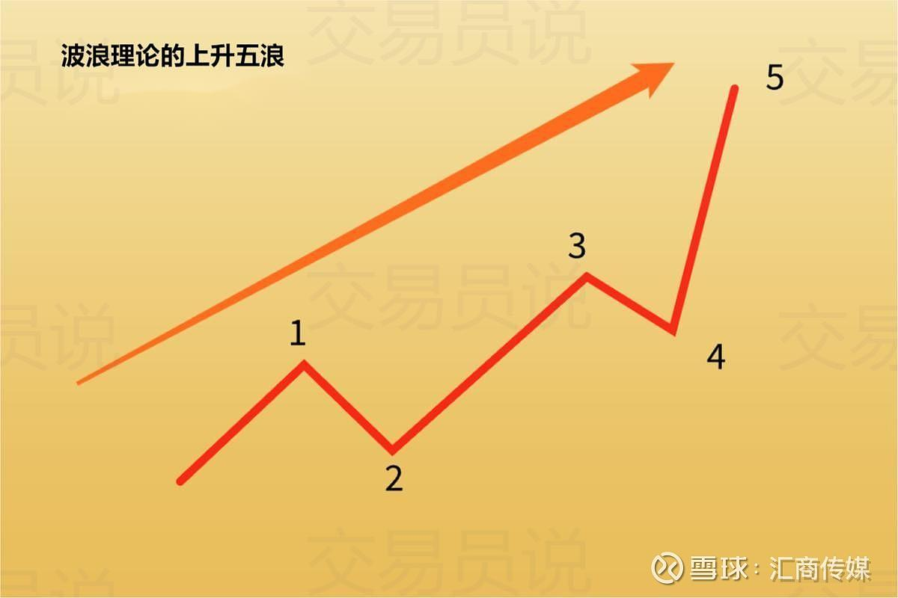

**多头三铁律**
- 波浪2低点不能完全回撤跌破波浪1低点(假突破)
- 波浪3通常为驱动浪中相对长的伊朗
- 波浪4低点不能与波浪1顶点重叠(不跌破颈线)

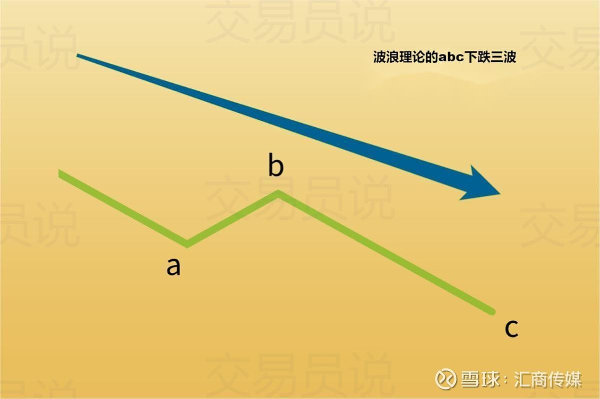

**空头三铁律**
- 波浪b的回升一定会小于波浪a的顶点(假突破)
- 波浪c通常幅度大而且时间很长、整体成交量也大
- 当波浪c反弹，最高点不能与波浪a的最低点重叠(否则便是站回)

简单来说，价格本来就会跟随市场行情上涨和下跌，这是交替进行的过程，波浪理论便是在推动波和调整波之间不断循环，而当8个波浪都出现后，则代表一个大的循环完成，走势将进入下8波浪

> 注意:波浪理论是一个多空循环的走势，这不代表价格下跌后一定是结束长期涨势或者跌势，很有可能在新的波浪中，价格将会创新高或者破新低

### 三种方法交易奥略特波浪
- 交易第三个波浪

    **交易艾略特波浪理论的一个重要原则,即在基本波浪中，至少有一个波浪是拓展的，必须是其他非拓展波浪大小的161.8%以上**

    <span style="color: red;">简单来说，拓展波浪也是最长的波浪。多数情况下，第三个波浪会成为拓展的那个，而此前的第二个波浪可能回撤到第一个波浪的50%-61.8%左右</span>

    <span style="color: red;font-weight: bold;">遇到这种的情况，显然是适合交易的机会。在看涨基本波浪中。在看涨基本波浪中，只需在第一个波浪的50%~61.8%之间设置一个买入现价挂单，止盈设置在第二个波浪大小的161.8%左右，止损则必须放在基本趋势开始的地方</span>

    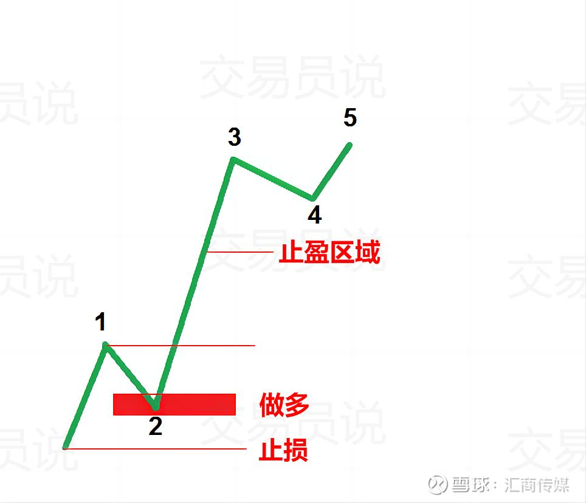

    ```shell
    一浪区间：低点 10，高点 20
    一浪涨幅：20 − 10 = 10
    1、回撤 50%
    回撤幅度：10 × 50% = 5
    回撤目标价：20 − 5 = 15
    2、回撤 61.8%
    回撤幅度：10 × 0.618 = 6.18
    回撤目标价：20 − 6.18 = 13.82
    结论
    二浪常规回撤区间：13.82 ~ 15
    ```

- 交易平坦型波浪

    在修正波浪中，平坦型会经常形成。艾略特识别到不少于10种这样的形态。虽然数量多，但是他们都有一个共同点：**波浪b必须回撤到前一个波浪a最少61.8%处**

    因此，交易平坦型波浪的关键是要分析波浪a。它是基本波浪还是修正波浪？平坦型也有a-b-c结构，而且波浪a和波浪B显示修正活动，波浪c才能形成完整的5波结构。

    如果波浪a看起来不像基本波浪，那么它一定就是修正波浪。于是接下来就是寻找61.8%回撤的条件是否满足

    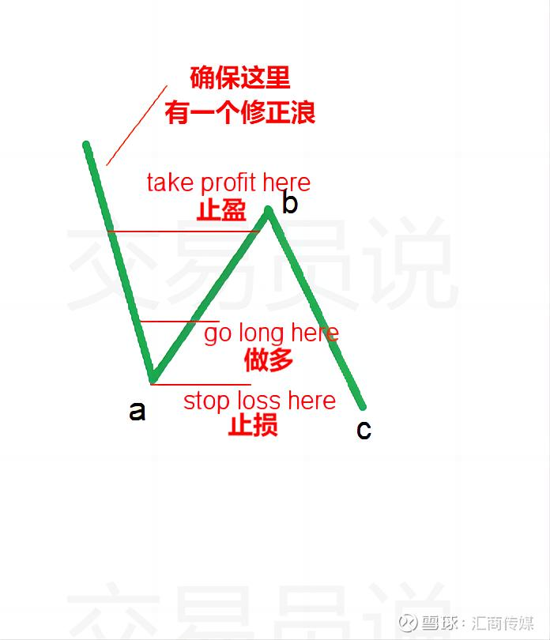

    

- 交易第五个波浪

    **交易艾略特波浪理论还有一个很强势的原则，即波浪1不应该等同波浪5。因此艾略特波浪交易者会简单对比第一波和第五波的长度**

    <span style="color: red;">如果第五个波浪只是第一个波浪的61.8%，那么在看涨五波结构中适合做空。止损设置在拓展波浪结束的地方。</span>

    不过，交易第五个波浪的风险较大，因为市场在这里会出现多种可能性。

    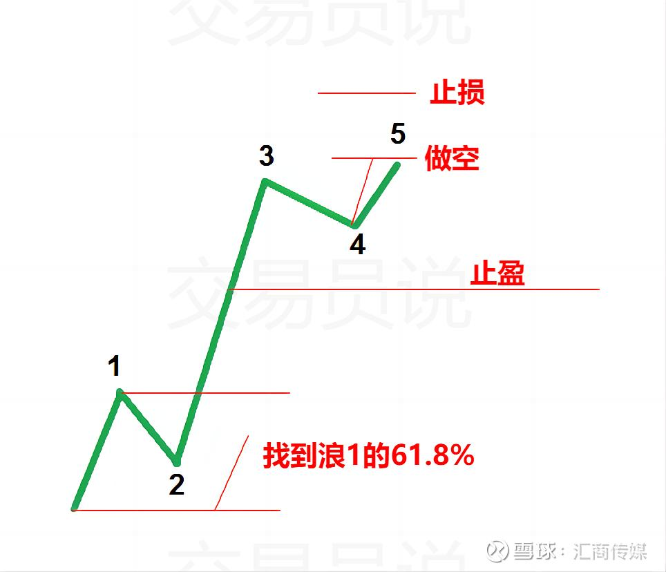

使用艾略特波浪与斐波那契额会掉线结合使用的交易策略

艾略特波浪在上涨趋势时候，由5波上和3波下跌组成，在上涨的过程中会有回调，但是在上涨到什么价位才会出现回调呢？回调后有停在什么价位呢？关于这些艾略特波浪虽然没有一个严谨的规律，但是也会有一些大概的标准

<span style="color: red;">这时，我们就需要使用斐波那契额回调线(黄金分割线)了。使用斐波那契额回调线可以掌握用线连接最高价和最低价后，回调后支撑或反弹后的阻力会在百分之多少。一般来说，大多数交易者都会关注23.6%、38.2%以及61.8%；</span>

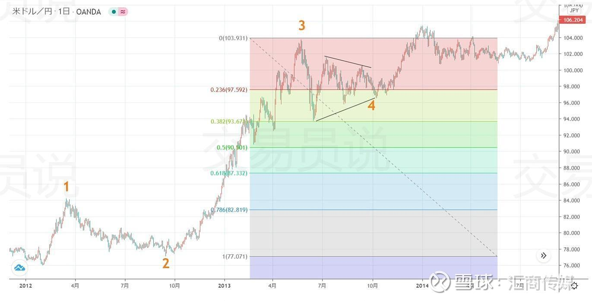

上面是美元/日元(USD/JPY)的日图。首先分析推动波第三波到第四波的回调。按照奥略特波浪的标准来说，第四波会回调到第三波上涨的38.2%位置。

<span style="color: red;">从图中也可以看出，推动波第3波上涨后的第4波回调到了第3波的38.2％。</span>

这里的第4波虽然是三角形态的调整波，但是最大下跌幅度刚好是斐波那契回调线的38.2％。

下面再来看延长的第5波：

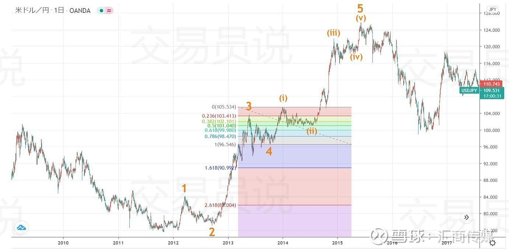

<span style="color: red;">这里可以看出调整(ii)波的回调刚好是调整(i)波的50.0％左右。按照艾略特波浪的标准来说，调整第2波会回调到推动第1波的50.0％或是61.8％</span>

接着再看下图：

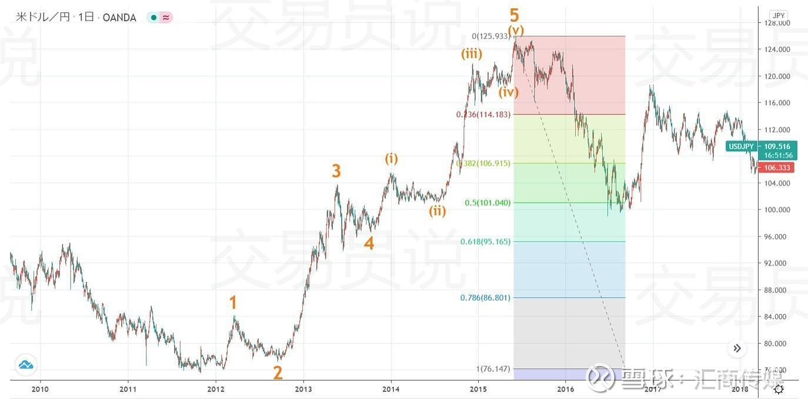

可以看出，第1波到第5波的推动波完成后，下跌到上涨幅度的50.0％支撑位。

所以，使用斐波那契回调线的话可以分析出艾略特波浪的回调后的支撑或反弹后的阻力。但是，也并不是说一定会回调或反弹到38.2％或50.0％或61.8％附近。只是作为分析市场的一种方法，希望大家可以记住

## 结语
与其说波浪理论是被创造出来的，不如说它是一种“发现”，波浪理论更像是观察市场透露出的现象，经由验证去找寻、定义市场规律，并不是说创造、发明一种解释市场脉动的方法，而是发现市场的规律可以这样解释，有点像牛顿发现地心引力，而不是发明地心引力。

就好比苏轼曾赋诗一首：“横看成岭侧成峰，远近高低各不同，不识庐山真面目，只缘身在此山中”，在市场中，知道自己在做什么，了解自己的定位是很重要的一环，伴随交易者心理层面的变化、博弈，波浪理论说白了就是尝试发现这个波动，当你清楚自身位在哪个阶段，交易的节奏就不会打乱，掌握波浪理论就跟掌握呼吸法一样，让交易者轻松应对市场状况
